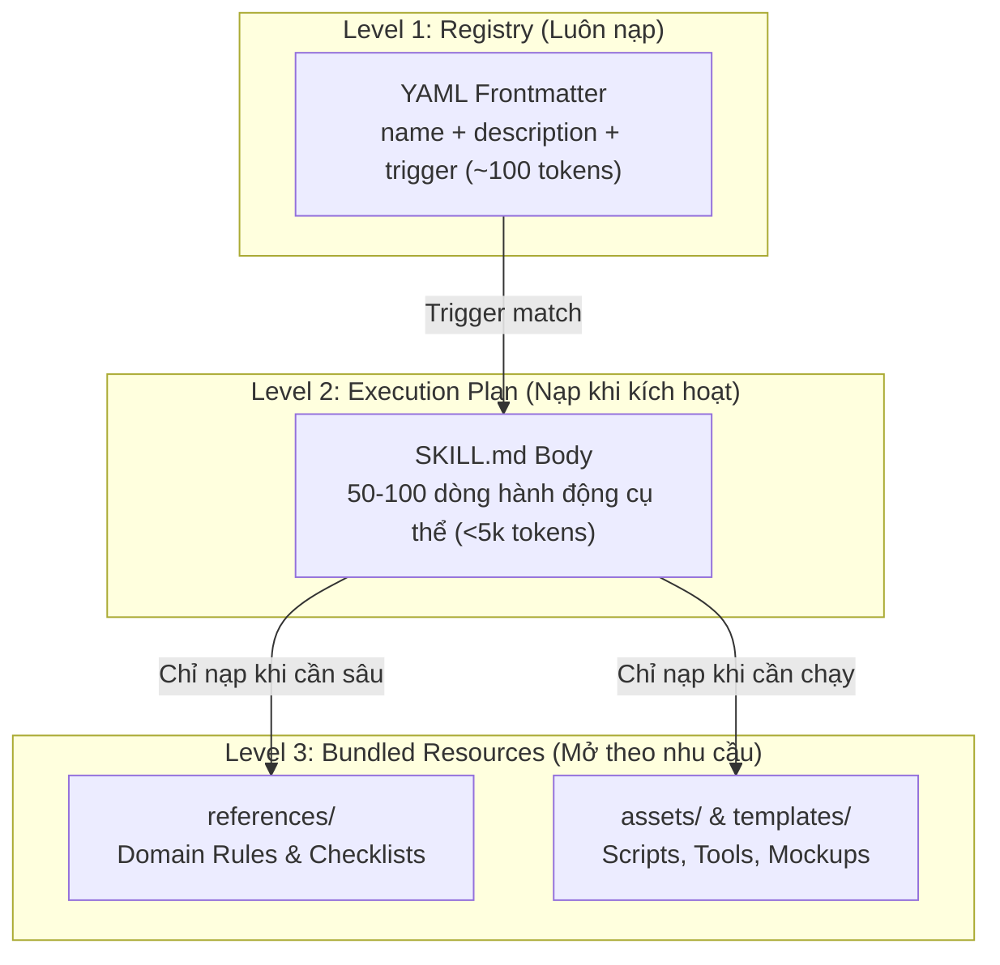
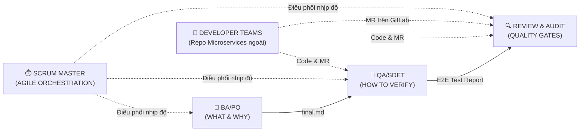

# Danh Mục Tính Năng & Kỹ Năng (Feature & Skill Catalog)

> **Bảng tra cứu nhanh toàn diện:** Tổng hợp 30 Skills, 29 Slash Commands, 6 Personas, 6 Plugins, 6 Core Rules và các Workflow tự động hóa trong hệ thống `agent-skills` (Nhánh `main` chuyên trách BA - QA - SM - Code Review).

**Điều hướng nhanh:** [Tổng quan](#1-tổng-quan-hệ-thống) | [Slash Commands](#2-danh-mục-slash-commands-29-lệnh) | [Kỹ năng Skills](#3-danh-mục-kỹ-năng-skills-30-skills) | [Ma trận Vai trò Personas](#4-ma-trận-vai-trò-personas--ranh-giới) | [Luật Cốt lõi Rules](#5-hệ-thống-luật-rules--chính-sách) | [Domain & References](#6-tài-liệu-nghiệp-vụ--references)

---

## 1. Tổng quan Hệ thống

| Thành phần | Số lượng | Vị trí lưu trữ | Vai trò / Mục đích |
|---|:---:|---|---|
| **Plugins** | 6 | `plugins/` | Các gói module: `ba-po`, `qa`, `code-reviewer`, `scrum-master`, `fintech-data`, `core` |
| **Vai trò (Personas)** | 6 | `plugins/*/agents/` | BA/PO, QA/SDET, Scrum Master, Code Reviewer, Security Auditor, Web Performance Auditor |
| **Skills** | 30 | `plugins/*/skills/` | Kỹ năng chuyên môn thực thi theo chuẩn Progressive Disclosure 3 tầng |
| **Slash Commands** | 29 | `plugins/*/commands/` | Lệnh tắt kích hoạt nhanh quy trình nghiệp vụ |
| **Core Rules** | 6 | `.agents/rules/` + `AGENTS.md` | Luật định hình hành vi, an toàn git, và chuẩn mực output |
| **n8n Nodes / Workflows** | 28+ nodes | `n8n-workflows/`, `scripts/n8n-nodes/` | Tự động hóa fast-path ChatOps, Cron & Webhooks |
| **Domain Guides** | 40+ docs | `references/`, `docs/` | Tri thức chứng khoán KRX, Trading API, TimescaleDB, QA SDK |

---

## 2. Danh mục Slash Commands (29 lệnh)

Tất cả lệnh được định nghĩa đồng bộ qua TOML (`plugins/*/commands/`) và tự động nạp vào CLI / Claude Code / Antigravity.

### 2.1. Phân tích Nghiệp vụ & Sản phẩm — BA/PO (`plugins/ba-po` — 9 lệnh)

| Command | Tham số | Đầu ra chính | Mục đích & Khi nào dùng |
|---|---|---|---|
| `/ba-spec` | `{issueKey}` | `spec/*-final.md` | Import từ Jira/Confluence, quét gaps, lập Business Spec bàn giao. |
| `/ba-refine` | `{issueKey}` | Jira Description | Brainstorm phân kỳ/hội tụ ý tưởng thô và cập nhật spec lên Jira. |
| `/ba-interview` | `{issueKey}` | Spec Clarifications | Phỏng vấn tương tác 1-1 làm rõ điểm mù logic nghiệp vụ. |
| `/ba-user-stories` | `{issueKey}` | `spec/user-stories.md` | Viết User Stories theo chuẩn INVEST kèm Acceptance Criteria Gherkin. |
| `/ba-gap-analysis` | `{issueKey}` | `spec/gap-analysis.md` | Phân tích khoảng cách AS-IS vs TO-BE và lộ trình chuyển đổi. |
| `/ba-prioritize` | `{issueKey}` | `spec/prioritization.md`| Ưu tiên tính năng/backlog theo mô hình MoSCoW hoặc WSJF. |
| `/ba-stakeholder` | `{issueKey}` | `spec/stakeholder-notes.md` | Phỏng vấn đa đối tượng (PO, Dev Lead, Compliance, End-user). |
| `/ba-process` | `{issueKey}` | `spec/process-model.md` | Vẽ sơ đồ quy trình nghiệp vụ (BPMN / Swimlane / Flowchart). |
| `/flowchart` | `{path}` | `.svg` / `.png` | Xuất sơ đồ Editorial HTML/SVG sang định dạng đồ họa qua Playwright. |

### 2.2. Kiểm thử & Đảm bảo Chất lượng — QA/SDET (`plugins/qa` — 6 lệnh)

| Command | Tham số | Đầu ra chính | Mục đích & Khi nào dùng |
|---|---|---|---|
| `/qa-test-design` | `{issueKey}` | `checklist.md` + `.feature` | Thiết kế bộ test 2 giai đoạn: Checklist BVA/EP + Kịch bản BDD Gherkin. |
| `/qa-auto-design` | `{issueKey}` | Test Automation code | Sinh mã test tự động Playwright/Pytest (tái sử dụng SDK Index). |
| `/qa-run-test` | `{issueKey}` | `report.md` + `test-output.log` | Chạy test automation, ghi nhận 100% request/response log. |
| `/qa-full-pipeline` | `{issueKey} [--auto]` | Full Test Suite + Report | Chạy toàn bộ pipeline QA 1 lệnh (Design → Push → Auto → Run). |
| `/qa-code2spec` | `{path}` | Reverse-engineered Spec | Dịch ngược mã nguồn và commit history thành đặc tả nghiệp vụ. |
| `/qa-squash-push` | `{issueKey}` | Squash TM Sync | Đồng bộ kịch bản Gherkin lên hệ thống quản lý test Squash TM. |

### 2.3. Review Code, Bảo mật & Hiệu năng — CR & Auditors (`plugins/code-reviewer` — 4 lệnh)

| Command | Tham số | Đầu ra chính | Mục đích & Khi nào dùng |
|---|---|---|---|
| `/cr-review` | `[mrUrl/branch]` | Review assessment | Đánh giá code đa chiều (Kiến trúc, logic, hiệu năng, clean code, testability). |
| `/cr-code-simplify` | `[path]` | Simplified code | Tối ưu hóa, làm gọn mã nguồn và test mock mà không đổi hành vi logic. |
| `/security-audit` | `[path]` | Security audit report | Quét lỗ hổng bảo mật mã nguồn theo chuẩn OWASP Top 10. |
| `/webperf-audit` | `[url]` | CWV report | Đo lường và tối ưu Core Web Vitals (LCP, FID/INP, CLS). |

### 2.4. Điều phối Agile & Quản lý Dự án — Scrum Master (`plugins/scrum-master` — 4 lệnh)

| Command | Tham số | Đầu ra chính | Mục đích & Khi nào dùng |
|---|---|---|---|
| `/sm-sprint-planning` | `[sprintId]` | Sprint backlog plan | Tính velocity, phân tích năng lực và kéo backlog cho Sprint mới. |
| `/sm-daily-standup` | `[sprintId]` | Daily standup report | Thống kê tiến độ Jira, phân tích cân bằng tải và gửi Mattermost. |
| `/sm-impediment-triage`| `[sprintId]` | Risk triage report | Quét các ticket bị treo/kẹt quá lâu trên board và đề xuất hướng xử lý. |
| `/sm-sprint-retrospective`| `[sprintId]` | Retrospective summary | Phân tích burndown, rút ra bài học What went well / To improve. |

### 2.5. Dữ liệu & Đối chiếu Chứng khoán — Fintech Data (`plugins/fintech-data` — 1 lệnh)

| Command | Tham số | Đầu ra chính | Mục đích & Khi nào dùng |
|---|---|---|---|
| `/db-recon` | `[topic/date]` | Reconciliation report | Quét và đối chiếu sai lệch dữ liệu thị trường KRX MDDS trên TimescaleDB. |

### 2.6. Pipeline Phối hợp & Meta Skills — Core (`plugins/core` — 5 lệnh)

| Command | Tham số | Đầu ra chính | Mục đích & Khi nào dùng |
|---|---|---|---|
| `/e2e-delivery` | `{issueKey}` | Full Delivery Pipeline | Điều phối vòng đời: BA phân tích → QA thiết kế & test → CR review. |
| `/sync` | `[group/repo]` | Git pull sync | Đồng bộ, fetch và pull mã nguồn các microservices về máy cục bộ. |
| `/learn` | `—` | Rule mới | Đúc kết kinh nghiệm từ session vào `.agents/rules/lessons-learned.md`. |
| `/save-checkpoint` | `—` | Checkpoint file | Nén ngữ cảnh phiên làm việc thành snapshot nhỏ gọn. |
| `/load-checkpoint` | `[id]` | Restored session | Khôi phục trạng thái làm việc từ Checkpoint. |

---

## 3. Danh mục Kỹ năng Skills (30 Skills)

Mỗi skill tuân thủ cấu trúc **Progressive Disclosure 3 tầng**:
- **Level 1 (Frontmatter):** `name` + `description` + `trigger` (~100 tokens, luôn nạp trong registry).
- **Level 2 (Body):** `SKILL.md` (< 120 dòng), gồm quy trình 3-5 bước và tiêu chí hoàn thành.
- **Level 3 (Resources):** Thư mục `references/` (kiến thức), `assets/` / `templates/` (tools/templates) mở theo nhu cầu.

### Bảng tra cứu 30 Skills theo 6 Plugins:

| Plugin | Tên Skill | Mục đích cốt lõi | Trigger kích hoạt chính |
|---|---|---|---|
| **ba-po** | `ba-spec` | Tạo Business-Spec từ Jira | Phân tích yêu cầu, import Jira issue lần đầu |
| **ba-po** | `ba-refine` | Tinh chỉnh spec và sync Jira | Khi cần brainstorm, bổ sung AC, đẩy Jira |
| **ba-po** | `ba-interview-me` | Phỏng vấn làm rõ điểm mù | Khi spec thô còn nhiều giả định chưa rõ |
| **ba-po** | `ba-user-story-writing` | Viết User Stories INVEST | Khi cần chia nhỏ yêu cầu thành Stories |
| **ba-po** | `ba-gap-analysis` | Phân tích AS-IS vs TO-BE | So sánh hệ thống hiện tại và mục tiêu |
| **ba-po** | `ba-backlog-prioritization` | Ưu tiên Backlog MoSCoW | Lên kế hoạch Sprint, sắp xếp tính năng |
| **ba-po** | `ba-stakeholder-interview` | Phỏng vấn đa bên liên quan | Thu thập yêu cầu từ nhiều phòng ban |
| **ba-po** | `ba-process-modeling` | Vẽ sơ đồ BPMN / quy trình | Mô hình hóa quy trình nghiệp vụ |
| **ba-po** | `ba-design-flowchart` | Render sơ đồ Editorial | Tạo flowchart, ERD, sequence diagram |
| **qa** | `qa-test-design` | Thiết kế Checklist + Gherkin | Khi nhận `final.md` để lên phương án test |
| **qa** | `qa-auto-design` | Viết Automation code chuẩn POM | Sinh mã Playwright/Pytest từ Gherkin |
| **qa** | `qa-run-test` | Chạy test & xuất báo cáo log | Thực thi test suite, đo lường trung thực |
| **qa** | `qa-full-pipeline` | Full pipeline QA tự động | Chạy 1 lệnh từ Design tới Report |
| **qa** | `qa-code2spec` | Dịch ngược mã nguồn thành spec | Đối chiếu code thực tế với yêu cầu |
| **qa** | `qa-squash-push` | Đẩy test cases lên Squash TM | Đồng bộ Gherkin vào Campaign Test Plan |
| **code-reviewer** | `cr-review-code-and-quality` | Review code đa chiều 5 trục | Đánh giá MR/PR trước khi merge |
| **code-reviewer** | `cr-code-simplification` | Đơn giản hóa mã nguồn | Rút gọn code phức tạp nhưng giữ nguyên logic |
| **code-reviewer** | `security-code-audit` | Quét bảo mật OWASP Top 10 | Kiểm toán an ninh mã nguồn |
| **code-reviewer** | `webperf-core-vitals` | Kiểm toán Core Web Vitals | Đo lường LCP, INP, CLS trên trang web |
| **scrum-master** | `sm-sprint-planning` | Lập kế hoạch Sprint tự động | Tính velocity, chốt sprint backlog |
| **scrum-master** | `sm-daily-standup` | Báo cáo Daily Standup tự động | Họp standup, gửi Mattermost |
| **scrum-master** | `sm-impediment-triage` | Xử lý sự cố và blockers | Ticket bị treo, phát hiện điểm nghẽn |
| **scrum-master** | `sm-sprint-retrospective`| Tổng kết và rút kinh nghiệm Sprint | Kết thúc Sprint, họp retrospective |
| **fintech-data** | `db-timescale-reconciler` | Đối chiếu dữ liệu KRX MDDS | Quét sai lệch số liệu sàn trên TimescaleDB |
| **core** | `meta-context` | Tối ưu hóa nạp ngữ cảnh | Giảm lãng phí token khi thiết lập phiên |
| **core** | `meta-using-agent-skills` | Khám phá & định tuyến skills | Định hướng chọn skill phù hợp |
| **core** | `meta-session-checkpoint` | Nén/khôi phục context phiên | Lưu hoặc phục hồi trạng thái làm việc |
| **core** | `meta-continuous-learning` | Đúc kết tri thức thành Rules | Sau khi giải quyết xong bài toán phức tạp |
| **core** | `meta-cross-validation` | Thẩm định ma trận truy vết | Kiểm tra độ bao phủ Spec ↔ Code ↔ Test |
| **core** | `repo-group-sync` | Đồng bộ toàn bộ repos nội bộ | Fetch & pull code mới nhất từ GitLab |

---

## 4. Ma trận Vai trò (Personas) & Ranh giới

Trong workspace này, bạn đóng vai trò là **Kỹ sư Đảm bảo Chất lượng & Nghiệp vụ Toàn diện (BA-QA-SM-CR AI Engineer)**:

| Hoạt động SDLC | BA/PO | QA/SDET | CR & Security | Scrum Master | Developer Teams (Bên ngoài) |
|---|:---:|:---:|:---:|:---:|:---:|
| **Phân tích yêu cầu & Specs** | ✅ **Owner** | ❌ | ❌ | ❌ | Tham vấn kỹ thuật |
| **Checklist & Gherkin Scenarios**| ❌ | ✅ **Owner** | ❌ | ❌ | Tham khảo để code |
| **Automation Test (E2E/API/WS)** | ❌ | ✅ **Owner** | ❌ | ❌ | ❌ |
| **Chạy kiểm thử & Xuất log 100%**| ❌ | ✅ **Owner** | ❌ | ❌ | ❌ |
| **Audit Bảo mật & Hiệu năng Web**| ❌ | 🔍 Hỗ trợ | ✅ **Owner** | ❌ | Nhận báo cáo để sửa |
| **Code Review MR trước Merge** | ❌ | 🔍 Testability| ✅ **Owner** | ❌ | Sửa theo review |
| **Điều phối Sprint & Standup** | ❌ | ❌ | ❌ | ✅ **Owner** | Cập nhật trạng thái |

---

## 5. Hệ thống Luật (Rules) & Chính sách

Nằm tại `.agents/rules/` và được kích hoạt tự động 100% (**Always-on**):

1. **[action-first-adhd.md](.agents/rules/action-first-adhd.md) — Giao tiếp Trực diện & Focus Protocol**
   - *Lead With Action:* Dòng đầu luôn là kết quả hoặc lệnh thực thi. Cấm câu chào dạo đầu.
   - *Matter-of-Fact Errors:* Báo lỗi gồm `Dòng lỗi` + `Nguyên nhân` + `Cách khắc phục`.
   - *Focus Protocol:* Giữ vững 1 task duy nhất, cấm lạc đề (No rabbit holes, scope guard).
2. **[autonomy-contract.md](.agents/rules/autonomy-contract.md) — Hợp đồng Tự chủ**
   - Mặc định tự động chạy (Autonomous by default).
   - Chỉ dừng hỏi người dùng trong 5 trường hợp đóng: thiếu input bắt buộc, thiếu credential, câu hỏi 🔴 Critical, sắp commit/merge vào main, hoặc thao tác không hoàn tác được bằng git.
3. **[git-workflow.md](.agents/rules/git-workflow.md) — Quy trình Phân nhánh Git**
   - ❌ **CẤM commit trực tiếp vào `main`/`master`** (Được bảo vệ bằng Git Hook & Agent Hook).
   - Tạo nhánh feature (`feature/{issueKey}`, `fix/{issueKey}`) → Code & Test → Trình bày phê duyệt → Commit sau khi approve → Merge vào main.
4. **[workspace-paths.md](.agents/rules/workspace-paths.md) — Cấu trúc Thư mục Artifacts**
   - Bắt buộc mọi artifact nằm trong `workspace/issues/{issueKey}/`:
     - `source/`: Tài liệu gốc tải về (PDF, Jira JSON)
     - `spec/`: Đặc tả nghiệp vụ `*-final.md`, sơ đồ quy trình
     - `tech/`: Tech-spec, kế hoạch lập trình `plan.md`
     - `test/`: Checklist, file `.feature`, mã automation test
     - `trace/`: Ma trận truy vết yêu cầu ↔ test
5. **[confidence-level.md](.agents/rules/confidence-level.md) — Hệ thống Điểm Tự tin**
   - Công thức: `confidence = (completeness * 0.6) + (certainty * 0.4)`.
   - Thẩm định tính đầy đủ và minh bạch của artifact trước khi bàn giao.
6. **Anti-Leak & Zero Pollution**
   - Không in prompt nội bộ (`SKILL.md`) ra báo cáo.
   - Không tự ý sinh file rác ngoài thư mục `workspace/`.

---

## 6. Tài liệu Nghiệp vụ & References

| Tài liệu | Đường dẫn | Mục đích sử dụng |
|---|---|---|
| **Domain Chứng khoán & Fintech** | [`references/securities-domain-rules.md`](references/securities-domain-rules.md) | Luật KRX, phiên giao dịch HOSE/HNX/UPCoM, tick size, tính toán sức mua |
| **SDK Index Tra cứu Code Test** | [`plugins/qa/skills/qa-auto-design/references/sdk-map.json`](plugins/qa/skills/qa-auto-design/references/sdk-map.json) | Bản đồ tái sử dụng class Auth, Trading API, MarketData API, WS Client |
| **Quy chuẩn Subagents Handoff** | [`docs/architecture/subagent-handoff-protocol.md`](docs/architecture/subagent-handoff-protocol.md) | Phân quyền Tool Scoping, Context Window cách ly và quy trình bàn giao |
| **Quy tắc Vận hành QA** | [`plugins/qa/skills/qa-full-pipeline/references/qa-operational-rules.md`](plugins/qa/skills/qa-full-pipeline/references/qa-operational-rules.md) | Chuẩn mực ghi log 100%, tham số hóa đa sàn, cấm hardcode giá |
| **Chiến lược n8n Fast-Path** | [`docs/architecture/n8n-integration-strategy.md`](docs/architecture/n8n-integration-strategy.md) | Webhooks n8n cho ChatOps Mattermost và tự động hóa CI/CD |
| **Editorial Diagram Style Guide** | [`plugins/ba-po/skills/ba-design-flowchart/references/style-guide.md`](plugins/ba-po/skills/ba-design-flowchart/references/style-guide.md) | Chuẩn thiết kế sơ đồ phẳng, tinh tế, typography hiện đại |

---

## 7. Tiện Ích Dòng Lệnh Mở Rộng (Extended CLI Utilities)

| Lệnh / Tiện ích | Cú pháp | Mục đích |
|---|---|---|
| **Token Budget Validator** | `npm run validate:tokens` | Kiểm định độ dài & ngân sách token cho 30 file `SKILL.md` |
| **Export Plugin Độc lập** | `npm run plugin:export -- -p <name> [--tar]` | Đóng gói 1 plugin thành thư mục độc lập hoặc file `.tar.gz` |
| **So sánh Checkpoint Diff** | `npm run checkpoint:diff` | So sánh biến động file `workspace/` so với snapshot gần nhất |
| **Git Worktree Isolation** | `bash scripts/lib/qa-worktree.sh create {key}` | Cách ly môi trường chạy test E2E Playwright để không làm bẩn working tree |

