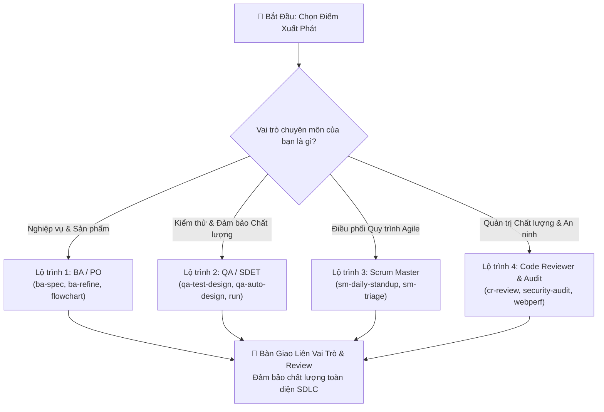
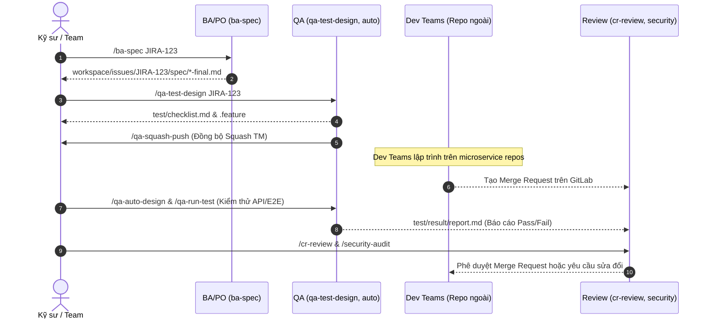

# 📚 Lộ Trình Làm Chủ Agent Skills (Learning Roadmap)

> **Hướng dẫn từng bước giúp kỹ sư BA, QA, Scrum Master và Code Reviewer làm chủ hệ thống `agent-skills` theo từng cấp độ chuyên môn (Nhánh `main`).**

---

## 🧭 1. Xác định Điểm Xuất Phát & Vai Trò Của Bạn

Chọn lộ trình học tập phù hợp nhất với vai trò thực tế của bạn:

**Khảo sát Năng lực & Nhu cầu:**
- [ ] Tôi muốn tự động phân tích yêu cầu từ Jira/Confluence thành tài liệu đặc tả chuẩn *(Chọn Lộ trình 1: BA/PO)*
- [ ] Tôi muốn thiết kế checklist BVA, sinh kịch bản BDD và tự động hóa test Playwright/Pytest *(Chọn Lộ trình 2: QA/SDET)*
- [ ] Tôi muốn điều hành Daily Standup tự động, theo dõi tiến độ Sprint và triage blockers *(Chọn Lộ trình 3: Scrum Master)*
- [ ] Tôi muốn kiểm toán bảo mật OWASP, phân tích chất lượng Merge Request và Core Web Vitals *(Chọn Lộ trình 4: Code Review & Quality)*



---

## ⏱️ 2. Các Cột Mốc Thời Gian

### 🟢 Cột mốc 15 Phút: Bắt Đầu Nhanh (Quick Start)
**Mục tiêu:** Cài đặt xong môi trường tối thiểu, kích hoạt bảo vệ hooks và chạy thành công lệnh đầu tiên.

```bash
# 1. Clone repository
git clone git@gitlab.dnse.com.vn:my-project/agent-skills.git
cd agent-skills

# 2. Cài đặt môi trường nhanh (macOS)
npm run setup:mac

# 3. Kích hoạt Git protection hooks (chặn commit vào main)
npm run setup:hooks

# 4. Kiểm tra kiểm định hệ thống
npm run validate
```

**Thử nghiệm lệnh đầu tiên trong Claude Code / Antigravity:**
- Phân tích thử một Jira ticket:
  ```bash
  /ba-spec PROJ-101
  ```
- Hoặc kiểm thử pipeline QA:
  ```bash
  /qa-full-pipeline PROJ-101 --help
  ```

---

### 🟡 Cột mốc 1 Giờ: Làm Quen Với Vai Trò Của Bạn

| Vai trò | Kỹ năng trọng tâm | Luồng thực hiện chuẩn trong 1 giờ |
|---|---|---|
| **BA / PO** | `ba-spec` → `ba-interview-me` → `ba-process-modeling` | 1. Chạy `/ba-spec {issueKey}` để kéo dữ liệu Jira.<br/>2. Chạy `/ba-interview-me` để AI chất vấn làm rõ các giả định ngầm.<br/>3. Vẽ sơ đồ quy trình qua `/ba-process` hoặc xuất ảnh bằng `/flowchart`. |
| **QA / SDET** | `qa-test-design` → `qa-auto-design` → `qa-run-test` | 1. Nhận `spec/*-final.md` từ BA.<br/>2. Chạy `/qa-test-design` tạo `checklist.md` và `.feature`.<br/>3. Chạy `/qa-auto-design` (AI tự động tra cứu `sdk-map.json` để tái sử dụng client có sẵn).<br/>4. Chạy `/qa-run-test` và đọc báo cáo `report.md` (100% logs). |
| **Scrum Master**| `sm-daily-standup` → `sm-impediment-triage` | 1. Chạy `/sm-daily-standup` để tổng hợp tiến độ Sprint hiện tại từ Jira.<br/>2. Chạy `/sm-impediment-triage` để phát hiện các ticket bị treo trên Kanban và gửi thông báo Mattermost. |
| **Code Reviewer**| `cr-review-code-and-quality` → `security-code-audit` | 1. Chạy `/cr-review {mrUrl}` để review đa chiều (Kiến trúc, logic, hiệu năng, clean code, testability).<br/>2. Chạy `/security-audit` quét các lỗ hổng OWASP Top 10. |

---

### 🔵 Cột mốc Nửa Ngày: Phối Hợp Liên Vai Trò & Quality Governance

Hiểu và làm chủ luồng bàn giao khép kín giữa các vai trò với nguyên tắc **Traceability-First (Tính truy vết xuyên suốt)**:



---

### 🟣 Cột mốc Làm Chủ Chuyên Sâu (Mastery & Advanced Topics)

1. **Hiểu Kiến Trúc Progressive Disclosure 3 Tầng:**
   - Đọc: [`docs/guides/skill-anatomy.md`](docs/guides/skill-anatomy.md).
   - Nắm rõ cách chia: Frontmatter (~100 tokens), Body (<100 dòng), Resources (`references/`, `templates/`, `scripts/`).
2. **Kích hoạt n8n Fast-Path & ChatOps:**
   - Khởi động n8n local: `npm run n8n` hoặc chạy background: `npm run n8n:bg`.
   - Kết nối webhook tự động hóa chạy test, gửi báo cáo Standup qua Mattermost.
   - Đọc: [`docs/architecture/n8n-integration-strategy.md`](docs/architecture/n8n-integration-strategy.md).
3. **Đánh Giá Chất Lượng Kỹ Năng Bằng Eval Suite:**
   - Chạy bộ kiểm thử tự động đo độ chính xác trigger:
     ```bash
     npm run evals
     ```
   - Ngưỡng đạt chuẩn: Rank-1 trigger rate ≥ 90% trên toàn bộ 30 skills.
4. **Đúc Kết Bài Học & Checkpoints Phiên Làm Việc:**
   - Lưu bài học sau một task khó: `/learn`.
   - Nén phiên làm việc khi cần nghỉ: `/save-checkpoint` và phục hồi lại bằng `/load-checkpoint`.

---

## 🛠️ 3. Ma Trận "Bạn Muốn Làm Gì?" (Use Cases & Workflows)

| Mục tiêu thực tế của bạn | Các lệnh & tính năng cần kết hợp | Tài liệu tham khảo |
|---|---|---|
| **Làm rõ yêu cầu nghiệp vụ còn mơ hồ** | `/ba-spec` + `/ba-interview` + `/ba-process` | [`docs/architecture/ba-workflow-detail.md`](docs/architecture/ba-workflow-detail.md) |
| **Tự động hóa kiểm thử API chứng khoán** | `/qa-test-design` + `/qa-auto-design` + `sdk-map.json` | [`references/securities-domain-rules.md`](references/securities-domain-rules.md) |
| **Kiểm tra và audit bảo mật mã nguồn** | `/security-audit` + `/cr-review` | [`plugins/code-reviewer/skills/security-code-audit/`](plugins/code-reviewer/skills/security-code-audit/) |
| **Đối chiếu dữ liệu thị trường KRX** | `/db-recon` + TimescaleDB Production v3 | [`plugins/fintech-data/skills/db-timescale-reconciler/`](plugins/fintech-data/skills/db-timescale-reconciler/) |
| **Đồng bộ mã nguồn nhóm microservices** | `/sync` (`npm run sync`) | [`scripts/sync/repo-sync.js`](scripts/sync/repo-sync.js) |
| **Đẩy kịch bản BDD lên Squash TM** | `/qa-squash-push` | [`plugins/qa/skills/qa-squash-push/`](plugins/qa/skills/qa-squash-push/) |
| **Điều hành Daily Standup & Báo cáo** | `/sm-daily-standup` + Mattermost Webhook | [`plugins/scrum-master/skills/sm-daily-standup/`](plugins/scrum-master/skills/sm-daily-standup/) |
