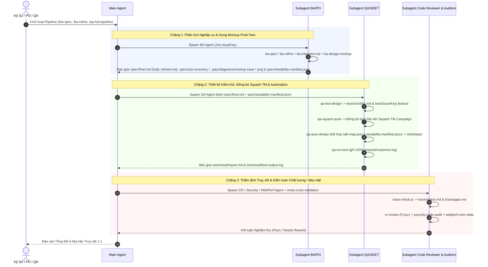

# Quy Chuẩn Chuyển Giao & Điều Phối Tác Nhân Con (Subagent Handoff Protocol)

## 1. Nguyên Tắc Cốt Lõi
Trong hệ sinh thái `agent-skills` (Nhánh `main`: 6 Plugins, 6 Personas), việc phối hợp giữa các tác nhân (Subagents) tuân theo 3 nguyên tắc bất biến:
1. **Context Window Isolation (Cách ly Ngữ cảnh):** Mỗi subagent được khởi tạo với một cửa sổ ngữ cảnh độc lập, chỉ nhận đầu vào tối thiểu cần thiết để hoàn thành nhiệm vụ, tránh tình trạng tràn token và nhiễu ngữ cảnh từ các pha trước.
2. **Artifact-Based Handoff (Chuyển giao qua File Artifacts):** Các tác nhân không trao đổi thông điệp dài dòng qua chat mà bàn giao kết quả thông qua các file chuẩn hóa được lưu trong 5 thư mục của `workspace/issues/{issueKey}/` (`source/`, `spec/`, `tech/`, `test/`, `trace/`) hoặc `workspace/sprints/{sprintId}/`.
3. **Tool Scoping & Least Privilege (Tối thiểu hóa Quyền hạn):** Mỗi subagent chỉ được cấp đúng các công cụ phục vụ chức năng nghiệp vụ của mình (xác định qua YAML frontmatter trong `plugins/*/agents/*.md`).

---

## 2. Ma Trận Quyền Hạn & Phân Phối Công Cụ (6 Personas)

| Tác nhân (Subagent) | File Định Nghĩa | Quyền Công Cụ (Tools) | Ranh Giới Ghi File (Write Scope) | Ràng Buộc Bảo Mật |
|---|---|---|---|---|
| **BA/PO** | `plugins/ba-po/agents/ba-po.md` | `read_url_content`, `view_file`, `write_to_file`, `ask_question`, CLI helpers (`extract-asis-ui.js`, `render-mockup.js`, `jira-push-spec.js`) | `workspace/issues/{issueKey}/spec/*`<br/>`workspace/issues/{issueKey}/source/*` | ❌ Cấm sửa code ứng dụng `src/*`<br/>❌ Cấm viết test automation |
| **QA/SDET** | `plugins/qa/agents/qa.md` | `run_command`, `view_file`, `write_to_file`, `grep_search`, `list_dir` | `workspace/issues/{issueKey}/test/*`<br/>`workspace/issues/{issueKey}/trace/*` | ❌ Cấm tự ý sửa `spec/*`<br/>❌ Cấm sửa app code `src/*` |
| **Scrum Master** | `plugins/scrum-master/agents/scrum-master.md` | `view_file`, `grep_search`, `list_dir`, `run_command`, `write_to_file` | `workspace/sprints/{sprintId}/*`<br/>`config/sm-config.yaml` | ❌ Cấm sửa `workspace/issues/*` |
| **Code Reviewer** | `plugins/code-reviewer/agents/code-reviewer.md` | `view_file`, `grep_search`, `list_dir`, `run_command` | Read-Only (hoặc báo cáo trong `trace/`) | ❌ Cấm ghi sửa app code trực tiếp khi đang review |
| **Security Auditor** | `plugins/code-reviewer/agents/security-auditor.md` | `view_file`, `grep_search`, `list_dir`, `run_command` | Read-Only (hoặc báo cáo trong `trace/`) | ❌ Cấm ghi sửa app code |
| **Web Performance Auditor** | `plugins/code-reviewer/agents/web-performance-auditor.md` | `view_file`, `grep_search`, `list_dir`, `run_command`, Chrome DevTools | Read-Only (hoặc báo cáo trong `trace/`) | ❌ Cấm ghi sửa app code |

---

## 3. Quy Trình Chaining Handoff Tuần Tự Qua File Artifacts



---

## 4. Cô Lập Môi Trường Bằng Git Worktree (`qa-worktree.sh`)

Khi tác vụ QA cần chạy bộ kiểm thử E2E dài hoặc sinh nhiều file kiểm thử trong môi trường tách biệt:
```bash
# Tạo worktree độc lập cho issue
bash scripts/lib/qa-worktree.sh create {issueKey}

# Thực thi test trong worktree mà không ảnh hưởng nhánh làm việc hiện tại
cd .worktrees/qa-{issueKey}
pytest -v workspace/issues/{issueKey}/test/

# Dọn dẹp sau khi kiểm thử xong
bash scripts/lib/qa-worktree.sh remove {issueKey}
```
