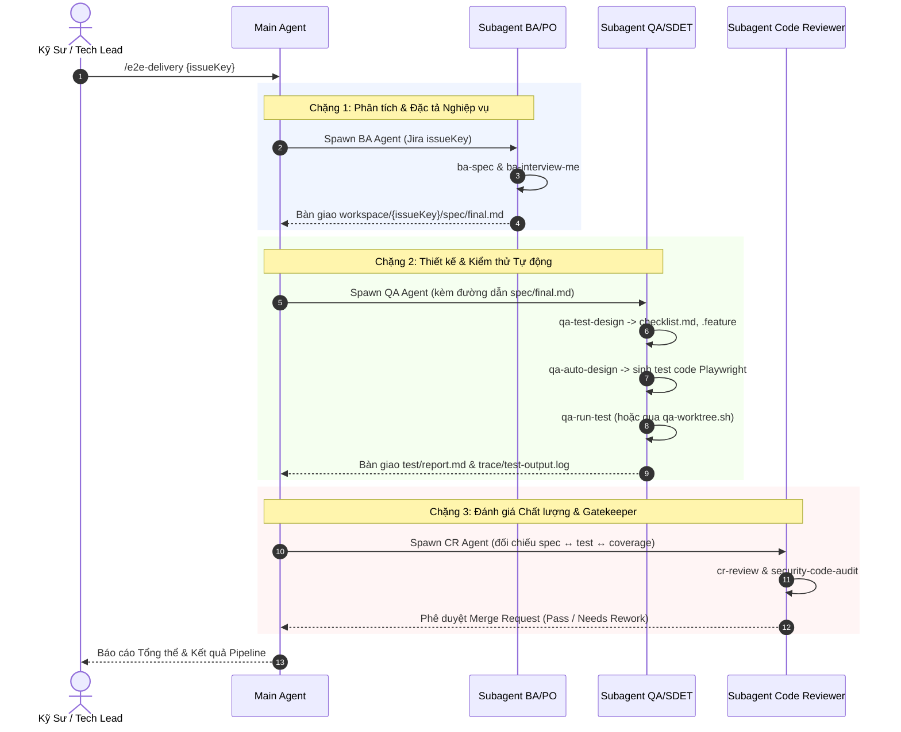

# Quy Chuẩn Chuyển Giao & Điều Phối Tác Nhân Con (Subagent Handoff Protocol)

## 1. Nguyên Tắc Cốt Lõi
Trong hệ sinh thái `agent-skills`, việc phối hợp giữa các tác nhân (Subagents) tuân theo 3 nguyên tắc:
1. **Context Window Isolation (Cách ly Ngữ cảnh):** Mỗi subagent được khởi tạo với một context window độc lập, chỉ nhận đầu vào tối thiểu cần thiết để hoàn thành nhiệm vụ, tránh tình trạng tràn token và nhiễu ngữ cảnh từ các pha trước.
2. **Artifact-Based Handoff (Chuyển giao qua Artifact):** Các tác nhân không trao đổi thông điệp dài dòng qua chat mà bàn giao kết quả thông qua các file chuẩn hóa được lưu trong `workspace/issues/{issueKey}/`.
3. **Tool Scoping & Least Privilege (Tối thiểu hóa Quyền hạn):** Mỗi subagent chỉ được cấp đúng các công cụ phục vụ chức năng nghiệp vụ của mình (xác định qua YAML frontmatter).

---

## 2. Ma Trận Quyền Hạn & Phân Phối Công Cụ (Tool Scoping Matrix)

| Tác nhân (Subagent) | File Định Nghĩa | Quyền Công Cụ (Tools) | Ranh Giới Ghi File (Write Scope) | Ràng Buộc Bảo Mật |
|---|---|---|---|---|
| **BA/PO** | `plugins/ba-po/agents/ba-po.md` | `read_url_content`, `view_file`, `write_to_file`, `ask_question` | `workspace/{issueKey}/spec/*`<br/>`workspace/{issueKey}/source/*` | ❌ Cấm `run_command`<br/>❌ Cấm push git |
| **QA/SDET** | `plugins/qa/agents/qa.md` | `run_command`, `view_file`, `write_to_file`, `grep_search`, `list_dir` | `workspace/{issueKey}/test/*`<br/>`workspace/{issueKey}/trace/*` | ❌ Cấm sửa `spec/*`<br/>❌ Cấm sửa app code `src/*` |
| **Code Reviewer** | `plugins/code-reviewer/agents/code-reviewer.md` | `view_file`, `grep_search`, `list_dir`, `run_command` | Read-Only | ❌ Cấm ghi sửa app code |
| **Security Auditor** | `plugins/code-reviewer/agents/security-auditor.md` | `view_file`, `grep_search`, `list_dir`, `run_command` | Read-Only | ❌ Cấm ghi sửa app code |
| **Scrum Master** | `plugins/scrum-master/agents/scrum-master.md` | `view_file`, `grep_search`, `list_dir`, `run_command`, `write_to_file` | `workspace/sprints/*`<br/>`sm-config.yaml` | ❌ Cấm sửa `workspace/issues/*` |

---

## 3. Quy Trình Chaining Handoff Tuần Tự (`/e2e-delivery`)



---

## 4. Cô Lập Môi Trường Bằng Git Worktree (`qa-worktree.sh`)

Khi tác vụ QA cần chạy test E2E dài hoặc sinh hàng chục file kiểm thử:
```bash
# Tạo worktree độc lập
bash scripts/lib/qa-worktree.sh create {issueKey}

# Thực thi test trong worktree mà không làm bẩn nhánh làm việc hiện tại
cd .worktrees/qa-{issueKey}
pytest -v workspace/{issueKey}/test/

# Dọn dẹp sau khi kiểm thử xong
bash scripts/lib/qa-worktree.sh remove {issueKey}
```
