# Tài liệu tham khảo các loại sơ đồ Mermaid

## Mục lục

- [Flowchart / Graph (Sơ đồ luồng)](#flowchart--graph)
- [Sequence Diagram (Sơ đồ tuần tự)](#sequence-diagram)
- [State Diagram (Sơ đồ trạng thái)](#state-diagram)
- [Class Diagram (Sơ đồ lớp)](#class-diagram)
- [ER Diagram (Sơ đồ thực thể)](#er-diagram)
- [XY Chart (Biểu đồ XY)](#xy-chart)

## Flowchart / Graph (Sơ đồ luồng)

### Header bắt buộc

Mọi file `.mmd` loại flowchart PHẢI bắt đầu bằng header sau:

```mermaid
%%{init: {"flowchart": {"defaultRenderer": "elk"}, "elk": {"edgeRouting": "ORTHOGONAL", "mergeEdges": false, "nodePlacementStrategy": "BRANDES_KOEPF"}}}%%
flowchart LR
```

- `defaultRenderer: "elk"` — dùng ELK layout thay vì dagre mặc định
- `edgeRouting: "ORTHOGONAL"` — mũi tên đi vuông góc 90°, không xiên
- `mergeEdges: false` — giữ các nhánh tách biệt tại Decision node
- `nodePlacementStrategy: "BRANDES_KOEPF"` — căn gióng các node trên luồng chính cùng một trục ngang Y, giúp các mũi tên đi thẳng tắp 100%
- `flowchart LR` — hướng trái → phải, **bắt buộc** (cấm `TB`, `TD`, `RL`, `BT`)

---

### Node Shape Taxonomy (Bảng phân loại hình dạng — BẮT BUỘC)

| Vai trò node | Ký hiệu Mermaid | Hình dạng | Ví dụ |
|---|---|---|---|
| **Start / End / Trigger** | `([Text])` | Stadium (pill) | `([Bắt đầu])`, `([Kết thúc])` |
| **Process / Task / Action** | `[Text]` | Rectangle | `[Xử lý lệnh]` |
| **Decision / Gateway** | `{Text}` | Diamond | `{Lệnh hợp lệ?}` |
| **Sub-process** (gọi diagram khác) | `[[Text]]` | Double border | `[[Kiểm tra margin]]` |
| **Database / Queue / Storage** | `[(Text)]` | Cylinder | `[(Redis Cache)]` |
| **External System / Input** | `>Text]` | Asymmetric | `>OpenAPI Gateway]` |
| **Fork / Join / Merge** | `((Text))` | Circle | `((Merge))` |

**Quy tắc bắt buộc:**
- `([Stadium])` cho điểm Start và End — không dùng `[Rectangle]` cho vai trò này
- `{Diamond}` **chỉ** dùng cho quyết định — không dùng cho process/task
- Mỗi diagram: **1 Start** và **tối đa 2 End**
- Node ID: camelCase không dấu — `checkMargin`, `placeOrder`, `handleError`

---

### Arrow Type Rules (Bảng loại mũi tên — BẮT BUỘC)

| Loại cạnh | Ký hiệu | Dùng cho |
|---|---|---|
| **Normal flow** | `-->` | Luồng chính, bước tiếp theo |
| **Retry / Fallback** | `-.->`  | Vòng lặp thử lại, quay lui |
| **Critical / Forced** | `==>` | Bắt buộc, không thể bỏ qua |
| **Invisible anchor** | `~~~` | Neo node khi cần cố định vị trí |

**Quy tắc bắt buộc về label:**
- Mọi nhánh ra từ `{Decision}` **PHẢI** có label — không được để trống
- Label tối đa **20 ký tự**
- Dùng cặp đối lập rõ ràng: `Hợp lệ / Lỗi`, `Có / Không`, `Pass / Fail`
- Backward edge `-.->`  **LUÔN** khai báo ở cuối file, sau tất cả forward edge

---

### Mẫu 1: Straight Spine Layout — Sơ đồ có rẽ nhánh (Chuẩn BPMN / Enterprise)

Áp dụng cho quy trình có kiểm tra điều kiện. Trục xương sống chính (`Start` ➔ `Task` ➔ `Decision` ➔ `Success` ➔ `End`) đi thẳng tắp trên một hàng ngang. Nhánh lỗi tách xuống tầng dưới và vòng lặp nét đứt quay lại dưới đáy:

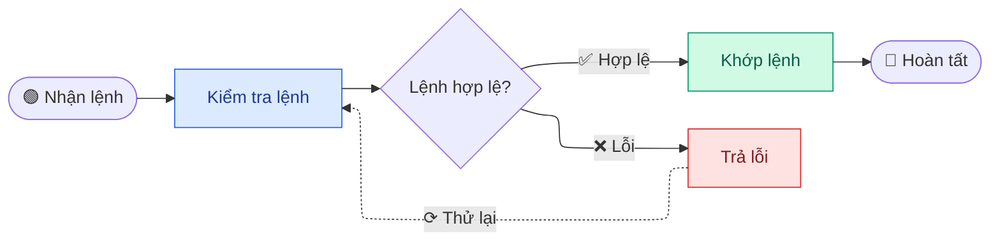

---

### Mẫu 2: Sequential Pipeline Layout — Sơ đồ tuần tự 100% thẳng hàng

Áp dụng cho chuỗi xử lý qua các microservices hoặc các bước xử lý liên hoàn không rẽ nhánh:

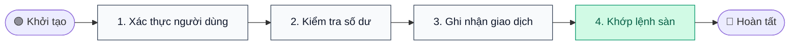

---

## Sequence Diagram (Sơ đồ tuần tự)

### Cú pháp cơ bản
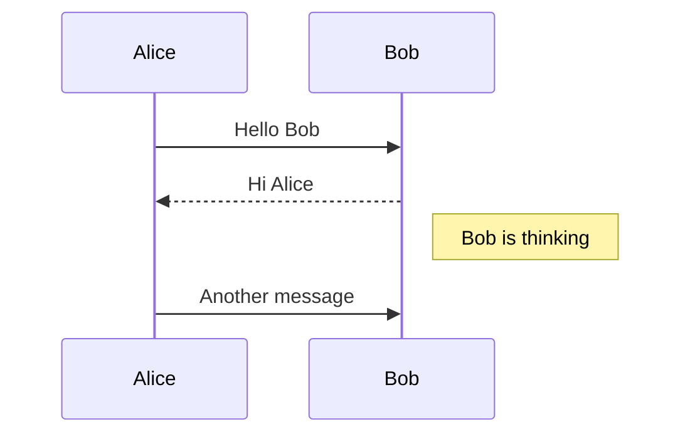

### Thành viên (Participants)
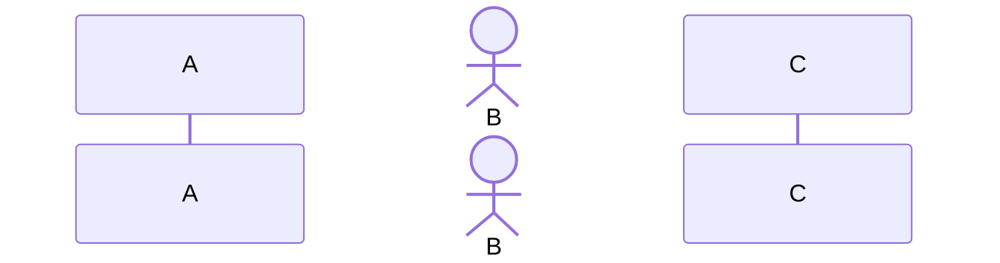

### Các loại thông điệp (Message Types)
- `->>` - Mũi tên nét liền
- `-->>` - Mũi tên đứt nét
- `-x` - Nét liền có dấu chéo
- `--x` - Nét đứt có dấu chéo
- `-)` - Nét liền với mũi tên mở
- `--)` - Nét đứt với mũi tên mở

### Kích hoạt (Activations)
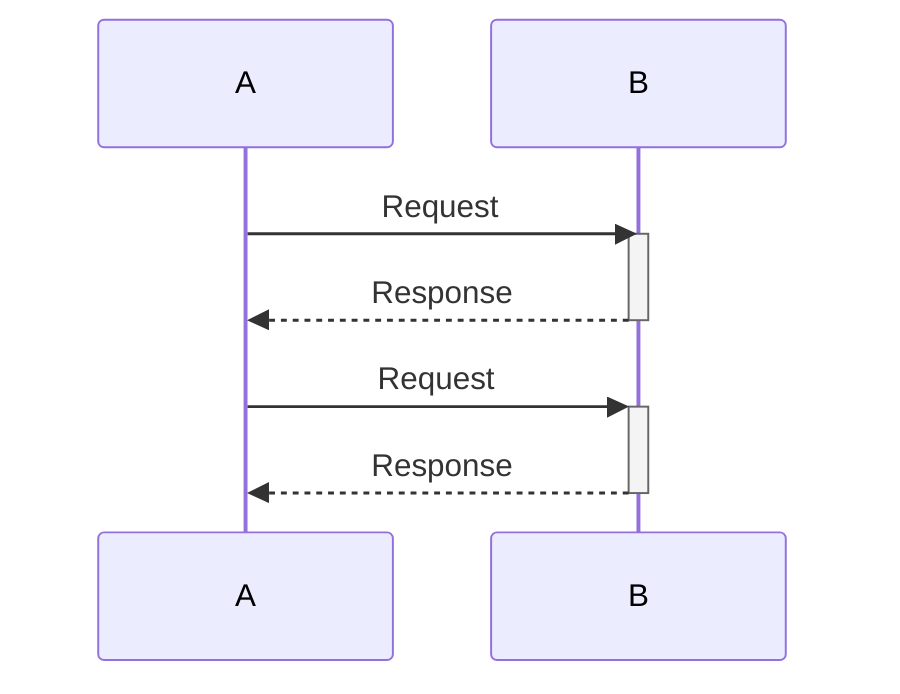

### Thực hành tốt nhất
- Dùng `actor` cho người dùng thay vì hệ thống.
- Sử dụng block `activate/deactivate` để hiện các luồng xử lý đồng thời.
- Nhóm thông điệp bằng `alt/else` (câu lệnh điều kiện).

---

## State Diagram (Sơ đồ trạng thái)

### Cú pháp cơ bản
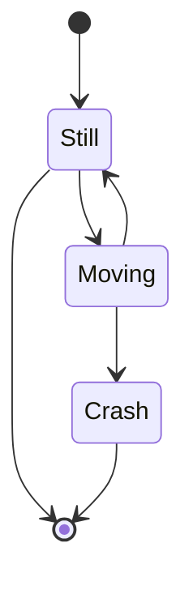

### Trạng thái (States)
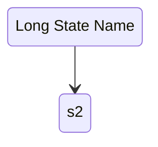

### Trạng thái lồng nhau (Nested States)
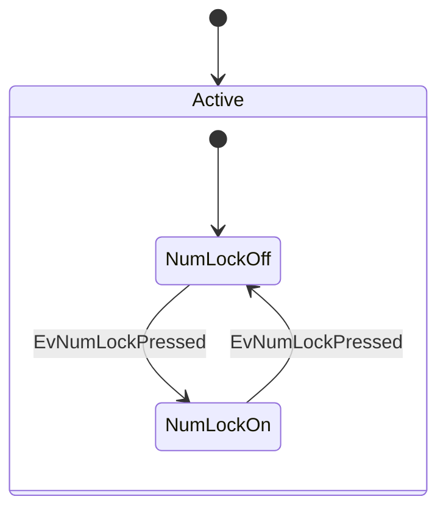

### Hỗ trợ tên CJK (Tiếng Trung/Nhật/Hàn)
Phiên bản 1.1 hỗ trợ đặt tên trực tiếp trạng thái bằng tiếng CJK:
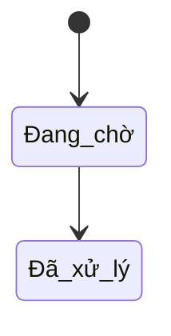

### Thực hành tốt nhất
- Luôn luôn khai báo điểm khởi đầu `[*]` ở đầu.
- Tránh mô hình trạng thái quá sâu (deeply nested).
- Giữ tên trạng thái ngắn gọn, dùng `as` nếu tên cần dài.

---

## Class Diagram (Sơ đồ lớp)

### Cú pháp cơ bản
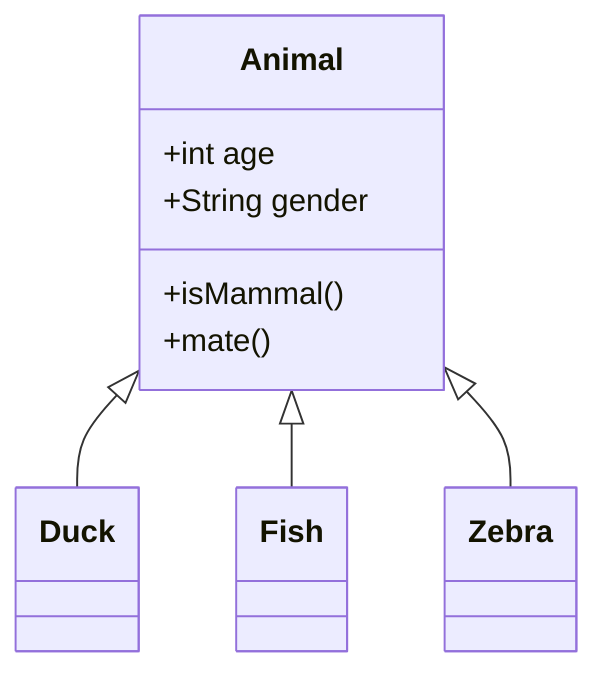

### Quan hệ (Relationships)
- `<|--` - Kế thừa (Inheritance)
- `*--` - Thành phần (Composition)
- `o--` - Tập hợp (Aggregation)
- `-->` - Liên kết (Association)
- `--` - Liên kết (không chiều)
- `..>` - Phụ thuộc (Dependency)
- `..|>` - Hiện thực hóa (Realization/Implementation)
- `..` - Liên kết nét đứt

### Độ hiển thị (Visibility)
- `+` Public
- `-` Private
- `#` Protected
- `~` Package/Internal

### Thực hành tốt nhất
- Giới hạn tối đa 5-7 lớp trong một sơ đồ để dễ đọc.
- Bỏ qua các getter/setter nếu chúng làm lộn xộn sơ đồ.
- Tập trung vào các quan hệ quan trọng.

---

## ER Diagram (Sơ đồ thực thể kết hợp)

### Cú pháp cơ bản
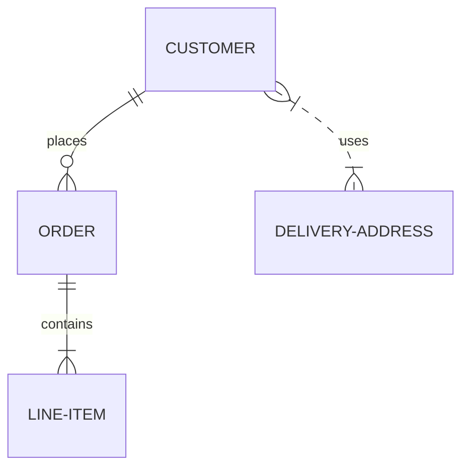

### Quan hệ (Relationships)
Cú pháp: `<entity1> <cardinality1>--<cardinality2> <entity2> : <label>`

Ký hiệu bản số (Cardinality):
- `|o` - Zero or one (0 hoặc 1)
- `||` - Exactly one (Chính xác 1)
- `}o` - Zero or more (0 hoặc nhiều)
- `}|` - One or more (1 hoặc nhiều)

### Thuộc tính (Attributes)
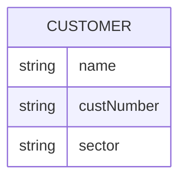

### Thực hành tốt nhất
- Viết hoa toàn bộ tên Thực thể (Entity) theo quy ước.
- Cung cấp các nhãn quan hệ rõ ràng (động từ).
- Định dạng thuộc tính nhất quán (camelCase hoặc snake_case).

---

## XY Chart (Biểu đồ XY)

### Cú pháp cơ bản


### Hỗ trợ tooltip
Thêm cờ `--interactive` khi render SVG để hiển thị tooltip khi hover qua các cột và điểm trên biểu đồ XY.

---

## Thực hành tốt nhất chung

### Hỗ trợ CSS Tùy chỉnh & Theme
`ba-design-flowchart` tự động quản lý hầu hết các styling thông qua các theme có sẵn. Khi cần tùy chỉnh ngoài các theme, hãy dùng `--bg`, `--fg`, `--accent`, v.v. thông qua CLI, thay vì đưa directives theme trực tiếp vào trong mã Mermaid.

### Đặt tên và Nhãn
- Dùng nhãn ngắn, cụ thể.
- Hỗ trợ nhãn nhiều dòng trong flowchart bằng `<br/>` hoặc HTML entities nếu cần thiết.
- Hạn chế ký tự đặc biệt ở ID của node; gán nhãn bằng `id["My Label"]`.

### Xử lý lỗi
Nếu quá trình render thất bại:
1. Kiểm tra lại cú pháp hoặc thụt lề sai.
2. Cách ly từng phần của sơ đồ để tìm ra dòng lỗi.
3. Tham khảo lại danh sách lỗi hoặc chạy CLI với `DEBUG=true` để lấy thông tin.
