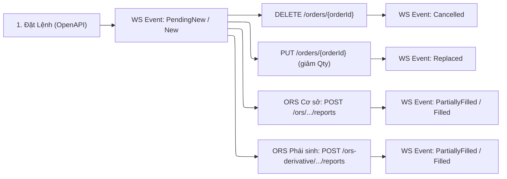
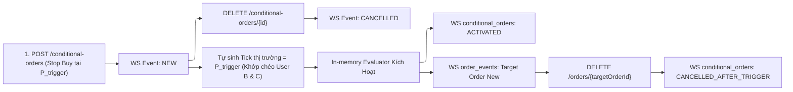

# Cẩm Nang Kiểm Thử Chuyển Trạng Thái Lệnh (Order State Machine E2E Testing)

Tài liệu này hướng dẫn chi tiết phương pháp thiết kế kịch bản và kỹ thuật gọi REST API để giả lập trạng thái lệnh trên môi trường UAT, giúp hệ thống kích hoạt và bắn về các sự kiện WebSocket realtime tương ứng.

Áp dụng cho 2 nhóm lệnh chính:
1. **Lệnh Thường (Normal Orders):** Kênh WebSocket `order_events`
2. **Lệnh Điều Kiện (Conditional Orders):** Kênh WebSocket `conditional_orders`

---

## 1. Kiến Trúc Kiểm Thử E2E (Trigger - Listen - Verify)

Thay vì chỉ lắng nghe thụ động trên WebSocket hoặc mock dữ liệu cục bộ, kiểm thử E2E chuyển trạng thái lệnh bắt buộc phải tuân thủ mô hình tương tác song hành 3 bước:

```
┌─────────────────────────────────────────────────────────────┐
│ 1. LISTEN: Kết nối WS & Subscribe Kênh                      │
│    - Client A kết nối WS và subscribe channel của account   │
└──────────────────────────────┬──────────────────────────────┘
                               ▼
┌─────────────────────────────────────────────────────────────┐
│ 2. TRIGGER: Kích hoạt Lệnh qua REST API                     │
│    - Gọi API Đặt lệnh / Hủy / Sửa / Khớp chéo               │
└──────────────────────────────┬──────────────────────────────┘
                               ▼
┌─────────────────────────────────────────────────────────────┐
│ 3. VERIFY: Đón Nhận & Khẳng Định Event Realtime             │
│    - asyncio.wait_for nhận event                            │
│    - Validate schema Pydantic v2 & business status          │
└─────────────────────────────────────────────────────────────┘
```

---

## 2. Phần A: Kỹ Thuật Giả Lập Trạng Thái Cho LỆNH THƯỜNG (Channel `order_events`)



### 2.1. `PendingNew` $\rightarrow$ `New` (Lệnh mới vào sổ chờ)
- **Kỹ thuật:** Gọi API đặt lệnh (`POST /api/v1/orders` cho Cơ sở hoặc `POST /api/v1/derivative/orders` cho Phái sinh) với mức giá biên: LO mua tại **giá sàn** (`floor_price`) hoặc LO bán tại **giá trần** (`ceiling_price`).
- **Cơ chế:** Lệnh hoàn toàn hợp lệ nhưng với mức giá biên này sẽ không thể khớp ngay, được đẩy vào sổ lệnh chờ (Order Book) của Sở/Sàn.
- **Event WS:** Đón nhận event `PendingNew` rồi chuyển tiếp sang `New`.
- **Payload xác minh:** `status in ("PendingNew", "New")`, `filled_quantity == 0`.

### 2.2. `PendingReplace` $\rightarrow$ `Replaced` (Sửa lệnh thành công)
- **Kỹ thuật:** Từ lệnh `New` đang chờ khớp ở trên, gọi API `PUT /api/v1/orders/{orderId}`:
  + Giảm khối lượng (ví dụ: đặt 200 cổ sửa xuống còn 100 cổ).
  + Hoặc sửa mức giá hợp lệ trong biên độ trần/sàn.
  + Điều kiện nghiệp vụ: $newQuantity > filledQuantity$, lệnh LO trong phiên liên tục.
- **Event WS:** Đón nhận event `PendingReplace` rồi `Replaced` mang khối lượng/giá mới.

### 2.3. `PendingCancel` $\rightarrow$ `Cancelled` (Hủy lệnh thành công)
- **Kỹ thuật:** Từ lệnh `New` hoặc `PartiallyFilled` chưa khớp hết, gọi API `DELETE /api/v1/orders/{orderId}`.
- **Event WS:** OMS thu hồi lệnh từ sổ lệnh và bắn event `PendingCancel` $\rightarrow$ `Cancelled`.

### 2.4. `PartiallyFilled` & `Filled` (Kỹ Thuật Bắn Báo Cáo Khớp Lệnh Qua ORS Admin API — Cơ Sở & Phái Sinh)
Trên môi trường UAT, do lệnh thường đưa lên sàn không có cơ chế tự động khớp từ sàn, Agent **BẮT BUỘC** sử dụng bộ API Quản trị ORS UAT (ORS Admin Execution Report) để giả lập tín hiệu khớp lệnh từ Sở về Core:

#### A. Ma Trận Endpoint ORS UAT Theo Loại Lệnh:
| Thao Tác | Gateway Cơ Sở (Equities) | Gateway Phái Sinh (Derivatives) | Ghi Chú |
|---|---|---|---|
| **1. Login Admin** | `POST ${ORS_ADMIN_URL}/admin-service/login` | `POST ${ORS_ADMIN_URL}/admin-service/login` | Dùng chung token JWT quyền `ADMIN` |
| **2. Tra cứu Sổ Lệnh** | `GET ${ORS_FO_URL}/ors/orders?_start=0&_end=100` | `GET ${ORS_FO_URL}/ors-derivative/orders?_start=0&_end=100` | Lấy đúng `id` và `accountNo` |
| **3. Chi Tiết Lệnh** | `GET ${ORS_FO_URL}/ors/accounts/{accountNo}/orders/{orderId}` | `GET ${ORS_FO_URL}/ors-derivative/accounts/{accountNo}/orders/{orderId}` | Kiểm tra trạng thái core của lệnh |
| **4. Bắn Báo Cáo Khớp (Report)** | `POST ${ORS_FO_URL}/ors/accounts/{accountNo}/orders/{orderId}/reports` | `POST ${ORS_FO_URL}/ors-derivative/accounts/{accountNo}/orders/{orderId}/reports` | Kích hoạt `PartiallyFilled` hoặc `Filled` |

#### B. Quy trình 3 bước tự động hóa và cơ chế phân loại lệnh:
1. **Bước 1 — Login ORS Admin lấy Token:**
   - **Endpoint:** `POST ${ORS_ADMIN_URL}/admin-service/login`
   - **Headers:** `Content-Type: application/json`
   - **Payload:** `{"username": "${ORS_ADMIN_USERNAME}", "password": "${ORS_ADMIN_PASSWORD}"}` (nạp từ `.env`)
   - **Output:** Trích xuất JWT Bearer Token để xác thực cho các thao tác ORS tiếp theo.

2. **Bước 2 — Tra cứu Lệnh trên ORS & Tự động điều hướng Gateway:**
   - Client tự động kiểm tra loại lệnh qua hàm `_resolve_prefix(is_derivative, symbol)`:
     + **Phái sinh (`/ors-derivative`):** Khi `is_derivative=True` HOẶC `symbol` bắt đầu bằng `VN30F`, `GB05`, `GB10`, hoặc mã hợp đồng tương lai KRX 8-10 ký tự (ví dụ: `41I1G9000`).
     + **Cơ sở (`/ors`):** Mặc định cho các mã cổ phiếu 3 ký tự (ví dụ: `VNM`, `VIX`, `HPG`).
   - Khi đặt lệnh với `client_ref`, ORS lưu vào trường `clOrdId`.
   - Helper `ors_admin_client.find_order(client_ref=..., symbol=..., is_derivative=...)` tự động gọi đúng sổ lệnh để trích xuất `id` (chuỗi ký tự hoặc số nguyên) và `accountNo` tương ứng.

3. **Bước 3 — Bắn Báo Cáo Khớp Lệnh (Execution Report Injection):**
   - **Endpoint Cơ sở:** `POST ${ORS_FO_URL}/ors/accounts/{accountNo}/orders/{orderId}/reports`
   - **Endpoint Phái sinh:** `POST ${ORS_FO_URL}/ors-derivative/accounts/{accountNo}/orders/{orderId}/reports`
   - **Headers:** `Authorization: Bearer <ADMIN_TOKEN>`, `Content-Type: application/json`
   - **Payload mẫu Phái sinh:**
     ```json
     {
       "clOrdId": "896",
       "id": 896,
       "symbol": "41I1G9000",
       "orderStatus": "PartiallyFilled",
       "lastQuantity": 1,
       "lastPrice": 2000,
       "fillQuantity": "",
       "avgPrice": "",
       "execType": "F",
       "execId": ""
     }
     ```
   - **Payload mẫu Cơ sở:**
     ```json
     {
       "clOrdId": "ORD_12345",
       "id": "191",
       "symbol": "VIX",
       "orderStatus": "PartiallyFilled",
       "lastQuantity": 100,
       "lastPrice": 13500,
       "fillQuantity": "",
       "avgPrice": "",
       "execType": "F",
       "execId": ""
     }
     ```
   - **Lưu ý định dạng `orderId`:** `orderId` trên đường dẫn URL và trường `id` trong payload **có thể là chuỗi ký tự (str)** hoặc số nguyên (int), không ép kiểu cứng sang integer.

   - **Quy tắc xác định trạng thái:**
     + **Khớp một phần (`PartiallyFilled`):** Truyền `lastQuantity < leaveQuantity` (nhỏ hơn tổng khối lượng đặt, ví dụ đặt 2 HĐ phái sinh truyền `lastQuantity = 1`, `orderStatus = "PartiallyFilled"`).
     + **Khớp toàn phần (`Filled`):** Truyền đủ `lastQuantity == orderQuantity` (ví dụ đặt 1 HĐ truyền `lastQuantity = 1`, `orderStatus = "Filled"`).
   - **Event WS:** Kênh `order_events` của tài khoản lập tức nhận sự kiện `PartiallyFilled` hoặc `Filled` tương ứng từ Core ORS!

#### C. Phương án dự phòng (Khớp chéo 2 tài khoản UAT nếu engine sàn bật auto-match):
- User B đặt Bán 200 cổ giá $P$, User A đặt Mua 100 cổ giá $P$ $\implies$ Engine sàn khớp chéo $\implies$ User A `Filled`, User B `PartiallyFilled`.


### 2.5. `Rejected` (Từ chối lệnh từ Core ORS hoặc Sở)
- **Kỹ thuật:** Cố tình gọi API vi phạm một trong các điều kiện kiểm tra hợp lệ:
  + Đặt giá vượt trần hoặc dưới sàn: `price > ceiling_price` $\implies$ Nhận mã lỗi `PRICE_MUST_LESS_THAN_OR_EQUAL_TO_CEILING_PRICE`.
  + Đặt lẻ lô tại sàn HOSE (phiên liên tục G1): `quantity = 155` $\implies$ Nhận mã lỗi `INVALID_QUANTITY`.
  + Đặt khối lượng mua vượt sức mua: $quantity \times price > PP0$ $\implies$ Nhận mã lỗi `INVALID_INPUT: cash not enough`.
- **Event WS:** Hệ thống phát event `status = Rejected` kèm `error_code` tương ứng.

### 2.6. `WaitToConfirm` $\rightarrow$ `Filled` (Lệnh Thỏa Thuận 2F)
- **Kỹ thuật:**
  1. User A gọi `POST /api/v1/negotiation-orders` chỉ định tài khoản đối ứng User B.
  2. User B lắng nghe WebSocket kênh thỏa thuận $\rightarrow$ Nhận event `WaitToConfirm` (confirmation-request).
  3. User B gọi API xác nhận thỏa thuận $\rightarrow$ Hai bên cùng nhận event `Filled`.

---

## 3. Phần B: Kỹ Thuật Giả Lập Trạng Thái Cho LỆNH ĐIỀU KIỆN (Channel `conditional_orders`)

Lệnh điều kiện được quản lý bởi **Động Cơ Evaluator In-Memory** (quét theo stream tick khớp lệnh thị trường realtime).



### 3.1. `NEW` (Lệnh điều kiện chờ kích hoạt)
- **Kỹ thuật:** Gọi API `POST /order-service/conditional-orders` (hoặc `POST /accounts/{accountNo}/orders` với `orderCategory: STOP`):
  + Đặt `symbol = X`, `side = BUY`, `orderType = LO`, `price = P`, `stopPrice = P_trigger`.
  + Đặt `stopPrice` vượt xa giá thị trường hiện tại (chưa thể chạm tới).
- **Event WS:** Kênh `conditional_orders` đẩy event xác nhận `status = NEW` kèm `order_id`.

### 3.2. `ACTIVATED` (Kích hoạt lệnh điều kiện khi giá thị trường chạm ngưỡng)

Để lệnh điều kiện chuyển trạng thái sang `ACTIVATED`, bắt buộc phải có tick thị trường thỏa mãn điều kiện kích hoạt:

- **Phương án 1 — Kỹ thuật Tự Tạo Tick Giá Thị Trường Bằng Lệnh Đối Ứng (Self-Market Tick Generation):**
  1. **User A đặt lệnh điều kiện:** Stop Buy 100 cổ mã $X$ khi giá thị trường $\ge P_{\text{trigger}}$ (với $P_{\text{trigger}} = P_{\text{reference}}$). Lệnh vào trạng thái `NEW`.
  2. **Tự sinh tick giá thị trường:** Dùng User B và User C đặt 1 cặp lệnh thường khớp chéo:
     - User B đặt BÁN thường 100 cổ mã $X$ tại giá $P_{\text{trigger}}$.
     - User C đặt MUA thường 100 cổ mã $X$ tại giá $P_{\text{trigger}}$.
     $\implies$ Hai lệnh thường khớp nhau ngay tại giá $P_{\text{trigger}}$!
  3. **Evaluator kích hoạt:** MDDS/Kafka phát tin khớp lệnh tick giá $P_{\text{trigger}}$. Động cơ Evaluator lập tức phát hiện điều kiện thỏa mãn:
     - Kênh `conditional_orders`: Nhận event `status = ACTIVATED` kèm `target_order_id`.
     - Kênh `order_events`: Target Order được tự động sinh ra và đẩy vào sàn với `status = PendingNew` $\rightarrow$ `New`!

- **Phương án 2 — Kỹ thuật Đặt Điều Kiện Chạm Ngay Thị Giá Hiện Tại (In-The-Money Trigger):**
  1. Lấy giá khớp gần nhất $P_{\text{last}}$ của mã $X$ (từ snapshot TimescaleDB hoặc Quote API).
  2. Đặt Lệnh Stop Buy với $stopPrice \le P_{\text{last}}$ (hoặc Stop Sell với $stopPrice \ge P_{\text{last}}$).
  3. Khi có bất kỳ giao dịch tick tiếp theo xuất hiện $\implies$ Evaluator kích hoạt ngay lập tức.

### 3.3. `CANCELLED` (Hủy lệnh điều kiện chủ động)
- **Kỹ thuật:** Khi lệnh điều kiện đang ở trạng thái `NEW`, gọi API `DELETE /order-service/conditional-orders/{orderId}`.
- **Event WS:** Kênh `conditional_orders` đẩy event xác nhận `status = CANCELLED`.

### 3.4. `CANCELLED_AFTER_TRIGGER` (Hủy lệnh thường sau khi lệnh điều kiện đã kích hoạt)
- **Kỹ thuật:**
  1. Sau khi lệnh điều kiện đã `ACTIVATED`, Target Order được sinh ra trên sàn ở trạng thái `New` (chưa khớp).
  2. Gọi API hủy lệnh thường: `DELETE /api/v1/orders/{targetOrderId}`.
  3. Hệ thống đồng bộ trạng thái target order $\implies$ Kênh `conditional_orders` phát event `status = CANCELLED_AFTER_TRIGGER`.

### 3.5. `REJECTED` Khi Kích Hoạt (Kỹ Thuật Rút Cạn Sức Mua)
- **Kịch bản:** Lệnh điều kiện khi đặt không phong tỏa tiền (Unfunded). Nếu tại thời điểm kích hoạt tài khoản không đủ sức mua, lệnh đích sẽ bị Core từ chối.
- **Quy trình giả lập:**
  1. User A đặt lệnh Stop Buy 100 cổ mã $X$ (lệnh nhận trạng thái `NEW`).
  2. Trước khi giá chạm ngưỡng, User A dùng một lệnh thường khác mua hết toàn bộ tiền mặt khả dụng ($PP0 \rightarrow 0$).
  3. Tạo tick giá kích hoạt lệnh điều kiện (bằng cặp User B & C).
  4. Evaluator đẩy Target Order vào ORS $\implies$ Bị từ chối do thiếu tiền (`INVALID_INPUT: cash not enough`).
  5. **Event WS:** Kênh `conditional_orders` nhận event `status = REJECTED`.

### 3.6. `CANCELLED_BY_RIGHTS_EVENT` (Hủy tự động do sự kiện quyền / chốt cổ tức)
- **Cơ chế:** Khi cổ phiếu có sự kiện quyền (chia cổ tức, phát hành thêm), giá tham chiếu bị điều chỉnh giảm kỹ thuật vào ngày GDKHQ. Để tránh kích hoạt sai, động cơ lệnh điều kiện tự động hủy toàn bộ các lệnh điều kiện của mã đó.
- **Giả lập trên UAT:** Gửi event sự kiện quyền vào Kafka topic hoặc API quản trị $\implies$ Kênh `conditional_orders` nhận event `status = CANCELLED_BY_RIGHTS_EVENT`.

### 3.7. `OCO` (One-Cancels-the-Other trên Phái Sinh)
- **Kỹ thuật:** Đặt lệnh OCO gồm 2 nhánh: Chốt lời $P_{\text{tp}}$ và Cắt lỗ $P_{\text{sl}}$.
- **Cơ chế:** Dùng lệnh đối ứng tạo tick chạm $P_{\text{tp}} \implies$ Nhánh TP chuyển `Filled`, nhánh SL tự động bị hủy và bắn event `CANCELLED`.

---

## 4. Tham Chiếu Mã Nguồn Mẫu (Blueprint Examples)

Toàn bộ các test case cho cả Lệnh Thường và Lệnh Điều Kiện đã được triển khai hoàn chỉnh trong:
- **Pydantic Model Schema:** [`ExampleOrderEvent`](../examples/test_ws_example.py) & [`ExampleConditionalOrderEvent`](../examples/test_ws_example.py)
- **Test Suite Lệnh Thường:** [`TestOrderEventsWebSocket`](../examples/test_ws_example.py)
- **Test Suite Lệnh Điều Kiện:** [`TestConditionalOrderEventsWebSocket`](../examples/test_ws_example.py)
