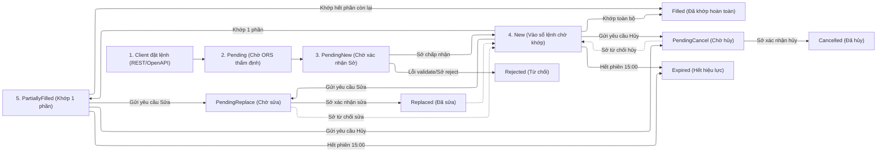

# Cẩm Nang Nghiệp Vụ Chứng Khoán & Hệ Thống Giao Dịch (Securities Domain Knowledge Base)

Tài liệu chuẩn hóa toàn bộ tri thức nghiệp vụ chứng khoán Việt Nam (thị trường cơ sở, phái sinh, hệ thống KRX, MDDS và OpenAPI) phân cấp từ **Cơ Bản $\rightarrow$ Nâng Cao**.
Tài liệu này là **Single Source of Truth** dùng chung cho toàn bộ 7 Persona trong hệ thống: **BA, DEV, QA/SDET, Code Reviewer, Security Auditor, Web Performance Auditor, Scrum Master**.

---

## MỤC LỤC

1. [CẤP ĐỘ 1 (CƠ BẢN): Khái Niệm Căn Bản & Cấu Trúc Thị Trường](#1-cấp-độ-1-cơ-bản-khái-niệm-căn-bản--cấu-trúc-thị-trường)
   - 1.1. Các Sở & Thị Trường (MarketID)
   - 1.2. Các Bảng Giao Dịch (BoardID)
   - 1.3. Biên Độ Dao Động Giá (Price Limits)
   - 1.4. Bảng Bước Giá (Tick Size) & Làm Tròn (Rounding)
   - 1.5. Đơn Vị Giao Dịch & Quy Tắc Lô (Lot Size)
   - 1.6. Chu Kỳ Thanh Toán & Dòng Tiền (Settlement T+2)
2. [CẤP ĐỘ 2 (TRUNG CẤP): Phiên Giao Dịch, Cờ Phiên & Các Loại Lệnh Đặt](#2-cấp-độ-2-trung-cấp-phiên-giao-dịch-cờ-phiên--các-loại-lệnh-đặt)
   - 2.1. Khung Thời Gian & Lịch Trình Các Phiên
   - 2.2. Bảng Mã Cờ Phiên Chuẩn KRX (BoardEventID & SessionID)
   - 2.3. Các Loại Lệnh Khớp Lệnh Cơ Sở (LO, ATO, ATC, MP, MTL, MOK, MAK, PLO)
   - 2.4. Lệnh Giao Dịch Thỏa Thuận (Negotiation Orders - 1F & 2F)
   - 2.5. Lệnh Phái Sinh & Quản Trị Vị Thế Hợp Đồng Tương Lai (Derivatives Orders)
   - 2.6. Quy Chuẩn Sửa Lệnh & Hủy Lệnh Chi Tiết (Amend & Cancel Rules)
3. [CẤP ĐỘ 3 (TRUNG CẤP): Vòng Đời Lệnh, Trạng Thái & Lệnh Điều Kiện](#3-cấp-độ-3-trung-cấp-vòng-đời-lệnh-trạng-thái--lệnh-điều-kiện)
   - 3.1. Máy Trạng Thái Vòng Đời Lệnh Toàn Trình (Order State Machine)
   - 3.2. Bảng Ánh Xạ Trạng Thái Lệnh Đa Tầng (Core/ORS, OpenAPI, WS Event & Sổ Lệnh UI)
   - 3.3. Danh Mục 15 Mã Lỗi Đặt Lệnh ORS & Quy Tắc Xử Lý Frontend/Backend
   - 3.4. Cơ Chế Tự Động Fallback Lệnh 24/7 (Session-Active & Symbol-Active)
   - 3.5. Hệ Thống Lệnh Điều Kiện Chuyên Sâu (Conditional Order Engine)
4. [CẤP ĐỘ 4 (NÂNG CAO): Quản Lý Biến Động & Tạm Ngừng Giao Dịch Khẩn Cấp](#4-cấp-độ-4-nâng-cao-quản-lý-biến-động--tạm-ngừng-giao-dịch-khẩn-cấp)
   - 4.1. Tạm Ngừng Từng Chứng Khoán (Instrument Halt - EI8/EI1/EI9)
   - 4.2. Tạm Ngừng Toàn Thị Trường (Market Halt - AE8/AE1/BE9)
   - 4.3. Cơ Chế Ngắt Mạch Thị Trường (Circuit Breaker - CB)
   - 4.4. Ngắt Biến Động Giá (Volatility Interruption - VI) & Nới Biên Độ (PLE)
5. [CẤP ĐỘ 5 (NÂNG CAO): Dữ Liệu Thị Trường Real-time (MDDS / KRX Protocols)](#5-cấp-độ-5-nâng-cao-dữ-liệu-thị-trường-real-time-mdds--krx-protocols)
   - 5.1. Các Bản Tin MDDS Từ Sở (Message Specifications)
   - 5.2. Các Kênh WebSocket Datafeed Phân Phối Ra Khách Hàng
   - 5.3. Tiêu Chuẩn Tuần Tự Thời Gian & Đo Lường Độ Trễ (Latency Tracking)
6. [CẤP ĐỘ 6 (CHUYÊN SÂU): Sức Mua & Ký Quỹ Truyền Thống Theo Tiểu Khoản (.1 và .6)](#6-cấp-độ-6-chuyên-sâu-sức-mua--ký-quỹ-truyền-thống-theo-tiểu-khoản-1-và-6)
   - 6.1. Mô Hình Tiểu Khoản Truyền Thống (.1 Thường & .6 Ký Quỹ)
   - 6.2. Công Thức Tính Sức Mua Khả Dụng (Buying Power)
   - 6.3. Quản Trị Rủi Ro Ký Quỹ Tổng Thể ($R_{tt}$) & Force Sell Toàn Danh Mục
   - 6.4. Quản Lý Room Chứng Khoán & Khối Ngoại
7. [CẤP ĐỘ 7 (ĐỘC QUYỀN): Hệ Thống Quản Trị Vị Thế Ký Quỹ Theo Deal (Deal-based Margin System)](#7-cấp-độ-7-độc-quyền-hệ-thống-quản-trị-vị-thế-ký-quỹ-theo-deal-deal-based-margin-system)
   - 7.1. Khái Niệm Cốt Lõi: Deal Là Gì & So Sánh Với Mô Hình Truyền Thống
   - 7.2. Cấu Trúc Thực Thể Hệ Thống Deal (Entities & Data Model)
   - 7.3. Vòng Đời Deal & Các Nghiệp Vụ Giao Dịch Đặc Thù
   - 7.4. Các Công Thức Toán Học & Tài Chính Chuẩn Xác Theo Deal
   - 7.5. Cơ Chế Giá Chặn Margin DEAL (Loan Price / Cap Price)
   - 7.6. Quản Trị Rủi Ro & Xử Lý Vi Phạm Theo Deal (Risk Management per Deal)
   - 7.7. Quy Tắc Đồng Bộ Sự Kiện Core/Flex Vào Deal (BO Event Sync Matrix)
8. [MA TRẬN HƯỚNG DẪN THỰC THI CHO TỪNG PERSONA](#8-ma-trận-hướng-dẫn-thực-thi-cho-từng-persona)

---

## 1. CẤP ĐỘ 1 (CƠ BẢN): Khái Niệm Căn Bản & Cấu Trúc Thị Trường

### 1.1. Các Sở & Thị Trường (MarketID / TscProdGrpId)

Hệ thống giao dịch (chuẩn KRX/SGDCK) phân chia thị trường thành các mã định danh chuẩn:

| MarketID | TscProdGrpId | Tên Thị Trường | Sản Phẩm Giao Dịch |
|:---|:---|:---|:---|
| **STO** | **STO** (=7) | HoSE Stock | Cổ phiếu, Chứng chỉ quỹ đóng (CCQ), ETF, Chứng quyền có bảo đảm (CW) niêm yết tại HoSE |
| **STX** | **STX** (=8) | HNX Listed Stock | Cổ phiếu niêm yết tại HNX |
| **UPX** | **UPX** (=9) | HNX UpCoM | Cổ phiếu công ty đại chúng chưa niêm yết đăng ký giao dịch tại HNX |
| **DVX** | **FIO** (=4) | HNX Derivative Index | Hợp đồng tương lai chỉ số (VN30F, v.v.) |
| **DVX** | **FBX** (=3) | HNX Derivative Bond | Hợp đồng tương lai Trái phiếu Chính phủ |
| **HCX** | **HCX** (=5) | HNX Corp Bond | Trái phiếu doanh nghiệp riêng lẻ |
| **BDO** | **BDO** (=1) | HoSE Bond | Trái phiếu niêm yết tại HoSE |
| **BDX** | **BDX** (=2) | HNX Gov Bond | Trái phiếu Chính phủ tại HNX |
| **RPO** | **RPO** (=6) | HoSE Repo | Giao dịch mua bán lại HoSE |

### 1.2. Các Bảng Giao Dịch (BoardID)

Mỗi thị trường được chia thành nhiều bảng (board) xử lý các phương thức giao dịch khác nhau:

| BoardID | Mã Gốc Từ Sở | Tên Bảng & Ý Nghĩa | Quy Cách |
|:---|:---|:---|:---|
| **G1** | `G1`, `G7` (Buy-in), `G3` (Post) | **Khớp lệnh Lô chẵn (Main Board)** | Giao dịch khớp lệnh thông thường, lô từ 100 cổ phiếu |
| **G4** | `G4` | **Khớp lệnh Lô lẻ (Odd-lot Board)** | Giao dịch khớp lệnh lô lẻ từ 1 đến 99 cổ phiếu |
| **G7** | `G7` | **Buy-in Board** | Bảng mua bắt buộc xử lý thiếu hụt thanh toán chứng khoán (08:45 - 09:00) |
| **T1** | `T1`, `T2` (Pre), `T3` (Post) | **Thỏa thuận Lô chẵn (Negotiation Regular)** | Giao dịch thỏa thuận thông thường |
| **T4** | `T4`, `T6` (Post) | **Thỏa thuận Lô lẻ (Negotiation Odd-lot)** | Giao dịch thỏa thuận số lượng lẻ |

### 1.3. Biên Độ Dao Động Giá (Price Limits)

Giá của cổ phiếu chỉ được phép dao động trong phạm vi biên độ so với Giá tham chiếu (Reference Price):

$$\text{Giá Sàn (Floor)} \le \text{Giá Đặt} \le \text{Giá Trần (Ceiling)}$$

| Sàn Giao Dịch | Biên Độ Ngày Thường | Ngày Đầu Niêm Yết / Không Hưởng Quyền Cổ Tức Đặc Biệt |
|:---|:---:|:---:|
| **HoSE (STO)** | $\mathbf{\pm 7.0\%}$ | $\mathbf{\pm 20.0\%}$ |
| **HNX (STX)** | $\mathbf{\pm 10.0\%}$ | $\mathbf{\pm 30.0\%}$ |
| **UpCoM (UPX)** | $\mathbf{\pm 15.0\%}$ | $\mathbf{\pm 40.0\%}$ |

* **Quy tắc làm tròn Giá Trần/Sàn:**
  * Giá trần = Làm tròn xuống (Floor) theo bước giá hợp lệ sao cho không vượt quá biên độ $\%$.
  * Giá sàn = Làm tròn lên (Ceil) theo bước giá hợp lệ sao cho không vượt quá biên độ $\%$.
  * Lưu ý: Giá sàn luôn $> 0$. Nếu giá sàn tính ra $\le 0$, giá sàn sẽ bằng bước giá nhỏ nhất (ví dụ 10đ hoặc 100đ).

### 1.4. Bảng Bước Giá (Tick Size) & Làm Tròn (Rounding)

#### A. Quy Tắc Bước Giá Trên HoSE (Cổ phiếu, CCQ đóng, ETF)
| Dải Giá (VNĐ) | Bước Giá (Tick Size) | Ví Dụ Giá Hợp Lệ | Ví Dụ Giá Bị Từ Chối |
|:---|:---:|:---|:---|
| $\text{Giá} < 10,000$ | **10 VNĐ** | $9,810$; $9,820$; $9,830$ | $9,815$ (Lỗi: sai tick size) |
| $10,000 \le \text{Giá} \le 49,950$ | **50 VNĐ** | $25,000$; $25,050$; $25,100$ | $25,020$ (Lỗi: sai tick size) |
| $\text{Giá} \ge 50,000$ | **100 VNĐ** | $50,100$; $50,200$; $105,500$ | $50,150$ (Lỗi: sai tick size) |

* **Ngoại lệ:** Chứng quyền có bảo đảm (CW) và Chứng chỉ quỹ ETF trên HoSE áp dụng bước giá **10 VNĐ** cho mọi mức giá.

#### B. Quy Tắc Bước Giá Trên HNX & UpCoM
* Áp dụng thống nhất bước giá **100 VNĐ** cho mọi mức giá của cổ phiếu.

### 1.5. Đơn Vị Giao Dịch & Quy Tắc Lô (Lot Size)

* **Lô chẵn (Round Lot - Board G1):** Khối lượng phải là bội số của **100** ($100, 200, 1,000, \dots$). Khối lượng tối đa cho 1 lệnh đặt trên HoSE là **500,000** cổ phiếu.
* **Lô lẻ (Odd Lot - Board G4):** Khối lượng từ **1 đến 99** cổ phiếu. Lô lẻ khớp lệnh độc lập trên bảng G4, không ghép lệnh chung với lô chẵn.
* **Giao dịch Thỏa thuận (Board T1/T4):**
  * HoSE: Khối lượng tối thiểu từ **20,000** cổ phiếu trở lên. Không áp dụng bước giá (chỉ cần giá nằm trong biên độ Trần/Sàn).
  * HNX/UpCoM: Khối lượng từ **5,000** cổ phiếu trở lên.

### 1.6. Chu Kỳ Thanh Toán & Dòng Tiền (Settlement T+2)

* **Thời gian về tài khoản:** Chu kỳ thanh toán là **T+2**.
  * Cổ phiếu mua ngày $T$ sẽ về tài khoản vào **11:30 - 13:00 ngày $T+2$** (nhà đầu tư được bán ngay trong phiên chiều $T+2$).
  * Tiền bán chứng khoán ngày $T$ về tài khoản vào trưa ngày $T+2$.
* **Ứng trước tiền bán (Advance Cash):** Cho phép rút hoặc tăng sức mua ngay trong ngày $T$ và $T+1$ bằng dịch vụ ứng trước (tính lãi suất theo số ngày vay thực tế).

---

## 2. CẤP ĐỘ 2 (TRUNG CẤP): Phiên Giao Dịch, Cờ Phiên & Lệnh Đặt

### 2.1. Khung Thời Gian & Lịch Trình Các Phiên

```
  08:45     09:00       09:15              11:30    13:00              14:30       14:45     15:00
    |---------|-----------|------------------|--------|------------------|-----------|---------|
    | Buy-in  | Phiên ATO | Khớp liên tục    | Nghỉ   | Khớp liên tục    | Phiên ATC | PLO     |
    | (G7)    | (G1/G4)   | sáng (G1/G4)     | trưa   | chiều (G1/G4)    | (G1/G4)   | (HNX)   |
```

| Khung Giờ | Tên Phiên | Sàn Áp Dụng | Phương Thức Khớp | Lệnh Cho Phép |
|:---|:---|:---:|:---:|:---|
| **08:45 - 09:00** | Mua bắt buộc (Buy-in) | HoSE (Board G7) | Khớp lệnh định kỳ | LO, ATO, MP |
| **09:00 - 09:15** | Định kỳ mở cửa (**ATO**) | HoSE | Khớp lệnh định kỳ | **ATO, LO** (Cấm sửa/hủy) |
| **09:00 - 11:30** | Khớp liên tục sáng | HNX, UpCoM | Khớp lệnh liên tục | LO, MP/MTL/MOK/MAK (HNX) |
| **09:15 - 11:30** | Khớp liên tục sáng | HoSE | Khớp lệnh liên tục | **LO, MP** |
| **11:30 - 13:00** | **Nghỉ trưa** | Toàn thị trường | Tạm dừng khớp lệnh | Hệ thống nhận/chờ lệnh |
| **13:00 - 14:30** | Khớp liên tục chiều | Toàn thị trường | Khớp lệnh liên tục | LO, MP (HoSE), MTL/MOK/MAK (HNX) |
| **14:30 - 14:45** | Định kỳ đóng cửa (**ATC**) | HoSE, HNX | Khớp lệnh định kỳ | **ATC, LO** (Cấm sửa/hủy) |
| **14:45 - 15:00** | Khớp lệnh sau giờ (**PLO**) | HNX | Khớp lệnh liên tục | **PLO** (Khớp theo giá đóng cửa) |
| **09:00 - 15:00** | Giao dịch Thỏa thuận | Toàn thị trường | Thỏa thuận điện tử | Thỏa thuận (T1, T4) |

### 2.2. Bảng Mã Cờ Phiên Chuẩn KRX (BoardEventID & SessionID)

Hệ thống MDDS của KRX bắn realtime các event thay đổi trạng thái phiên qua message `35=f` (Security Status):

| BoardEventID | Tên Sự Kiện KRX | Ý Nghĩa Nghiệp Vụ | TradingSessionID |
|:---|:---|:---|:---:|
| **GT1** | `GT Order Load` | Nạp các lệnh Good-Till-Date (GTC) đầu ngày | `01` |
| **AA1** | `Opening CA Open` | Bắt đầu nhận lệnh phiên ATO (09:00) | `10` |
| **BB1** | `Cont.A Open for Non-PCA` | Bắt đầu phiên Khớp lệnh liên tục sáng (09:15) | `40` |
| **AW8** | `Lunch Break` | Bắt đầu giờ nghỉ trưa (11:30) | `40` (Treo) |
| **AW9** | `Open after Lunch Break` | Bắt đầu phiên Khớp lệnh liên tục chiều (13:00) | `40` |
| **BC1** | `Closing CA Open` | Bắt đầu nhận lệnh phiên ATC (14:30) | `30` |
| **AC2** | `Closing CA Execution` | Thực hiện khớp lệnh đóng cửa ATC (14:45) | `99` |
| **AB2** | `Board Trading Close` | Kết thúc toàn bộ giao dịch của bảng | `99` |
| **AQ3** | `Market Final Closing` | Đóng cửa toàn bộ hệ thống giao dịch | `99` |
| **CD1** | `PCA Open` | Mở phiên định kỳ nhiều đợt (cho cổ phiếu bị Hạn chế giao dịch) | `80` |
| **CD3** | `PCA Execution` | Khớp lệnh định kỳ nhiều đợt (15 phút/lần: 09:30, 09:45...) | `80` |

### 2.3. Các Loại Lệnh Khớp Lệnh Cơ Sở (LO, ATO, ATC, MP, MTL, MOK, MAK, PLO)

#### 1. Ma Trận Hiệu Lực Lệnh Theo Sàn & Phiên Giao Dịch

| Loại Lệnh | Tên Nghiệp Vụ & Mô Tả | Sàn Áp Dụng | Phiên Cho Phép | Quy Tắc Nhập Giá & Khối Lượng | Đặc Tính Khớp & Hủy |
|:---|:---|:---:|:---:|:---|:---|
| **LO** (Limit Order) | Lệnh giới hạn: Mua với giá $\le$ giá đặt, Bán với giá $\ge$ giá đặt | HoSE, HNX, UPCoM | ATO, Liên tục, ATC | **Bắt buộc nhập giá** trong biên độ [Sàn, Trần] và đúng bước giá | Hiệu lực trong suốt ngày giao dịch cho đến khi khớp hết hoặc hết phiên/hủy |
| **ATO** (At-the-Opening) | Lệnh khớp tại giá mở cửa | HoSE (STO) | 09:00 - 09:15 | **Disable ô giá**, hệ thống tự động gán giá ATO | Ưu tiên khớp trước lệnh LO. Phần chưa khớp tự động hủy khi hết phiên ATO |
| **ATC** (At-the-Closing) | Lệnh khớp tại giá đóng cửa | HoSE, HNX | 14:30 - 14:45 | **Disable ô giá**, hệ thống tự động gán giá ATC | Ưu tiên khớp trước lệnh LO. Phần chưa khớp tự động hủy khi hết phiên ATC |
| **MP** (Market Price) | Lệnh thị trường HoSE | HoSE (STO) | Khớp liên tục | **Disable ô giá**, mua tại giá bán thấp nhất, bán tại giá mua cao nhất | Nếu chưa khớp hết, phần còn lại tự động chuyển thành lệnh LO tại mức giá kế tiếp |
| **MTL** (Market to Limit) | Lệnh thị trường chuyển sang giới hạn | HNX, HoSE (*) | Khớp liên tục | **Disable ô giá**, khớp theo giá tốt nhất của đối ứng | Phần chưa khớp hết chuyển thành lệnh LO tại mức giá khớp cuối cùng |
| **MOK** (Match or Kill) | Lệnh khớp toàn bộ hoặc hủy | HNX (STX) | Khớp liên tục | **Disable ô giá**, khớp toàn bộ khối lượng ngay tức thì | Nếu không khớp toàn bộ khối lượng ngay lập tức thì hệ thống hủy lệnh tức thì |
| **MAK** (Match and Kill) | Lệnh khớp và hủy phần còn lại | HNX (STX) | Khớp liên tục | **Disable ô giá**, khớp tối đa khối lượng có thể | Phần khối lượng còn lại chưa khớp lập tức bị hủy bỏ |
| **PLO** (Post Limit Order) | Lệnh khớp sau giờ | HNX (STX) | 14:45 - 15:00 | **Disable ô giá**, hệ thống tự động lấy Giá đóng cửa ATC | Khớp ngay khi có lệnh đối ứng cùng mức giá đóng cửa. Cấm sửa/hủy |

> (*) **Ghi chú chuẩn hóa HoSE:** DNSE đã chuẩn hóa việc hỗ trợ lệnh MTL trên sàn HoSE để thay thế/bổ trợ cho lệnh MP truyền thống, tăng tính nhất quán trên nền tảng giao dịch.

#### 2. Quy Tắc Khối Lượng Tối Đa & Ràng Buộc Form Đặt Lệnh
* **Khối lượng tối đa 1 lệnh (`maxQuantityPerOrder`):**
  * Sàn HoSE: Tối đa **500,000 cổ phiếu / lệnh**.
  * Sàn HNX & UPCoM: Không giới hạn trần khối lượng cho 1 lệnh (chỉ bị giới hạn bởi sức mua / sức bán khả dụng).
* **Quy tắc Validate Frontend (Form Đặt Lệnh):**
  * Với các lệnh thị trường (`ATO`, `ATC`, `MP`, `MTL`, `MOK`, `MAK`, `PLO`): Ô nhập giá bị vô hiệu hóa (`disable`), giá trị lệnh tạm tính hiển thị là `-` (do giá khớp phụ thuộc vào khớp lệnh thị trường).
  * Với lệnh `LO`: Ô nhập giá bắt buộc phải có dữ liệu, nằm trong khoảng $[FloorPrice, CeilingPrice]$ và tuân thủ đúng bước giá (tick size).

---

### 2.4. Lệnh Giao Dịch Thỏa Thuận (Negotiation Orders - 1F & 2F)

Giao dịch thỏa thuận thực hiện trên bảng T1 (Lô chẵn) hoặc T4 (Lô lẻ), không tham gia vào sổ lệnh khớp liên tục của Sở:

| Loại Lệnh Thỏa Thuận | Tên Gọi & Đặc Điểm | Quy Trình Khởi Tạo & Xác Nhận | Trạng Thái Lệnh Tương Ứng |
|:---|:---|:---|:---|
| **Lệnh 1F (1 Firm)** | Thỏa thuận 1 bên (Quảng cáo chào mua / chào bán) | Bên khởi tạo gửi lệnh lên Sở (Mua hoặc Bán). Bên đối ứng quét thấy lệnh, tiến hành chấp thuận (`Accept`) hoặc từ chối (`Reject`). | Khởi tạo: `PendingNew`<br>Xác nhận: `Accepting`<br>Từ chối: `Rejecting`<br>Hủy: `PendingCancel` |
| **Lệnh 2F (2 Firms)** | Thỏa thuận 2 bên (Đã có sẵn đối tác cụ thể) | Hai bên mua và bán thống nhất trước mã, giá, khối lượng và số tài khoản đối ứng. Cả 2 bên cùng nhập lệnh đối ứng vào hệ thống. | Khởi tạo: `PendingNew`<br>Chờ đối ứng: `WaitToConfirm` (confirmation-request)<br>Khớp: `Filled`<br>Hủy: `Cancelled` |

* **Quy cách lô & biên độ thỏa thuận:**
  * Khối lượng tối thiểu: HoSE từ **20,000 CP** trở lên; HNX/UPCoM từ **5,000 CP** trở lên.
  * Mức giá thỏa thuận: Nằm trong biên độ Trần/Sàn của ngày, **không bắt buộc phải chia hết cho bước giá (tick size)**.

---

### 2.5. Lệnh Phái Sinh & Quản Trị Vị Thế Hợp Đồng Tương Lai (Derivatives Orders)

Giao dịch Hợp đồng tương lai Chỉ số (VN30F) trên sàn HNX Derivative (`DVX`):

1. **Loại lệnh áp dụng:** Cho phép `LO`, `MTL`, `MOK`, `MAK`, `ATC`.
2. **Chiều vị thế:**
   * Mua (`NB`): Mua mở vị thế Long (nếu chưa có vị thế hoặc đang có vị thế Long) HOẶC Mua đóng vị thế Short (nếu đang Short).
   * Bán (`NS`): Bán mở vị thế Short HOẶC Bán đóng vị thế Long.
3. **Các trường cọc quản trị tài sản Phái sinh:**
   * `orderSecure`: Tiền cọc tạm giữ cho các lệnh đang treo chờ khớp trên sổ lệnh.
   * `dealSecure`: Tiền cọc thực tế đang sử dụng cho các vị thế (Deal) đang mở.
   * `holdOvernightSecure`: Tỷ lệ/số tiền cọc bổ sung bắt buộc khi duy trì vị thế phái sinh qua đêm (tránh rủi ro gap giá ATO hôm sau).
4. **Ràng buộc Ngày Đáo Hạn (`DeListedDate`):** Mọi lệnh phái sinh (kể cả lệnh điều kiện nhiều ngày GTD) không được phép có thời hạn vượt quá ngày thứ Năm của tuần thứ 3 trong tháng đáo hạn của hợp đồng.

---

### 2.6. Quy Chuẩn Sửa Lệnh & Hủy Lệnh Chi Tiết (Amend & Cancel Rules)

#### 1. Ma Trận Điều Kiện Sửa Lệnh (Replace Order Rules - Chuẩn ORS/OpenAPI)

| Tiêu Chí Kiểm Tra | Trường Hợp Cho Phép Sửa (Pass) | Trường Hợp Bị Từ Chối (Reject) |
|:---|:---|:---|
| **Trạng Thái Lệnh Hiện Tại** | **CHỈ** khi lệnh đang ở trạng thái `New` hoặc `PartiallyFilled` | Khi lệnh ở trạng thái: `Filled`, `Rejected`, `PendingNew`, `PendingReplace`, `PendingCancel`, `Cancelled`, `Expired` |
| **Loại Lệnh & Phiên** | **CHỈ** cho phép sửa lệnh **`LO` trong Phiên Khớp Lệnh Liên Tục** | Sửa lệnh LO ngoài phiên liên tục (phiên ATO, ATC, ngoài giờ); Hoặc sửa bất kỳ lệnh thị trường nào (`ATO`, `ATC`, `MP`, `MTL`, `MOK`, `MAK`, `PLO`) |
| **Khối Lượng Sửa (`newQuantity`)** | Bắt buộc: $\mathbf{newQuantity > filledQuantity}$ (Khối lượng mới phải lớn hơn khối lượng đã khớp) | Khối lượng mới $\le$ khối lượng đã khớp ($\mathbf{newQuantity \le filledQuantity}$) |
| **Mức Giá Sửa (`newPrice`)** | $\text{FloorPrice} \le newPrice \le \text{CeilingPrice}$ và đúng bước giá sàn | Mức giá nằm ngoài biên độ trần/sàn hoặc sai bước giá (lẻ tick size) |
| **Ràng Buộc Sức Mua / Sức Bán** | - Mua (NB): $newQuantity \le qmaxBuy$ (tính lại theo giá mới)<br>- Bán (NS): $newQuantity \le tradeQuantity$ (khả dụng) | Khối lượng mới hoặc giá mới làm vượt quá sức mua/bán khả dụng của tài khoản |
| **Điều Chỉnh Đồng Thời** | Cho phép sửa riêng Giá HOẶC riêng Khối lượng; Nếu sửa cả hai phải đồng thời thỏa mãn sức mua và biên độ | Sửa cả Giá và Khối lượng vượt quá sức mua/bán |

#### 2. Quy Tắc Ưu Tiên Thời Gian Khi Sửa Lệnh
* **Sửa GIẢM khối lượng:** Khối lượng giảm đi được cắt bớt trực tiếp, **giữ nguyên độ ưu tiên về thời gian** xếp hàng tại SGDCK của phần khối lượng còn lại.
* **Sửa TĂNG khối lượng HOẶC SỬA GIÁ:** Lệnh cũ bị hủy và phát sinh một lệnh mới với độ ưu tiên thời gian được tính lại tại thời điểm SGDCK tiếp nhận lệnh sửa $\implies$ **Mất toàn bộ quyền ưu tiên thời gian cũ**.

#### 3. Quy Tắc Bất Khả Xâm Phạm Về Hủy Lệnh
* **Phiên ATO (09:00 - 09:15) và Phiên ATC (14:30 - 14:45) trên HoSE:** **TUYỆT ĐỐI CẤM SỬA VÀ CẤM HỦY** đối với 100% các loại lệnh (kể cả lệnh LO đặt từ trước hoặc lệnh ATO/ATC).
* **Phiên PLO trên HNX (14:45 - 15:00):** **TUYỆT ĐỐI CẤM HỦY** lệnh PLO sau khi đã được hệ thống tiếp nhận.
* Chỉ cho phép hủy phần khối lượng **chưa khớp** của lệnh đang ở trạng thái `New` hoặc `PartiallyFilled`.

---

## 3. CẤP ĐỘ 3 (TRUNG CẤP): Vòng Đời Lệnh, Trạng Thái & Lệnh Điều Kiện

### 3.1. Máy Trạng Thái Vòng Đời Lệnh Toàn Trình (Order State Machine)

Hệ thống giao dịch (OMS/ORS, Gateway Sở và OpenAPI) vận hành máy trạng thái hữu hạn (FSM) chặt chẽ cho từng vòng đời lệnh:



* **Nguyên tắc bất biến của các trạng thái kết thúc (Terminal States):**
  * Các trạng thái `Filled`, `Cancelled`, `Rejected`, `Expired` là **trạng thái cuối cùng (Terminal)**. Một khi lệnh đã chuyển sang một trong các trạng thái này, hệ thống **TUYỆT ĐỐI KHÔNG ĐƯỢC PHÉP** chuyển sang bất kỳ trạng thái nào khác.
  * Mọi yêu cầu sửa hoặc hủy gửi đến lệnh đã ở trạng thái Terminal đều bị từ chối ngay lập tức tại tầng ORS Gateway.

---

### 3.2. Bảng Ánh Xạ Trạng Thái Lệnh Đa Tầng (Multi-Tier Order Status Mapping)

Sự đồng bộ trạng thái xuyên suốt giữa hệ thống Core Brokerage (FIX Protocol), dịch vụ OpenAPI V2, WebSocket Realtime Topic và Giao diện Sổ Lệnh (Web/App UI - Chuẩn hóa theo ticket `G3PTP-7070`, `G3PTP-17152`, `G3PTP-13773`):

| Trạng Thái Core / FIX (Tag 39) | OpenAPI V2 Enum | WebSocket Event Status | Hiển Thị Sổ Lệnh UI | Ý Nghĩa Nghiệp Vụ | Trạng Thái Cuối (Terminal)? |
|:---:|:---:|:---:|:---:|:---|:---:|
| `Pending` | `PENDING` | `Pending` | **Chờ gửi** | Lệnh đang được xử lý kiểm tra sức mua, ký số SmartOTP và định tuyến nội bộ | Không |
| `PendingNew` (A) | `PENDING_NEW` | `PendingNew` | **Chờ khớp** | Lệnh đã gửi sang Gateway của SGDCK, đang chờ bản tin ACK phản hồi | Không |
| `New` (0) | `NEW` | `New` | **Chờ khớp** | SGDCK đã xác nhận lệnh hợp lệ và xếp vào Sổ lệnh chờ khớp của sàn | Không |
| `PartiallyFilled` (1) | `PARTIALLY_FILLED` | `PartiallyFilled` | **Khớp 1 phần** | Một phần khối lượng đã khớp thành công, phần còn lại vẫn nằm trên sổ lệnh | Không |
| `Filled` (2) | `FILLED` | `Filled` | **Đã khớp** | Khớp hoàn toàn $100\%$ khối lượng đặt | **Có** |
| `PendingReplace` (E) | `PENDING_REPLACE` | `PendingReplace` | **Chờ sửa** | Đang gửi yêu cầu sửa giá/khối lượng lên Sở, chờ xác nhận | Không |
| `Replaced` (5) | `REPLACED` | `Replaced` | **Chờ khớp** | Sở xác nhận sửa thành công, lệnh mang mức giá hoặc khối lượng mới | Không |
| `PendingCancel` (6) | `PENDING_CANCEL` | `PendingCancel` | **Chờ hủy** | Đang gửi yêu cầu hủy khối lượng chưa khớp lên Sở, chờ xác nhận | Không |
| `Cancelled` (4) | `CANCELLED` | `Cancelled` | **Đã hủy** | Sở xác nhận hủy thành công khối lượng chưa khớp | **Có** |
| `Rejected` (8) | `REJECTED` | `Rejected` | **Bị từ chối** | Lệnh bị từ chối bởi hệ thống quản trị rủi ro ORS hoặc bởi SGDCK (kèm mã lỗi) | **Có** |
| `Expired` (C) / `DoneForDay` (3) | `EXPIRED` | `Expired` | **Hết hiệu lực** | Lệnh chưa khớp hết thời hạn phiên trong ngày (Gộp chung hiển thị trên UI) | **Có** |
| `WaitToConfirm` | `WAIT_TO_CONFIRM` | `WaitToConfirm` | **Chờ xác nhận** | Lệnh thỏa thuận 2F đang chờ đối tác nhập lệnh đối ứng xác nhận | Không |
| `Accepting` | `ACCEPTING` | `Accepting` | **Đang xác nhận** | Bên đối tác đang tiến hành chấp thuận lệnh thỏa thuận 1F | Không |
| `Rejecting` | `REJECTING` | `Rejecting` | **Đang từ chối** | Bên đối tác từ chối lệnh thỏa thuận 1F | Không |

---

### 3.3. Danh Mục 15 Mã Lỗi Đặt Lệnh ORS & Quy Tắc Xử Lý Frontend/Backend

Khi gọi API Đặt lệnh (`POST /dnse-order-service/v2/orders`), hệ thống ORS (Order Routing System) thực hiện thẩm định và trả về các mã lỗi chuẩn sau (theo tài liệu Confluence `4786356229`):

| Mã Lỗi Backend (ORS Code) | Diễn Giải Nghiệp Vụ Cụ Thể | Thông Báo Toast Web/App | Hành Vi Xử Lý Hệ Thống |
|:---|:---|:---|:---|
| `INVALID_INPUT: cash not enough` | Sức mua khả dụng ($PP0$) của tài khoản không đủ để thanh toán giá trị lệnh mua | "Vượt quá khối lượng được giao dịch" | Chặn đặt lệnh, hiển thị Toast đỏ |
| `TRADE_QUANTITY_NOT_ENOUGH` | Khối lượng chứng khoán khả dụng bán (`tradeQuantity`) nhỏ hơn khối lượng đặt | "Vượt quá khối lượng được giao dịch" | Chặn đặt lệnh, hiển thị Toast đỏ |
| `PRICE_MUST_GREATER_THAN_OR_EQUAL_TO_FLOOR_PRICE` | Mức giá đặt nhỏ hơn Giá sàn của mã trong ngày | "Giá ngoài biên độ" | Trong phiên: Báo lỗi.<br>Ngoài phiên: Fallback sang lệnh 24/7 |
| `PRICE_MUST_LESS_THAN_OR_EQUAL_TO_CEILING_PRICE` | Mức giá đặt lớn hơn Giá trần của mã trong ngày | "Giá ngoài biên độ" | Trong phiên: Báo lỗi.<br>Ngoài phiên: Fallback sang lệnh 24/7 |
| `INVALID_QUANTITY` | Khối lượng $= 0$, âm, lẻ lô hoặc vượt quá $500,000$ CP trên sàn HoSE | "Khối lượng không hợp lệ" | Trong phiên: Báo lỗi.<br>Ngoài phiên: Fallback sang lệnh 24/7 |
| `CAN_NOT_PLACE_ORDER_ON_THIS_SESSION` | Loại lệnh không tương thích với phiên hiện tại (vd: đặt ATO trong phiên liên tục) | Không hiện lỗi | **Tự động Fallback sang Lệnh 24/7** (`SESSION_ACTIVE`) |
| `CANNOT_PLACE_ORDER_IN_THE_CLOSED_SESSION` | Đặt lệnh khi thị trường đã đóng cửa (buổi tối, cuối tuần) | Không hiện lỗi | **Tự động Fallback sang Lệnh 24/7** (`SESSION_ACTIVE`) |
| `CANNOT_PLACE_ORDER_IN_THE_HALT_SESSION` | Đặt lệnh khi toàn thị trường/bảng đang tạm ngưng giao dịch (Halt) | "Phiên giao dịch tạm ngưng" | **Tự động Fallback sang Lệnh 24/7** (`SESSION_ACTIVE`) |
| `CAN_NOT_PLACE_ORDER_ON_HALTED_SYMBOL` | Mã chứng khoán bị Sở tạm ngừng giao dịch khẩn cấp | "Mã chứng khoán tạm ngưng giao dịch" | **Tự động Fallback sang Lệnh 24/7** (`SYMBOL_ACTIVE`) |
| `CAN_NOT_PLACE_ORDER_ON_UNLISTED_SYMBOL` | Mã chứng khoán bị hủy niêm yết hoặc mã không tồn tại trên hệ thống | "Mã chứng khoán không hợp lệ" | Chặn đặt lệnh, hiển thị Toast đỏ |
| `BATCH_IN_PROGRESS` | Hệ thống đang chạy batch quyết toán và đồng bộ dữ liệu cuối ngày (EOD) | "Hệ thống đang xử lý, vui lòng thử lại sau" | **Tự động Fallback sang Lệnh 24/7** (`SESSION_ACTIVE`) |
| `INVALID_OTP` | Mã SmartOTP hoặc SMS OTP người dùng nhập không chính xác | "Mã OTP không hợp lệ" | Giữ nguyên popup cho phép người dùng nhập lại OTP |
| `OTP_EXPIRED` | Mã OTP đã quá thời gian hiệu lực quy định | "Mã OTP đã hết hạn, vui lòng lấy mã mới" | Cho phép gửi lại mã OTP mới |
| `ACCOUNT_LOCKED` | Tài khoản của khách hàng bị khóa giao dịch (theo yêu cầu rủi ro/pháp lý) | "Tài khoản bị khóa giao dịch" | Chặn toàn bộ thao tác đặt lệnh |
| `INTERNAL_SERVER_ERROR` | Sự cố kết nối cơ sở dữ liệu hoặc lỗi không mong đợi tại backend | "Đã có lỗi xảy ra, vui lòng thử lại" | Ghi log TraceID và bắn cảnh báo Mattermost |

---

### 3.4. Cơ Chế Tự Động Fallback Lệnh 24/7 (Session-Active & Symbol-Active)

Để mang lại trải nghiệm giao dịch liên tục không gián đoạn, DNSE triển khai cơ chế **Tự động Fallback Lệnh 24/7**:

1. **Nguyên lý hoạt động:**
   * Khi người dùng đặt lệnh thường thông qua Web/App/OpenAPI ngoài giờ giao dịch hoặc khi thị trường tạm ngưng, thay vì từ chối lệnh, Client và ORS tự động bắt các mã lỗi ngoài giờ (`CANNOT_PLACE_ORDER_IN_THE_CLOSED_SESSION`, `CAN_NOT_PLACE_ORDER_ON_THIS_SESSION`, `CANNOT_PLACE_ORDER_IN_THE_HALT_SESSION`, `BATCH_IN_PROGRESS`, `CAN_NOT_PLACE_ORDER_ON_HALTED_SYMBOL`).
   * Hệ thống tự động chuyển tiếp request sang dịch vụ Lệnh Điều Kiện (`POST /dnse-order-service/conditional-orders`) với `orderCategory = TRADING_EVENT`.
2. **Phân loại Trigger Type:**
   * **`SESSION_ACTIVE`:** Áp dụng khi lệnh đặt ngoài giờ, giờ nghỉ trưa hoặc khi sàn Halt. Lệnh được lưu an toàn trong hệ thống; ngay khi thị trường mở cửa phiên giao dịch tiếp theo (09:00 sáng hoặc 13:00 chiều), hệ thống tự động sinh Target Order đẩy thẳng vào Sở.
   * **`SYMBOL_ACTIVE`:** Áp dụng khi đặt lệnh cho mã chứng khoán đang bị tạm ngưng giao dịch (`EI8`). Ngay khi Sở phát cờ gỡ tạm ngưng (`EI1`/`EI9`), hệ thống tự động kích hoạt lệnh lên sàn.
3. **Quy tắc biên phiên:**
   * Trong phiên giao dịch chính thức (sau khi tiến trình BOD hoàn tất), các lỗi về Giá (ngoài trần/sàn) và Khối lượng (lẻ lô, âm) sẽ báo lỗi trực tiếp cho người dùng, **tuyệt đối không fallback sang 24/7** để đảm bảo tính kỷ luật giá trong phiên.

---

### 3.5. Hệ Thống Lệnh Điều Kiện Chuyên Sâu (Conditional Order Engine)

Theo tài liệu đặc tả kiến trúc dịch vụ Lệnh Điều Kiện (`Conditional Order Service` - Confluence `4995416095` & `4875812936`), hệ thống vận hành một Động cơ Đánh giá Realtime (Evaluation Engine) độc lập:

#### 1. Các Nhóm Lệnh Điều Kiện (`orderCategory`):

1. **`STOP` (Lệnh Dừng - Stop-Loss / Stop-Limit):**
   * Giám sát giá thị trường realtime theo toán tử điều kiện `conditionOperator`:
     * $\le$: Dùng cho lệnh Cắt lỗ Bán (Stop Sell) khi giá giảm xuống chạm hoặc thủng `stopPrice`.
     * $\ge$: Dùng cho lệnh Mua Breakout (Stop Buy) khi giá tăng vượt ngưỡng cản `stopPrice`.
   * Khi thỏa mãn điều kiện: Hệ thống tự động sinh `TargetOrder` (với loại lệnh `LO`, `MP` hoặc `MTL`) đẩy lên sàn.
2. **`TRAILING_STOP` (Lệnh Dừng Trượt Giá):**
   * Điểm kích hoạt tự động trượt theo đỉnh cao nhất (đối với vị thế Bán bảo toàn lãi) hoặc đáy thấp nhất (đối với vị thế Mua) theo khoảng trượt `trailingAmount` (VND) hoặc `trailingPercent` (%).
   * Ngay khi thị trường đảo chiều vượt quá khoảng trượt đã định $\implies$ Tự động kích hoạt lệnh.
3. **`TRADING_EVENT` (Lệnh Theo Sự Kiện Phiên / Lệnh 24/7):**
   * Cho phép đặt lệnh bất kỳ lúc nào 24/7. Lệnh tự động kích hoạt khi phiên giao dịch thỏa mãn trạng thái `SESSION_ACTIVE` hoặc cổ phiếu `SYMBOL_ACTIVE`.
4. **`OCO` (One-Cancels-the-Other - Lệnh Kép Chốt Lời & Cắt Lỗ Phái Sinh):**
   * Áp dụng chuyên biệt cho thị trường Phái sinh (`DERIVATIVES`) nhằm bảo vệ vị thế đang mở.
   * Giám sát đồng thời 2 mục tiêu: Chốt lời (`takeProfitPrice`) và Cắt lỗ (`stopPrice` / `stopOrderPrice`).
   * Hệ thống đặt trước 1 lệnh chờ trên sàn; khi giá biến động chạm ngưỡng cắt lỗ, hệ thống thực hiện lệnh **Sửa/Thay thế (Replace Order)** sang giá cắt lỗ và ngược lại. Khi một vế khớp hoàn toàn, vế kia tự động kết thúc. Bắt buộc áp dụng hiệu lực trong ngày (`DAY`).

#### 2. Hiệu Lực Thời Gian (Time-In-Force - TIF):
* **`DAY` (Trong ngày):** Có hiệu lực đến hết ngày giao dịch. Nếu chưa kích hoạt, cuối ngày tự động chuyển sang `EXPIRED`.
* **`GTD` (Good-Till-Date):** Giữ hiệu lực liên tục qua nhiều ngày cho đến mốc thời gian hết hạn (`expireTime`). Đối với Phái sinh, thời gian này không được vượt quá ngày đáo hạn hợp đồng (`DeListedDate`).
* **`GTC` (Good-Till-Cancelled):** Có hiệu lực vô thời hạn cho đến khi thỏa mãn điều kiện kích hoạt hoặc bị người dùng hủy bỏ.

#### 3. Kiến Trúc Hiệu Năng & Zero-DB Latency:
* **Đánh giá 100% trên RAM:** Trong giờ giao dịch, dữ liệu tick khớp lệnh tần suất cao được đẩy từ Kafka vào các Goroutine Worker phân tách theo từng mã chứng khoán (`Actor per Symbol`). Không phát sinh truy vấn PostgreSQL trong quá trình so khớp.
* **Biên Dịch Bytecode VM (`antonmedv/expr`):** Biểu thức điều kiện được biên dịch sẵn sang Bytecode ngay lúc tạo lệnh. Quá trình đánh giá tick giá chỉ mất vài nano-giây.
* **Khóa phân tán Redis (`Redis Distributed Lock`):** Mọi tác vụ kích hoạt (`TriggerOrder`) bắt buộc giành khóa phân tán theo `orderId` $\implies$ Ngăn chặn triệt để lỗi kích hoạt trùng lặp (`Double Trigger`) khi thị trường giật giá mạnh quanh ngưỡng điều kiện.

#### 4. Máy Trạng Thái Của Lệnh Điều Kiện:
```
  [Tạo mới] ──► [NEW] (Theo dõi trên RAM) ──(Thỏa điều kiện)──► [ACTIVATED] ──► [Khớp trên sàn] ──► [FILLED]
                  │                                                                │
                  ├─► [CANCELLED] (User chủ động hủy)                               ├─► [PARTIALLY_FILLED]
                  ├─► [EXPIRED] (Hết hạn DAY/GTD)                                  └─► [CANCELLED_AFTER_TRIGGER]
                  ├─► [REJECTED] (Lỗi sức mua / sàn từ chối khi gửi TargetOrder)
                  ├─► [CANCELLED_BY_RIGHTS_EVENT] (Hủy tự động do sự kiện chia cổ tức/quyền mua)
                  └─► [CANCELLED_BY_DELISTED_EVENT] (Hủy tự động do hủy niêm yết)
```

#### 5. Cơ Chế Tự Động Bảo Vệ Vị Thế Khi Có Sự Kiện Quyền / Cổ Tức:
* **Rủi ro thực tế:** Khi doanh nghiệp thực hiện quyền (chia cổ tức bằng tiền/cổ phiếu, phát hành thêm), giá tham chiếu của cổ phiếu sẽ bị **điều chỉnh giảm kỹ thuật** vào ngày Giao dịch không hưởng quyền (GDKHQ). Nếu giữ nguyên lệnh Cắt lỗ (Stop Sell), việc điều chỉnh giá kỹ thuật sẽ làm lệnh bị **kích hoạt oan** ngoài ý muốn của nhà đầu tư.
* **Giải pháp tự động của DNSE:** Dịch vụ Lệnh Điều Kiện tự động tiêu thụ sự kiện quyền từ Kafka vào cuối ngày $T-1$. Toàn bộ các lệnh điều kiện của mã chứng khoán đó sẽ được hệ thống tự động hủy và chuyển sang trạng thái **`CANCELLED_BY_RIGHTS_EVENT`**, gửi thông báo cảnh báo đến khách hàng để bảo vệ an toàn tài sản tuyệt đối.

---

## 4. CẤP ĐỘ 4 (NÂNG CAO): Quản Lý Biến Động & Tạm Ngừng Giao Dịch Khẩn Cấp

### 4.1. Tạm Ngừng Từng Chứng Khoán (Instrument Halt)

Khi một mã chứng khoán có thông tin bất thường, SGDCK gửi tín hiệu tạm ngừng giao dịch mã đó trong phiên:

```
  [Giao dịch bình thường] ──(EI8)──> [Instrument Halt] ──(EI1)──> [15p Định kỳ sau Halt] ──(EI9)──> [Khớp liên tục]
                                                            (Riêng UPX: Không có 15p định kỳ, nhảy thẳng sang EI9)
```

* **Cờ `EI8` (Instrument Halt):** SGDCK gửi msg `35=f` có tag `20005=EI8` kèm mã `symbol`.
  * **Hành vi bắt buộc:** Hệ thống OMS/ORS và toàn bộ Client (Web/App) phải lập tức khóa giao dịch mã này (Status = `HALT`), từ chối mọi lệnh đặt mới.
* **Cờ `EI1` (Trading Halt Release by Instrument):** SGDCK gỡ bỏ tạm ngừng giao dịch.
  * *Trên HoSE (STO) & HNX (STX):* Bước vào **15 phút Khớp lệnh định kỳ sau Halt**. Trong 15 phút này: **CHỈ ĐƯỢC ĐẶT LỆNH LO, TUYỆT ĐỐI CẤM SỬA/HỦY**.
  * Nếu thời điểm gỡ Halt trùng với phiên ATC chung của Sở: Không mở 15p riêng mà gộp luôn vào phiên ATC chung (chỉ có cờ `EI1`, không trả `EI9`).
* **Cờ `EI9` (Cont.A Open after Instrument Halt):** Kết thúc 15 phút định kỳ, cổ phiếu quay trở lại phiên Khớp lệnh liên tục bình thường, cho phép sửa/hủy lệnh.
* **Riêng sàn UpCoM (UPX):** Khi gỡ ngừng giao dịch, Sở **KHÔNG** mở 15 phút định kỳ mà gửi thẳng cờ **`EI9`** để vào phiên liên tục ngay lập tức!

### 4.2. Tạm Ngừng Toàn Thị Trường (Market Halt)

Sự cố hệ thống kỹ thuật diện rộng hoặc tình huống khẩn cấp cấp quốc gia:

* **Cờ `AE8` (Market Halt):** Tag `20005=AE8` (Board = `AL`). Chặn toàn bộ giao dịch trên tất cả các mã và toàn bộ các bảng của thị trường đó.
* **Cờ `AE1` (Market Halt Release):** Gỡ tạm ngừng toàn thị trường. Bảng G1/G4 bước vào 15 phút khớp lệnh định kỳ sau Halt. Bảng thỏa thuận (T) giao dịch trở lại bình thường.
* **Cờ `BE9` (Cont.A Open after Market Halt):** Kết thúc 15 phút định kỳ sau Market Halt, toàn thị trường quay trở lại phiên khớp lệnh liên tục. (Với UpCoM gửi thẳng cờ `BE9` sau khi gỡ).

### 4.3. Cơ Chế Ngắt Mạch Thị Trường (Circuit Breaker - CB)

Áp dụng khi chỉ số thị trường (VNINDEX) giảm mạnh đột ngột qua các ngưỡng kích hoạt (ví dụ: $7\%$, $10\%$, $15\%$):
* **`AF6` (CB Notice):** Cảnh báo chuẩn bị ngắt mạch thị trường.
* **`AF8` (Suspension by CB):** Ngừng giao dịch toàn thị trường do ngắt mạch.
* **`AF1` (CA Open after CB):** Mở phiên khớp lệnh định kỳ sau khi hết thời gian ngắt mạch.
* **`BF9` (Cont.A Open after CB):** Khôi phục lại phiên liên tục.

### 4.4. Ngắt Biến Động Giá (Volatility Interruption - VI) & Nới Biên Độ (PLE)

* **VI (Msg MD / Session `50`):** Kích hoạt đối với từng mã khi giá dự khớp có sự biến động đột biến so với giá khớp tham chiếu gần nhất một khoảng định trước. Giao dịch mã đó tạm chuyển sang phiên khớp lệnh định kỳ ngắn (2-5 phút) để cân bằng cung cầu trước khi khớp tiếp.
* **PLE (Cờ `AT6`, `AT8`):** Price Limit Extension - Nới rộng biên độ giá theo cơ chế tự động khi thị trường chạm kịch trần/sàn với khối lượng dư thừa lớn.

---

## 5. CẤP ĐỘ 5 (NÂNG CAO): Dữ Liệu Thị Trường Real-time (MDDS / KRX Protocols)

### 5.1. Các Bản Tin MDDS Từ Sở (Message Specifications)

Hệ thống nhận luồng dữ liệu Market Data Dissemination System (MDDS) từ SGDCK qua giao thức FIX/FAST hoặc Binary:

| MsgType | Tên Bản Tin | Thời Điểm | Mục Đích Nghiệp Vụ |
|:---:|:---|:---:|:---|
| **`d`** | Security Definition | Đầu ngày (Batch) | Thông tin mã CK, giá tham chiếu, giá trần, giá sàn, tỷ lệ ký quỹ |
| **`f`** | Security Status | Realtime | Cập nhật cờ phiên (BoardEvent), trạng thái Halt/Unhalt từng mã hoặc toàn sàn |
| **`M7`** | Security Info Notification | Sáng (trước 09:00) | Thông báo điều chỉnh khẩn cấp giá tham chiếu/trần/sàn trước giờ mở cửa |
| **`M8`** | Symbol Closing Info | Cuối ngày (EOD) | Giá đóng cửa chính thức của từng mã CK |
| **`X`** | Market Price & Depth | Realtime | Dữ liệu khớp lệnh (Trades) và sổ lệnh độ sâu 10 mức giá (Top 10 Bids/Asks) |
| **`M1`** | Index Information | Realtime (1s) | Giá trị chỉ số, khối lượng, giá trị giao dịch của VNINDEX, VN30, HNX30 |
| **`M2`** | Foreign Trading | Realtime | Tổng khối lượng mua/bán của khối ngoại và Room ngoại còn lại |

### 5.2. Các Kênh WebSocket Datafeed Phân Phối Ra Khách Hàng

Hệ thống BE chuẩn hóa dữ liệu MDDS thành các topic WebSocket JSON/Protobuf cung cấp cho Web/App/OpenAPI:

```
  Kênh Socket                   Nội Dung Dữ Liệu
  ───────────────────────────── ─────────────────────────────────────────────────────────────
  market_data:tick              Thông tin khớp lệnh gần nhất (Price, Vol, Side: Mua/Bán chủ động, Timestamp)
  market_data:topprice          3 hoặc 10 mức giá Mua/Bán tốt nhất kèm khối lượng (Sổ lệnh độ sâu)
  market_data:board_event       Sự kiện cờ phiên realtime (ATO, Liên tục, ATC, Nghỉ trưa, Halt)
  market_data:expected_price    Giá và khối lượng dự khớp trong phiên định kỳ ATO/ATC
  market_data:ohlc_realtime     Nến kỹ thuật cập nhật realtime (1m, 5m, 1h, 1D)
  market_data:ohlc_closed       Event xác nhận ĐÓNG nến theo từng resolution (đặc biệt quan trọng cuối ngày)
  market_data:foreigner         Dữ liệu giao dịch khối ngoại: Room còn lại, KL mua/bán trong ngày
  market_data:market_index      Điểm chỉ số VNINDEX, VN30, độ rộng thị trường (Số mã Tăng/Giảm/Trần/Sàn)
```

### 5.3. Tiêu Chuẩn Tuần Tự Thời Gian & Đo Lường Độ Trễ (Latency Tracking)

1. **Quy tắc Time-series Strict Ordering:**
   * Gói tin khớp lệnh hoặc nến phát sinh sau **BẮT BUỘC** phải có timestamp Sở ($T_{\text{exchange}}$) lớn hơn hoặc bằng gói tin trước đó.
   * Client tuyệt đối không được nhận gói tin đảo lộn thời gian (tránh trường hợp nến mới bị đè bởi nến cũ).
2. **Tracking Latency Toàn Trình:**
   $$\text{Total Latency} = T_{\text{client\_receive}} - T_{\text{exchange}}$$
   Bao gồm 3 chặng đo lường:
   * Chặng 1: $T_{\text{gateway\_receive}} - T_{\text{exchange}}$ (Độ trễ từ SGDCK về hạ tầng công ty chứng khoán).
   * Chặng 2: $T_{\text{socket\_broadcast}} - T_{\text{gateway\_receive}}$ (Thời gian xử lý nội bộ BE/Matching Engine/Broker).
   * Chặng 3: $T_{\text{client\_receive}} - T_{\text{socket\_broadcast}}$ (Độ trễ đường truyền mạng internet đến Web/App).

---

## 6. CẤP ĐỘ 6 (CHUYÊN SÂU): Sức Mua & Ký Quỹ Truyền Thống Theo Tiểu Khoản (.1 và .6)

### 6.1. Mô Hình Tiểu Khoản Truyền Thống (.1 Thường & .6 Ký Quỹ)

Hầu hết các công ty chứng khoán truyền thống tại Việt Nam phân tách tài khoản của nhà đầu tư thành các tiểu khoản độc lập dưới một số tài khoản lưu ký (CustodyID / AccountNo):

* **Tiểu khoản thường (Đuôi `.1`):** 
  * Chỉ được giao dịch trong phạm vi số tiền mặt và chứng khoán thực có (Tỷ lệ ký quỹ $IMR = 100\%$).
  * Không phát sinh nghĩa vụ nợ margin, không chịu áp lực Call Margin hay giải chấp từ thị trường.
* **Tiểu khoản ký quỹ (Đuôi `.6`):**
  * Được cấp hạn mức vay ký quỹ theo danh mục cổ phiếu cho vay do CTCK và UBCKNN quy định.
  * Toàn bộ tài sản (tiền và chứng khoán) trên tiểu khoản `.6` được gộp chung thành một **danh mục tổng thể (Portfolio)** để làm tài sản bảo đảm cho tổng dư nợ vay.
* **Nhược điểm cốt lõi của mô hình truyền thống:**
  1. **Bất tiện dòng tiền:** Khách hàng phải liên tục thực hiện nghiệp vụ chuyển tiền nội bộ giữa đuôi `.1` và đuôi `.6` khi muốn thay đổi nhu cầu sử dụng đòn bẩy.
  2. **Hiệu ứng lây lan rủi ro chéo (Cross-Default / Contagion Risk):** Khi một mã cổ phiếu trong danh mục margin sụt giảm nghiêm trọng (mất thanh khoản, giảm sàn nhiều phiên liên tục), tỷ lệ an toàn chung của cả tiểu khoản sụt giảm mạnh. Hệ thống sẽ **bán giải chấp bất kỳ cổ phiếu nào có thanh khoản** trong danh mục để thu hồi nợ, làm tổn hại đến các vị thế cổ phiếu tốt của khách hàng.
  3. **Khó đo lường hiệu suất từng thương vụ:** Khách hàng không thể bóc tách chính xác lãi/lỗ, chi phí lãi vay và giá hòa vốn của riêng từng lần giải ngân cho một mã cụ thể.

### 6.2. Công Thức Tính Sức Mua Khả Dụng (Buying Power)

$$\text{Sức Mua} = \frac{\text{Tiền Mặt Khả Dụng} + \text{Tiền Bán Chờ Về} + \text{Hạn Mức Thấu Chi} - \text{Giá Trị Lệnh Mua Đang Chờ}}{\text{Tỷ Lệ Ký Quỹ Ban Đầu của Mã Chứng Khoán } (IMR)}$$

* Với tiểu khoản thường (`.1`): $IMR = 100\% \implies \text{Sức Mua} = \text{Tiền Thực Có}$.
* Với tiểu khoản ký quỹ (`.6`): $IMR$ dao động từ $50\%$ đến $70\%$ tùy theo danh mục ký quỹ được UBCKNN phê duyệt. Ví dụ cổ phiếu $VNM$ có $IMR = 50\%$, có 100 triệu tiền mặt $\implies$ Sức mua tối đa = 200 triệu.

### 6.3. Quản Trị Rủi Ro Ký Quỹ Tổng Thể ($R_{tt}$) & Force Sell Toàn Danh Mục

Tỷ lệ thực tế tài khoản ký quỹ ($R_{tt}$) xác định mức độ an toàn tài chính toàn bộ tiểu khoản `.6`:

$$R_{tt} = \frac{\text{Tổng Giá Trị Danh Mục Chứng Khoán Theo Giá Thị Trường} - \text{Tổng Dư Nợ Vay Gốc \& Lãi}}{\text{Tổng Giá Trị Danh Mục Chứng Khoán Định Giá Ký Quỹ}}$$

| Ngưỡng $R_{tt}$ | Trạng Thái Tài Khoản | Hành Động Xử Lý Bắt Buộc |
|:---:|:---|:---|
| $R_{tt} \ge 100\%$ | **An Toàn (Normal)** | Tài khoản giao dịch bình thường, được rút tiền dư hoặc mua thêm. |
| $85\% \le R_{tt} < 100\%$ | **Cảnh Báo (Warning)** | Không cho phép giải ngân mua thêm các mã rủi ro. |
| $\mathbf{80\% \le R_{tt} < 85\%}$ | **Call Margin** | Gửi thông báo Call Margin. Khách hàng có 1 đến 2 phiên để nộp thêm tiền hoặc chủ động bán bớt tài sản. |
| $\mathbf{R_{tt} < 80\%}$ | **Force Sell (Giải chấp toàn danh mục)** | **Hệ thống tự động kích hoạt bán giải chấp cổ phiếu** trong phiên khớp lệnh liên tục gần nhất để đưa $R_{tt}$ về mức an toàn. Khi bán, CTCK chọn các mã có thanh khoản cao nhất trong danh mục để ép bán. |

### 6.4. Quản Lý Room Chứng Khoán & Khối Ngoại

1. **Foreign Room (Tỷ lệ sở hữu nước ngoài):**
   * Mỗi mã chứng khoán có tỷ lệ sở hữu tối đa dành cho nhà đầu tư nước ngoài (thường là $49\%$, $100\%$ hoặc $30\%$ với ngân hàng).
   * Khi **Room nước ngoài = 0**: Lệnh MUA của tài khoản nước ngoài **BẮT BUỘC BỊ TỪ CHỐI**. Lệnh BÁN vẫn được thực hiện bình thường và sẽ làm tăng lại Room trống.
2. **Margin Room (Hạn mức cho vay của CTCK):**
   * **Room mã chứng khoán:** Giới hạn tối đa tổng khối lượng cho vay đối với 1 mã (theo quy định UBCK không vượt quá $5\%$ tổng số cổ phiếu lưu hành).
   * **Room công ty:** Giới hạn tổng dư nợ cho vay margin trên toàn hệ thống (không vượt quá 2 lần vốn chủ sở hữu CTCK).

---

## 7. CẤP ĐỘ 7 (ĐỘC QUYỀN): Hệ Thống Quản Trị Vị Thế Ký Quỹ Theo Deal (Deal-based Margin System)

### 7.1. Khái Niệm Cốt Lõi: Deal Là Gì & So Sánh Với Mô Hình Truyền Thống

Khái niệm **DEAL** (tiên phong bởi DNSE) là giải pháp quản trị tài sản và giao dịch ký quỹ theo từng vị thế độc lập, khắc phục triệt để các nhược điểm của mô hình tiểu khoản `.1`/`.6` truyền thống:

1. **Tài khoản đơn nhất (Single Account View):** Khách hàng chỉ sở hữu **một tài khoản giao dịch duy nhất**. Không cần mở nhiều tiểu khoản, không cần chuyển tiền qua lại.
2. **Định danh Deal độc lập (Composite Key):** Mỗi Deal được định danh duy nhất trên hệ thống bởi bộ ba thông tin:
   $$\text{Deal} = (\text{accountNo}, \text{symbol}, \text{loanPackageId})$$
3. **Đa vị thế trên cùng một mã cổ phiếu:** Khách hàng có thể mở nhiều Deal khác nhau cho cùng một mã chứng khoán tùy theo chiến lược giải ngân.
   * *Ví dụ:* Trên cùng tài khoản `0001000115`, khách hàng có thể nắm giữ:
     * 01 Deal cổ phiếu `ACB` với Gói vay 0% (không vay, tỷ lệ cọc 100%).
     * 01 Deal cổ phiếu `ACB` với Gói vay 50% (vay tỷ lệ cọc 50%).
     * 01 Deal cổ phiếu `SSI` với Gói vay 70% (vay tỷ lệ cọc 30%).
4. **Cách ly rủi ro tuyệt đối (Ring-fenced Positions):** Quản trị rủi ro, theo dõi lãi lỗ, tính giá hòa vốn và xử lý giải chấp được thực hiện độc lập trên từng Deal:
   * Nếu Deal `SSI` bị lỗ và chạm ngưỡng giải chấp, hệ thống **CHỈ BÁN XỬ LÝ CỔ PHIẾU `SSI` THUỘC ĐÚNG DEAL ĐÓ**, hoàn toàn **KHÔNG ẢNH HƯỞNG HAY BÁN CHÉO SANG DEAL `ACB`**.

#### Bảng So Sánh Toàn Diện: Portfolio-based (.1/.6) vs Deal-based (DNSE)

| Tiêu Chí | Quản Lý Truyền Thống (.1 và .6) | Quản Lý Theo DEAL (Thế Hệ Mới) |
|:---|:---|:---|
| **Cấu trúc tài khoản** | Tách rời 2 tiểu khoản: `.1` (Thường) và `.6` (Margin) | **1 tài khoản duy nhất**, quản lý nhiều Deal độc lập bên trong |
| **Thao tác đặt lệnh** | Phải chọn đúng tiểu khoản trước khi đặt lệnh. Nếu thiếu tiền phải chuyển khoản giữa .1 và .6 | **Chọn gói vay ngay trong sổ đặt lệnh**, linh hoạt chọn tỷ lệ vay cho từng lệnh |
| **Đơn vị quản trị rủi ro** | **Toàn bộ tiểu khoản .6** (Gộp chung nợ và tài sản của tất cả các mã) | **Từng DEAL riêng lẻ** $(\text{accountNo}, \text{symbol}, \text{loanPackageId})$ |
| **Cơ chế Force Sell** | Bán tháo toàn danh mục, bán lây sang cổ phiếu tốt khác có thanh khoản | **Chỉ bán đúng cổ phiếu của Deal chạm ngưỡng xử lý**, bảo vệ các vị thế khác |
| **Đo lường hiệu suất** | Khó bóc tách chi phí vốn, lãi lỗ và lãi vay cho từng giao dịch | **Minh bạch 100%**: hiển thị chính xác giá vốn, lãi lỗ thực tế, lãi vay và giá hòa vốn của từng Deal |
| **Cơ chế thanh toán nợ** | Tiền bán vào tài khoản sẽ bị trừ nợ chung của toàn bộ tiểu khoản | Tiền bán của Deal nào ưu tiên trả nợ cho chính Deal đó, phần dôi ra chuyển thành sức mua khả dụng |

---

### 7.2. Cấu Trúc Thực Thể Hệ Thống Deal (Entities & Data Model)

Kiến trúc hệ thống Deal bao gồm 3 services lõi tương tác qua Kafka Event Bus và cache Redis/Postgres:
* **Deal Service:** Nhận thông tin lệnh khớp từ ORS/OMS và event từ BO (Flex) để hình thành, cập nhật số dư, tính lãi/lỗ và giá hòa vốn của Deal. Publish trạng thái Deal qua Kafka và đẩy realtime tới Web/App qua MQTT.
* **Loan Service:** Quản lý vòng đời món nợ, giải ngân nợ khi mua, thu nợ khi bán hoặc trả nợ trước hạn, tính lãi vay dồn tích theo ngày.
* **Risk Service:** Giám sát tỷ lệ rủi ro realtime theo từng Deal, phát hiện chạm ngưỡng Call Margin/Liquid, tính toán giá xử lý và kích hoạt lệnh Smart Order Force Sell.

```
                  ┌──────────────────────┐
                  │ Kafka (Order, Event) │
                  └──────────┬───────────┘
                             │
                             ▼
┌──────────────┐      ┌──────────────┐      ┌──────────────┐
│ Loan Service │ ◄─── │ Deal Service │ ───► │ Risk Service │
└──────────────┘      └──────┬───────┘      └──────────────┘
                             │
                             ▼
                    ┌─────────────────┐
                    │  MQTT / Socket  │ ──► [Client Web/App Realtime]
                    └─────────────────┘
```

#### 1. Rổ Vay (Margin Basket 2.0)
Rổ vay 2.0 là tập hợp các mã chứng khoán đủ tiêu chuẩn nghiệp vụ:
```json
{
  "id": 1098,
  "name": "RO_HNX30_VIP",
  "symbols": ["ACB", "BVS", "FPT", "SSI", "VHM"]
}
```
*Lưu ý:* Rổ vay 2.0 không lưu trực tiếp giá chặn và tỷ lệ cho vay (các tham số này được phân cấp xuống Gói vay - Loan Product).

#### 2. Gói Vay (Loan Package)
Định nghĩa sản phẩm tài chính phục vụ đa dạng khẩu vị rủi ro:
* `id`: Số hiệu gói vay.
* `name`: Tên gói vay (vd: "Gói Lãi Suất Ưu Đãi T0", "Margin Chuẩn 50%").
* `loanType`: Loại vay (`M`: Margin thường, `C`: Thấu chi/Cash).
* `source`: Nguồn vốn (`C`: CTCK DNSE, `B`: Ngân hàng, đối tác P2P).
* `initialRate`: Tỷ lệ ký quỹ (cọc) ban đầu của gói vay (vd: $0.5$ tương ứng tỷ lệ cho vay $50\%$).
* `initialRateForWithdraw`: Tỷ lệ ký quỹ áp dụng khi ứng/rút sức mua dôi ra từ Deal.
* `maintenanceRate`: Tỷ lệ duy trì (ngưỡng Call Margin, vd: $0.4$).
* `liquidRate`: Tỷ lệ bán xử lý giải chấp (ngưỡng Force Sell, vd: $0.3$).
* `interestRate`: Lãi suất vay trong hạn tính theo năm (vd: $0.13 = 13\%$/năm, tính trên cơ sở 365 ngày).
* `preferentialPeriod` & `preferentialInterestRate`: Số ngày được hưởng lãi suất ưu đãi và mức lãi suất ưu đãi.
* `term`: Kỳ hạn vay tính theo ngày (vd: 60, 90, 180 ngày).
* `overdueInterest`: Lãi suất quá hạn (thường bằng $150\%$ lãi trong hạn).
* `allowExtendLoanTerm` & `allowEarlyPayment`: Cờ cho phép gia hạn vay hoặc trả nợ trước hạn (boolean).
* `brokerFirmBuyingFeeRate` & `brokerFirmSellingFeeRate`: Biểu phí giao dịch mua/bán trả CTCK.
* `transferFee`: Phí chuyển khoản chứng khoán khi bán (đồng/cổ phiếu).

#### 3. Món Nợ Deal (Loan Management Model)
Mỗi lần Deal giải ngân sẽ tạo hoặc cộng dồn vào món nợ quản lý tại Loan Service:
* `disbursementDate`: Ngày giải ngân món nợ.
* `originalPrincipal`: Số tiền gốc đã giải ngân ban đầu.
* `dueDate`: Ngày đến hạn khoản vay.
* `unduePrincipal` / `undueInterest`: Nợ gốc và nợ lãi trong hạn chưa trả.
* `duePrincipal` / `dueInterest`: Nợ gốc và lãi đến hạn thanh toán trong ngày.
* `overduePrincipal` / `overdueInterest`: Nợ gốc và lãi quá hạn.
* `t0UnrealizedPrincipal`, `t1UnrealizedPrincipal`, `t2UnrealizedPrincipal`: Nợ gốc dự thu tương ứng với khối lượng chứng khoán đã khớp bán vào ngày $T_0, T_1, T_2$.
* `t0UnrealizedInterest`, `t1UnrealizedInterest`, `t2UnrealizedInterest`: Nợ lãi dự thu tương ứng tiền bán chờ về.

#### 4. Thực Thể Deal (Deal Model Core Fields)
```
Trường Dữ Liệu               Ý Nghĩa Nghiệp Vụ
──────────────────────────── ─────────────────────────────────────────────────────────────
dealId                       Mã định danh duy nhất của Deal trong toàn hệ thống
accountNo                    Số tài khoản chứng khoán của khách hàng (duy nhất)
symbol                       Mã chứng khoán của Deal
loanPackageId                Mã gói vay gán cho Deal
status                       Trạng thái Deal: OPEN (đang mở), PENDING_CLOSE, CLOSED (đã đóng)
side                         Vị thế: NB (Mua/Nắm giữ dài hạn), NS (Vị thế bán)
accumulateQuantity           Tổng khối lượng chứng khoán tích lũy từ khi mở Deal
openQuantity                 Khối lượng chứng khoán hiện đang mở (chưa bán chốt)
closedQuantity               Khối lượng chứng khoán đã bán chốt
tradeQuantity                Khối lượng chứng khoán thực có, được phép đặt bán trong phiên
t0/t1/t2ReceivingQuantity     Khối lượng chứng khoán mua chờ về theo chu kỳ T+2
dividendReceivingQuantity    Khối lượng cổ phiếu cổ tức đang chờ về
costPrice                    Giá vốn hiện tại của khối lượng đang mở (openQuantity)
averageCostPrice             Giá vốn bình quân gia quyền của toàn bộ lịch sử mua của Deal
marketPrice                  Giá thị trường realtime của mã chứng khoán
secure                       Số tiền cọc ký quỹ hiện tại của Deal
unrealizedProfit             Lãi/lỗ tạm tính của Deal theo thị giá
realizedProfit               Lãi/lỗ đã thực hiện (đã chốt khi bán từng phần)
breakEvenPrice               Giá hòa vốn chính xác của Deal (đã tính đủ thuế, phí, lãi vay)
currentDebt                  Tổng nợ gốc còn lại của Deal
currentInterest              Tổng nợ lãi tích lũy chưa trả của Deal
dealRate                     Tỷ lệ an toàn thực tế của Deal (R_deal)
liquidPrice                  Mức thị giá chạm ngưỡng bán giải chấp (Force Sell)
maintenancePrice             Mức thị giá chạm ngưỡng cảnh báo Call Margin
```

---

### 7.3. Vòng Đời Deal & Các Nghiệp Vụ Giao Dịch Đặc Thù

```
  [Lệnh Mua Khớp] ──► [Deal OPEN] ──► [Mua Mở Thêm] (Cập nhật bình quân giá vốn, cọc, nợ)
                             │
                             ├───────► [Bán Một Phần] (Chốt lãi/lỗ từng phần, ưu tiên trả nợ)
                             │
                             ├───────► [Bán Hết] ──► [Deal CLOSED]
                             │
                             └───────► [Khối Lượng < Lô Chẵn HoSE] ──► [PENDING_CLOSE]
                                                                      (Thu hết nợ -> Chuyển lô lẻ)
```

#### 1. Quy Trình Khớp Lệnh Mua / Bán
* **Lệnh Mua:** Khách hàng chọn mã chứng khoán và gói vay mong muốn. 
  * Nếu chưa có Deal cùng gói vay: Khớp lệnh sẽ **sinh ra một Deal mới** ở trạng thái `OPEN`.
  * Nếu đã có Deal cùng mã và cùng gói vay: Hệ thống **tự động gộp vào Deal hiện tại**, cộng dồn khối lượng vào `openQuantity`, cập nhật giá vốn gia quyền `costPrice` và tăng tiền cọc `secure`, tăng nợ `currentDebt`.
* **Lệnh Bán:** Khách hàng chọn đúng Deal muốn bán. Sức bán tối đa hiển thị theo `tradeQuantity` của Deal đó.
  * Khi lệnh bán khớp: Tiền bán thu về được **ưu tiên giữ lại để khấu trừ nợ gốc và nợ lãi** của chính Deal đó (giảm `currentDebt` và `currentInterest`).
  * Phần tiền bán còn lại sau khi trừ nghĩa vụ nợ sẽ chuyển thành tiền có thể ứng (`t0ReceivingCash`) để tăng sức mua cho tài khoản.
  * Nếu bán hết toàn bộ khối lượng (`openQuantity == 0`): Mọi nghĩa vụ nợ, phí, thuế được quyết toán dứt điểm, Deal chuyển sang trạng thái `CLOSED`.

#### 2. Xử Lý Chứng Khoán Lô Lẻ (Odd-Lot) Theo Deal
* **Tại HNX và UpCoM:** Cho phép khớp lệnh lô lẻ trực tiếp trên bảng liên tục $\implies$ Cho phép gộp chung lô lẻ và lô chẵn vào cùng một Deal bình thường.
* **Tại HoSE:**
  * Khi khách hàng bán một phần Deal mà số dư còn lại `openQuantity < 100` (lô lẻ từ 1 đến 99 cổ phiếu):
    * Hệ thống lập tức chuyển Deal sang trạng thái **`PENDING_CLOSE`**.
    * **Bắt buộc thu hồi toàn bộ dư nợ margin của Deal này**, coi phần chứng khoán lô lẻ còn lại là chứng khoán không vay nợ (để tránh rủi ro treo nợ trên tài sản không thể bán khớp lệnh khớp sàn).
    * Khách hàng giao dịch xử lý phần lô lẻ này thông qua nghiệp vụ nộp/rút chứng khoán hoặc bán thỏa thuận cho CTCK.

#### 3. Xử Lý Sự Kiện Quyền (Corporate Actions) & Thứ Tự Khấu Trừ Thuế Khi Bán
* **Cổ tức bằng tiền:** Tiền cổ tức được ghi nhận vào tài khoản tiền mặt của khách hàng, không ảnh hưởng đến số lượng cổ phiếu trên Deal.
* **Cổ tức bằng cổ phiếu / Cổ phiếu thưởng:**
  * Khối lượng cổ phiếu thưởng về sẽ tăng vào trường `dividendTradeQuantity` của Deal.
  * **Quy tắc vàng khấu trừ thuế TNCN khi bán:** Theo Luật thuế Việt Nam, bán cổ phiếu nhận từ cổ tức bị đánh thuế TNCN $5\%$ trên giá trị bán (hoặc mệnh giá 10,000đ tùy giá nào nhỏ hơn). Do đó, khi khách hàng đặt lệnh bán Deal:
    $$\text{Hệ thống BẮT BUỘC ưu tiên khớp trừ vào Cổ Phiếu Cổ Tức trước, sau đó mới trừ vào Cổ Phiếu Thường!}$$
    Điều này giúp xác định chính xác khoản thuế TNCN cổ tức phải nộp ngay khi khớp lệnh.

---

### 7.4. Các Công Thức Toán Học & Tài Chính Chuẩn Xác Theo Deal

#### 1. Giá Vốn (Cost Price) & Giá Vốn Bình Quân (Average Cost Price)

Khi khớp mua thêm một khối lượng mới vào Deal đang mở:

$$\text{costPrice}_{\text{new}} = \frac{\text{costPrice}_{\text{old}} \times Q_{\text{old}} + P_{\text{match}} \times Q_{\text{match}}}{Q_{\text{old}} + Q_{\text{match}}}$$

$$\text{averageCostPrice} = \frac{\sum (Q_{\text{match}} \times P_{\text{match}})}{\sum Q_{\text{match}}}$$

#### 2. Tiền Cọc Ký Quỹ Của Deal (Secure Amount)

$$\text{secure} = openQuantity \times costPrice \times initialRate$$

#### 3. Giá Hòa Vốn Chính Xác (Break-even Price)

Giá hòa vốn là mức giá thị trường mà tại đó khách hàng bán hết Deal sẽ không bị lỗ (thu hồi đủ vốn, trả hết nợ, lãi vay và toàn bộ thuế, phí giao dịch).

Công thức phân tách làm 2 trường hợp căn cứ theo quy định tính thuế cổ tức:

* **Trường hợp 1: Khi Giá vốn cổ phiếu $costPrice > 10,000$ VNĐ:**

$$P_{\text{breakeven}} = \frac{costPrice + \frac{\text{Phí mua chưa chốt}}{openQuantity} + \text{Phí CKCK} + \frac{\text{Lãi vay chưa chốt}}{openQuantity} + \frac{\text{Thuế cổ tức tạm tính}}{openQuantity}}{1 - \text{Tỷ lệ phí bán} - \text{Tỷ lệ thuế bán}}$$

* **Trường hợp 2: Khi Giá vốn cổ phiếu $costPrice \le 10,000$ VNĐ:**

$$P_{\text{breakeven}} = \frac{costPrice + \frac{\text{Phí mua chưa chốt}}{openQuantity} + \text{Phí CKCK} + \frac{\text{Lãi vay chưa chốt}}{openQuantity}}{1 - \text{Tỷ lệ phí bán} - \text{Tỷ lệ thuế bán} - \frac{\text{Thuế cổ tức tạm tính}}{openQuantity}}$$

*Trong đó:*
* $\text{Thuế cổ tức tạm tính} = \text{Khối lượng cổ tức} \times 5\% \times \min(10,000, P_{\text{market}})$.
* $\text{Phí mua chưa chốt} = \text{Phí mua đã thu} - \text{Phí mua của khối lượng đã đóng}$.
* $\text{Lãi vay chưa chốt} = \text{Lãi vay đã trả chưa phân bổ} + \text{Lãi vay tích lũy chưa trả}$.
* $\text{Phí CKCK}$: Mức phí chuyển khoản chứng khoán trả VSD khi bán (thường là 0.3đ - 0.5đ/cổ phiếu).

#### 4. Tỷ Lệ Thực Tế Của Deal ($R_{\text{deal}}$ hay Deal Rate)

Tỷ lệ an toàn của Deal được tính bằng tỷ số giữa **Tài sản thực có của Deal** và **Tổng giá trị thị trường của Deal**:

$$\text{Deal Rate} (R_{\text{deal}}) = \frac{\text{Tài Sản Thực Có Của Deal}}{\text{Tổng Giá Trị Tài Sản Deal}} = \frac{openQuantity \times P_{\text{market}} - \text{Debt} - \text{Interest} - \text{Fees}_{\text{open}} - \text{Fees}_{\text{remain}}}{openQuantity \times P_{\text{market}}}$$

*Trong đó:*
* $\text{Debt} = currentDebt$: Tổng dư nợ gốc còn lại của Deal.
* $\text{Interest} = currentInterest$: Nợ lãi tích lũy tính đến ngày hiện tại.
* $\text{Fees}_{\text{open}} = unrealizedOpenTaxAndFee$: Phí mua và các khoản thuế phí chưa kết chuyển của khối lượng đang mở.
* $\text{Fees}_{\text{remain}} = estimateRemainTaxAndFee$: Phí bán và thuế bán dự tính theo giá thị trường:
  $$\text{Fees}_{\text{remain}} = openQuantity \times P_{\text{market}} \times (\text{sellFeeRate} + \text{sellingTaxRate}) + openQuantity \times \text{transferFee}$$

#### 5. Sức Mua Dôi Ra Từ Deal (PP0 DEAL / Mana Init)

Khi cổ phiếu trong Deal có lãi và chưa chạm giá chặn, giá trị thặng dư tạo ra sức mua dôi ra để mở thêm các vị thế mới:

$$PP0_{\text{DEAL}} = \min(P_{\text{market}}, P_{\text{loan}}) \times (openQuantity - Q_{\text{right}} - Q_{\text{div}}) \times (1 - \text{initialRateForWithdraw}) - currentDebt - currentInterest - \text{Fees}$$

---

### 7.5. Cơ Chế Giá Chặn Margin DEAL (Loan Price / Cap Price)

#### 1. Mục Đích Nghiệp Vụ Của Giá Chặn
Khi một mã cổ phiếu tăng trưởng quá nóng trong thời gian ngắn (tăng $100\% - 200\%$), việc tiếp tục giải ngân cho vay theo thị giá sẽ tiềm ẩn rủi ro nợ xấu khổng lồ cho CTCK nếu cổ phiếu đảo chiều rơi tự do. 
Do đó, hệ thống cấu hình **Giá Chặn (Loan Price)** cho từng Loan Product:

$$\text{Mức Giá Tính Giải Ngân \& TSĐB} = \min(\text{Giá Thị Trường}, \text{Giá Chặn})$$

* Nếu $\text{Thị Giá} \le \text{Giá Chặn} \implies$ Giải ngân và tính TSĐB theo **Thị giá**.
* Nếu $\text{Thị Giá} > \text{Giá Chặn} \implies$ Giá trị giải ngân và TSĐB bị **Cap trần tại Giá chặn**.

#### 2. Giá Trị Giải Ngân Khi Mua Mã Có Giá Chặn

$$\text{Giá Trị Giải Ngân} = \min(P_{\text{match}}, P_{\text{loan}}) \times Q_{\text{match}} \times (1 - \text{initialRate})$$

* *Ví dụ:* Mã `GEE` có giá chặn $100,000$đ, gói vay giải ngân $50\%$ (initialRate = $0.5$). Khách hàng mua $10,000$ CP tại giá thị trường $120,000$đ:
  * Theo thị giá: Giá trị vay $= 120,000 \times 10,000 \times 50\% = 600,000,000$đ.
  * Theo giá chặn: Giá trị vay $= \min(120,000, 100,000) \times 10,000 \times 50\% = 500,000,000$đ.
  * Khách hàng phải bỏ thêm $100,000,000$đ vốn tự có vào tiền cọc ban đầu. Khi đó, $R_{\text{deal}}$ ban đầu hiển thị sẽ đạt mức xấp xỉ $58.3\%$, cao hơn mức ban đầu $50\%$.

#### 3. Tính Sức Mua Tối Đa (PPSE) & Khối Lượng Tối Đa ($Q_{\max}$) Khi Mua Mã Có Giá Chặn

Khi dùng sức mua sẵn có ($PP0$) để đặt lệnh mua một mã có giá chặn:

$$PPSE = \frac{PP0 \times P_{\text{market}}}{P_{\text{market}} - (1 - \text{initialRate}) \times \min(P_{\text{market}}, P_{\text{loan}})}$$

$$Q_{\max} = \text{ROUNDDOWN}\left(\frac{PP0}{P_{\text{market}} - (1 - \text{initialRate}) \times \min(P_{\text{market}}, P_{\text{loan}})}, 100\right)$$

*Lưu ý:* Việc làm tròn xuống (`ROUNDDOWN`) theo lô 100 của sàn giúp loại bỏ phần thập phân và đảm bảo hệ thống không bao giờ bị vượt quá sức mua thực tế (tránh lỗi Negative Buying Power).

#### 4. Khối Lượng Cổ Phiếu Được Phép Rút Khỏi Deal

Khách hàng muốn rút một phần cổ phiếu ra khỏi Deal (để chuyển lưu ký hoặc đưa về dạng không vay) nhưng vẫn phải đảm bảo Deal Rate sau khi rút không rơi xuống dưới tỷ lệ an toàn:

$$Q_{\text{withdraw}} = openQuantity - \frac{currentDebt + currentInterest + \text{Phí Thuế}}{\min(P_{\text{market}}, P_{\text{loan}}) \times (1 - \text{initialRate})}$$

#### 5. Tác Động Đến Hạn Mức Vốn (Pool) & Room Chứng Khoán

* **Pool Debit (Nguồn vốn CTCK):**
  * Khi khách hàng đặt lệnh mua: Hệ thống tạm tính $\text{Pool Debit} = \text{Pool Debit Hiện Tại} + \text{Giá Trị Giải Ngân Dự Tính}$ (tính theo công thức Giá chặn).
  * Khi khách hàng hủy lệnh mua chưa khớp: Hệ thống giải tỏa trả lại đúng phần Pool Debit tạm tính tương ứng.
* **Room Used (Số lượng cổ phiếu cho vay):**
  $$\text{Room Used} = \text{ROUNDUP}\left(Q_{\text{match}} \times \frac{\text{Giá Trị Giải Ngân Thực Tế}}{\text{Tổng Giá Trị Khớp Của Lệnh}}\right)$$
* **Quy tắc điều chỉnh Giá chặn từ Quản Trị Rủi Ro:**
  * Hiệu lực cấu hình là **Realtime**. Tuy nhiên, khuyến nghị **KHÔNG thay đổi Giá chặn trước 16:20 hàng ngày** để tránh làm biến động đột ngột chỉ số Mana và Deal Rate của khách hàng trong phiên giao dịch.
  * Khi hạ Giá chặn xuống mức thấp hơn, Risk Service phải tính toán lại Deal Rate và chủ động **cấp hoãn xử lý (Grace Period)** cho tài khoản nếu việc hạ giá chặn đẩy Deal vào ngưỡng Call/FS một cách cơ học.

---

### 7.6. Quản Trị Rủi Ro & Xử Lý Vi Phạm Theo Deal (Risk Management per Deal)

Hệ thống giám sát Deal Rate ($R_{\text{deal}}$) liên tục theo thời gian thực (realtime) với 3 ngưỡng ranh giới:

```
  Deal Rate:   100% ──────────── InitialRate ──────────── MaintenanceRate ──────────── LiquidRate ──────────── 0%
  Trạng Thái:      [Rất An Toàn]          [Bình Thường]         [Call Margin]           [Force Sell]
```

#### 1. Cảnh Báo & Call Margin Theo Deal
* **Điều kiện kích hoạt:** $\text{LiquidRate} < R_{\text{deal}} \le \text{MaintenanceRate}$.
* **Giá kích hoạt Call Margin ($P_{\text{maintenance}}$):** Là mức thị giá của cổ phiếu làm cho $R_{\text{deal}} = \text{MaintenanceRate}$.
  * Nếu $P_{\text{maintenance}} \ge 10,000$ VNĐ:
    $$P_{\text{maintenance}} = \frac{currentDebt + currentInterest + unrealizedOpenTaxAndFee + \text{transferFee} \times openQuantity + \text{dividendQuantity} \times 5\% \times 10,000}{openQuantity \times (1 - \text{maintenanceRate} - \text{sellingFeeRate} - \text{sellingTaxRate})}$$
  * Nếu $P_{\text{maintenance}} < 10,000$ VNĐ:
    $$P_{\text{maintenance}} = \frac{currentDebt + currentInterest + unrealizedOpenTaxAndFee + \text{transferFee} \times openQuantity}{openQuantity \times (1 - \text{maintenanceRate} - \text{sellingFeeRate} - \text{sellingTaxRate} - \text{dividendTaxRate})}$$
* **Số tiền khách hàng cần nộp bổ sung ($X$) để đưa Deal về tỷ lệ duy trì:**
  $$X = openQuantity \times P_{\text{market}} \times (\text{maintenanceRate} - 1) + currentDebt + currentInterest + estimateRemainTaxAndFee + unrealizedOpenTaxAndFee$$
* **Lịch trình thông báo Call Margin:**
  * Bắn thông báo tự động qua App Noti (DNoti) / Email / SMS tới khách hàng và Broker.
  * Bắn cảnh báo qua Mattermost cho nội bộ Risk: Vào đầu các mốc thời gian `09:00`, `11:30`, `15:00` và định kỳ lặp lại mỗi 1 tiếng trong phiên.

#### 2. Bán Xử Lý Giải Chấp (Force Sell) Theo Deal
* **Điều kiện kích hoạt:** $R_{\text{deal}} \le \text{LiquidRate}$.
* **Giá kích hoạt Bán xử lý ($P_{\text{liquid}}$):** Thay `maintenanceRate` bằng `liquidRate` vào công thức xác định giá phía trên.
* **Cơ chế Bán xử lý thông minh (Khác biệt hoàn toàn so với thị trường):**
  * Hệ thống **KHÔNG BÁN HẾT CỔ PHIẾU**, mà **CHỈ BÁN MỘT PHẦN VỪA ĐỦ** để nâng $R_{\text{deal}}$ từ ngưỡng nguy hiểm quay trở lại ngưỡng An toàn Duy trì (`maintenanceRate`).
  * Khối lượng cổ phiếu cần bán xử lý ($Q_{\text{liquid}}$) với giả định bán tại Giá Sàn (`FloorPrice`) hoặc Thị giá:

$$Q_{\text{liquid}} = \frac{openQuantity \times P_{\text{liquid}} \times (1 - \text{maintenanceRate}) - currentDebt - currentInterest - unrealizedOpenTaxAndFee - estimateRemainTaxAndFee}{P_{\text{liquid}} \times (1 - \text{maintenanceRate}) - \frac{unrealizedOpenTaxAndFee + estimateRemainTaxAndFee}{openQuantity} - \frac{FloorPrice \times (1 - \text{sellingFee} - \text{sellingTax}) - 0.3}{1 + \frac{\text{phí UTTB}}{365} \times \text{ngày}}}$$

  * **Quy tắc làm tròn:** $Q_{\text{liquid}}$ bắt buộc phải được **làm tròn lên (ROUNDUP)** theo lô quy định của sàn (bội số 100).
* **Cơ Chế Hoãn Bán Xử Lý (Grace Period):**
  * Cho phép Admin Quản Trị Rủi Ro thao tác trên Dashboard để cấu hình hoãn Force Sell tự động cho một tài khoản cụ thể đến một mốc ngày/giờ nhất định (ví dụ: khách hàng cam kết nộp tiền vào 10:30).
  * Trong thời gian hoãn, hệ thống bỏ qua việc đẩy lệnh Force Sell tự động. Nếu hết thời gian mà $R_{\text{deal}}$ vẫn vi phạm, hệ thống mới tự động kích hoạt xử lý.
* **Quy Chuẩn Lệnh Bán Xử Lý Thông Minh (Smart Order):**
  * Khối lượng đặt tối đa cho 1 lệnh cắt: Mặc định $10,000$ CP/lệnh (có thể config).
  * Nếu `tradeQuantity` hiện có nhỏ hơn $Q_{\text{liquid}}$ (do vướng lệnh bán đang chờ khớp): Hệ thống tự động **HỦY TẤT CẢ CÁC LỆNH ĐẶT CÙNG CHIỀU CỦA DEAL ĐÓ** để giải phóng sức bán trước khi đẩy lệnh Force Sell.
  * Cấu hình thời gian chờ khớp (Timeout). Nếu quá thời gian chưa khớp, hệ thống hủy lệnh cũ, điều chỉnh giá và bắn cảnh báo Mattermost thông báo tình trạng thanh khoản yếu.

---

### 7.7. Quy Tắc Đồng Bộ Sự Kiện Core/Flex Vào Deal (BO Event Sync Matrix)

Tất cả các giao dịch nghiệp vụ phát sinh từ hệ thống Core/Back-office (Flex) đều gửi sự kiện qua Kafka topic `IntraDayBoEvent`. Deal Service phải lắng nghe và cập nhật trạng thái Deal theo ma trận quy tắc chuẩn sau:

| Mã GD (txCode) | Tên Giao Dịch Nghiệp Vụ | Tác Động Đến Số Dư Deal | Quy Tắc Xử Lý Bắt Buộc Của Deal Service |
|:---:|:---|:---|:---|
| **`2202`** | Phong tỏa chứng khoán | `tradeQuantity` $\downarrow$, `blockedQuantity` $\uparrow$ | **Chỉ cho phép phong tỏa trên Deal không nợ** (gói vay Type `N` hoặc 0%). Nếu Deal có nợ $\implies$ Chặn lại, bắn lỗi Mattermost yêu cầu xử lý manual. |
| **`2203`** | Giải tỏa chứng khoán | `tradeQuantity` $\uparrow$, `blockedQuantity` $\downarrow$ | Tìm đúng Deal đã bị phong tỏa trước đó để giải tỏa về khối lượng giao dịch. |
| **`2204`** | Cắt giảm chứng khoán | `tradeQuantity` $\downarrow$, `openQuantity` $\downarrow$ | **Chỉ được phép giảm trên Deal không có nợ**. Deal có nợ cấm cắt giảm tự động. |
| **`2205`** | Nhận chứng khoán mua | `tradeQuantity` $\uparrow$, `openQuantity` $\uparrow$ | Tăng khối lượng cổ phiếu giao dịch và tính toán lại `costPrice` cho Deal. |
| **`2245`** | Nhận chuyển khoản lưu ký từ nơi khác | `tradeQuantity` $\uparrow$, `costPrice` cập nhật | Tăng số dư cổ phiếu giao dịch, cập nhật giá vốn theo giá chuyển khoản. Nếu là nhận cổ tức thì tăng `dividendQuantity`. |
| **`2244`** | Chuyển khoản lưu ký đi nơi khác | `tradeQuantity` $\downarrow$, `openQuantity` $\downarrow$ | **Chỉ được phép chuyển từ Deal hoàn toàn không còn dư nợ**. |
| **`2242`** | Chuyển chứng khoán giữa các tiểu khoản | Giảm ở tiểu khoản chuyển, tăng ở tiểu khoản nhận | Áp dụng khi khách hàng chuyển cổ phiếu giữa các tài khoản nội bộ. |
| **`3341` / `3351`** | Quyền cổ tức/cổ phiếu thưởng về TK giao dịch | `tradeQuantity` $\uparrow$, `dividendTradeQuantity` $\uparrow$, `dividendReceivingQuantity` $\downarrow$ | Chuyển trạng thái từ cổ phiếu chờ về sang cổ phiếu được phép giao dịch. Đánh dấu cờ cổ phiếu cổ tức để tính thuế TNCN $5\%$ khi bán. |
| **`3350` / `3354`** | Phân bổ tiền cổ tức | `availableCash` $\uparrow$ | Tăng tiền mặt khả dụng trên tài khoản của khách hàng sau khi đã khấu trừ thuế TNCN. |
| **`3380` / `3384`** | Thực hiện đăng ký mua quyền phát hành thêm | `availableCash` $\downarrow$, `receivingRightQuantity` $\uparrow$ | Trừ tiền nộp quyền mua, ghi nhận khối lượng quyền mua chờ về gắn vào Deal. |
| **`3386`** | Hủy thực hiện quyền mua | `availableCash` $\uparrow$, `receivingRightQuantity` $\downarrow$ | Hoàn trả tiền vào tài khoản, giảm khối lượng quyền mua đang theo dõi. |
| **`2200`** | Rút lưu ký chứng khoán (khỏi VSD) | `tradeQuantity` $\downarrow$, `openQuantity` $\downarrow$ | Tương tự mã `2204`, chỉ áp dụng cho Deal không có nợ. |
| **`2287`** | Điều chỉnh số dư chứng khoán | `tradeQuantity` $\uparrow$ hoặc $\downarrow$ | Cập nhật số dư Deal theo quyết định điều chỉnh của phòng Nghiệp vụ/VSD. |

---

## 8. MA TRẬN HƯỚNG DẪN THỰC THI CHO TỪNG PERSONA

| Persona | Nhiệm Vụ Cốt Lõi Khi Tham Chiếu Tài Liệu Này |
|:---|:---|
| 📋 **BA / PO** | - **Bắt buộc trích xuất đầy đủ các điều kiện Deal & Lệnh Đặt** vào file đặc tả `*-final.md`: phân định rõ Deal-based vs Portfolio-based, bộ ba định danh `(accountNo, symbol, loanPackageId)`.<br>- **Phân loại chính xác các loại lệnh & trạng thái:** Khai báo chi tiết `orderCategory` (`NORMAL`, `STOP`, `TRAILING_STOP`, `TRADING_EVENT`, `OCO`), Time-In-Force (`DAY`, `GTD`, `GTC`), và ma trận hiệu lực lệnh theo sàn/phiên.<br>- **Đặc tả đầy đủ quy chuẩn Sửa/Hủy lệnh:** Điều kiện cho phép sửa (chỉ lệnh LO trong phiên liên tục, $newQuantity > filledQuantity$), cấm sửa/hủy trong ATO/ATC và cấm hủy PLO.<br>- **Bao phủ 15 mã lỗi ORS & cơ chế Fallback 24/7:** Mô tả rõ hành vi fallback tự động khi đặt lệnh ngoài giờ hoặc mã bị tạm ngưng, cơ chế tự động hủy lệnh điều kiện khi có sự kiện chia cổ tức (`CANCELLED_BY_RIGHTS_EVENT`). |
| 💻 **DEV** | - **Triển khai đầy đủ FSM Order State Machine:** Xử lý chuẩn xác các trạng thái trung gian (`Pending`, `PendingReplace`, `PendingCancel`) và khóa cứng các trạng thái kết thúc Terminal (`Filled`, `Cancelled`, `Rejected`, `Expired`) — tuyệt đối không cho phép chuyển trạng thái sau khi đã kết thúc.<br>- **Thực thi nghiêm ngặt Ma trận Sửa lệnh (Replace Order):** Chặn đứng các yêu cầu sửa khi $newQuantity \le filledQuantity$ hoặc khi lệnh không ở trạng thái `New`/`PartiallyFilled`.<br>- **Đảm bảo tính Idempotency & Concurrency:** Sử dụng Redis Distributed Lock theo `OrderID` khi xử lý kích hoạt lệnh điều kiện (`TriggerOrder`) và các thao tác sửa/hủy lệnh để chống Double Trigger.<br>- **Xây dựng cơ chế Fallback Lệnh 24/7:** Tự động bắt mã lỗi ngoài phiên từ ORS để chuyển tiếp sang `POST /conditional-orders` (type `SESSION_ACTIVE` hoặc `SYMBOL_ACTIVE`).<br>- **Tính toán tài chính:** Tuyệt đối dùng `BigDecimal` với quy tắc làm tròn (`RoundingMode`) chuẩn mực cho $R_{\text{deal}}$, $P_{\text{liquid}}$, $P_{\text{breakeven}}$ và $Q_{\max}$. |
| 🧪 **QA / SDET** | - **Bắt buộc đọc dữ liệu chứng khoán thực tế từ TimescaleDB (DB ID: 644) — Ưu tiên v3 trước, v2 sau:** Khi thiết kế test checklist, kịch bản BDD Gherkin (`.feature`) hoặc code automation test, BẮT BUỘC tra cứu mã chứng khoán thực tế, giá trần/sàn/tham chiếu, bước giá và cờ phiên từ TimescaleDB (qua DB MCP hoặc `references/timescale-schema.md`). Bắt buộc ưu tiên dùng các bảng v3; chỉ khi không có bảng v3 mới dùng bảng v2.<br>- **Bao phủ kiểm thử 15 mã lỗi ORS:** Thiết kế test case kiểm chứng đầy đủ 15 mã lỗi ORS và xác minh luồng tự động Fallback sang Lệnh 24/7 khi đặt lệnh ngoài phiên/khi thị trường Halt.<br>- **Kiểm thử biên Sửa Lệnh (Replace Order):** Kiểm tra các ca biên $newQuantity = filledQuantity$ (phải bị reject), $newQuantity = filledQuantity + 1$ (pass), sửa lệnh ngoài phiên liên tục, và sửa lệnh thị trường (ATO, ATC, MP, MTL).<br>- **Kiểm thử chuyển trạng thái lệnh E2E (Order State Transitions):** Tạo kịch bản tích hợp API + WebSocket kiểm tra chuỗi chuyển đổi trạng thái: `PendingNew` $\rightarrow$ `New` $\rightarrow$ `PartiallyFilled` $\rightarrow$ `Replaced` $\rightarrow$ `Cancelled` / `Filled`. Trên UAT, bắt buộc sử dụng API Bắn Báo Cáo Khớp Lệnh ORS Admin (`POST https://api-fo-uat.dnse.com.vn/ors/accounts/{accountNo}/orders/{orderId}/reports`) để kích hoạt `PartiallyFilled` và `Filled`.<br>- **Kiểm thử Lệnh Điều Kiện & Quyền:** Kiểm chứng lệnh tự động hủy chuyển sang `CANCELLED_BY_RIGHTS_EVENT` khi mã có sự kiện chốt quyền cổ tức. |

| 🔍 **Code Reviewer** | - **Rà soát ma trận điều kiện Replace Order:** Đảm bảo code kiểm tra đầy đủ các điều kiện tiên quyết trước khi gửi yêu cầu sửa lệnh lên Sở (trạng thái lệnh, loại lệnh LO, phiên liên tục, $newQuantity > filledQuantity$, biên độ giá trần/sàn).<br>- **Kiểm tra đồng bộ trạng thái lệnh đa tầng:** Đảm bảo việc mapping trạng thái từ FIX tag 39 $\rightarrow$ OpenAPI $\rightarrow$ WebSocket $\rightarrow$ UI Sổ lệnh tuân thủ chuẩn thống nhất (gộp `Expired` và `DoneForDay` thành "Hết hiệu lực" theo ticket `G3PTP-7070` & `G3PTP-17152`).<br>- Rà soát code tính lãi vay dồn tích theo ngày ($365$ ngày), logic khấu trừ nợ gốc/lãi khi bán từng phần, và phòng tránh lỗi chia cho 0 (`Divide by Zero`). |
| 🛡️ **Security Auditor** | - **Xác thực giao dịch đa tầng (Multi-factor Trading Auth):** Kiểm tra cơ chế bắt buộc Trading-Token hoặc SmartOTP hợp lệ cho 100% các API nhạy cảm: Đặt lệnh, Sửa lệnh, Hủy lệnh và Đặt lệnh điều kiện.<br>- **Kiểm tra lỗ hổng IDOR & Tham số hóa:** Đảm bảo khách hàng không thể can thiệp sửa đổi `accountNo`, `orderId`, hoặc gói vay `loanPackageId` để trục lợi hoặc can thiệp vào lệnh của tài khoản khác.<br>- **Quét lỗi Concurrency & Double-triggering:** Đảm bảo Redis Distributed Lock hoạt động an toàn tuyệt đối khi thị trường biến động dữ dội với hàng nghìn tick giá/giây. |
| ⚡ **Web Performance** | - **Tối ưu hóa hiển thị Sổ Lệnh Realtime:** Sử dụng Virtual Scrolling / Throttling trên Web/App để xử lý mượt mà khi nhận liên tục các WebSocket event cập nhật trạng thái lệnh (`PartiallyFilled`, `New`, `Cancelled`) mà không gây giật lag UI.<br>- **Tối ưu hóa độ trễ đánh giá lệnh điều kiện:** Đảm bảo động cơ Evaluator chạy in-memory RAM bytecode VM đạt độ trễ đánh giá $< 1$ micro-giây/lệnh khi nhận tick data từ Kafka. |
| ⏱️ **Scrum Master** | - Hỗ trợ team phân tách User Story phức tạp thành các module rõ ràng: Module Đặt/Sửa/Hủy lệnh thông thường, Module Fallback 24/7, Module Động cơ Lệnh điều kiện (Evaluators vs Orders Service).<br>- Ước lượng đúng Story Points cho các nghiệp vụ kiểm thử tích hợp chuyển trạng thái lệnh E2E và cơ chế bảo vệ quyền cổ tức. |
