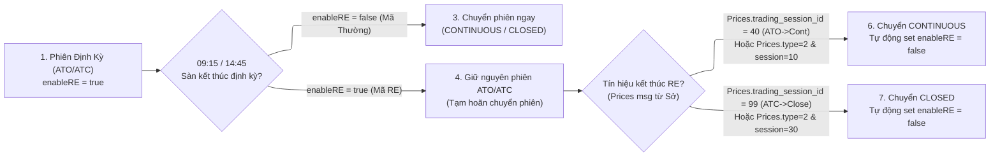

# Cấp Độ 2: Phiên Giao Dịch, Cờ Phiên & Lệnh Đặt

> **Thuộc:** [Cẩm Nang Nghiệp Vụ Chứng Khoán](../securities-domain-rules.md)

## 2. CẤP ĐỘ 2 (TRUNG CẤP): Phiên Giao Dịch, Cờ Phiên & Lệnh Đặt

### 2.1. Khung Thời Gian & Lịch Trình Các Phiên

```
  08:45     09:00       09:15   09:17      11:30    13:00              14:30       14:45   14:47     15:00
    |---------|-----------|-------|----------|--------|------------------|-----------|-------|---------|
    | Buy-in  | Phiên ATO |   RE  | Liên tục | Nghỉ   | Khớp liên tục    | Phiên ATC |   RE  | PLO     |
    | (G7)    | (G1/G4)   | (max) | sáng     | trưa   | chiều (G1/G4)    | (G1/G4)   | (max) | (HNX)   |
```

| Khung Giờ | Tên Phiên | Sàn Áp Dụng | Phương Thức Khớp | Lệnh Cho Phép |
|:---|:---|:---:|:---:|:---|
| **08:45 - 09:00** | Mua bắt buộc (Buy-in) | HoSE (Board G7) | Khớp lệnh định kỳ | LO, ATO, MP |
| **09:00 - 09:15**<br>*(kéo dài $\le$ 09:17:00)* | Định kỳ mở cửa (**ATO**)<br>*(Có cơ chế **Random End** $\le 2$ phút)* | HoSE | Khớp lệnh định kỳ | **ATO, LO** (Cấm sửa/hủy; cấm MTL/MP cho mã RE) |
| **09:00 - 11:30** | Khớp liên tục sáng | HNX, UpCoM | Khớp lệnh liên tục | LO, MP/MTL/MOK/MAK (HNX) |
| **09:15 - 11:30**<br>*(mã RE: ngay sau khi kết phiên RE)* | Khớp liên tục sáng | HoSE | Khớp lệnh liên tục | **LO, MP, MTL** |
| **11:30 - 13:00** | **Nghỉ trưa** | Toàn thị trường | Tạm dừng khớp lệnh | Hệ thống nhận/chờ lệnh |
| **13:00 - 14:30** | Khớp liên tục chiều | Toàn thị trường | Khớp lệnh liên tục | LO, MP (HoSE), MTL/MOK/MAK (HNX) |
| **14:30 - 14:45**<br>*(kéo dài $\le$ 14:47:00)* | Định kỳ đóng cửa (**ATC**)<br>*(Có cơ chế **Random End** $\le 2$ phút)* | HoSE, HNX | Khớp lệnh định kỳ | **ATC, LO** (Cấm sửa/hủy; cấm MTL/MP cho mã RE) |
| **14:45 - 15:00** | Khớp lệnh sau giờ (**PLO**) | HNX | Khớp lệnh liên tục | **PLO** (Khớp theo giá đóng cửa) |
| **09:00 - 15:00** | Giao dịch Thỏa thuận | Toàn thị trường | Thỏa thuận điện tử | Thỏa thuận (T1, T4) |

> ⚠️ **Đặc biệt lưu ý về Random End (RE):** Tại sàn HoSE, phiên ATO và ATC không kết thúc đồng loạt tại phút 15/phút 45 cho toàn bộ các mã. Các mã có biến động giá thỏa điều kiện kích hoạt RE sẽ kéo dài phiên định kỳ thêm tối đa **2 phút** (kết thúc ngẫu nhiên từ 09:15:00 đến 09:17:00 hoặc 14:45:00 đến 14:47:00). Chi tiết tại [Mục 2.7](#27-cơ-chế-khớp-lệnh-ngẫu-nhiên-random-end---re-theo-từng-mã-chứng-khoán).

### 2.2. Bảng Mã Cờ Phiên Chuẩn KRX (BoardEventID & SessionID)

Hệ thống MDDS của KRX bắn realtime các event thay đổi trạng thái phiên qua message `35=f` (Security Status) ở cấp độ Bảng/Sàn (`Board_Event`), đồng thời bắn `Symbol_Trading_Session` độc lập cho từng mã:

| BoardEventID | Tên Sự Kiện KRX | Ý Nghĩa Nghiệp Vụ | TradingSessionID (KRX Raw) | TradingSessionID (BE Enum Chuẩn Hóa) |
|:---|:---|:---|:---:|:---:|
| **GT1** | `GT Order Load` | Nạp các lệnh Good-Till-Date (GTC) đầu ngày | `01` | `1` (`TRADING_SESSION_ID_01`) |
| **AA1** | `Opening CA Open` | Bắt đầu nhận lệnh phiên ATO (09:00) | `10` | `2` (`TRADING_SESSION_ID_10`) |
| **BB1** | `Cont.A Open for Non-PCA` | Bắt đầu phiên Khớp lệnh liên tục sáng (09:15) | `40` | `7` (`TRADING_SESSION_ID_40`) |
| **AW8** | `Lunch Break` | Bắt đầu giờ nghỉ trưa (11:30) *(Sở không trả session ID)* | *null* | `15` (`TRADING_SESSION_ID_200`) |
| **AW9** | `Open after Lunch Break` | Kết thúc nghỉ trưa, vào liên tục chiều (13:00) *(Sở không trả)* | *null* | `16` (`TRADING_SESSION_ID_210`) |
| **BC1** | `Closing CA Open` | Bắt đầu nhận lệnh phiên ATC (14:30) | `30` | `6` (`TRADING_SESSION_ID_30`) |
| **AC2** | `Closing CA Execution` | Thực hiện khớp lệnh đóng cửa ATC (14:45) | `99` | `14` (`TRADING_SESSION_ID_99`) |
| **AB2** | `Board Trading Close` | Kết thúc toàn bộ giao dịch của bảng | `99` | `14` (`TRADING_SESSION_ID_99`) |
| **AQ3** | `Market Final Closing` | Đóng cửa toàn bộ hệ thống giao dịch | `99` | `14` (`TRADING_SESSION_ID_99`) |
| **CD1** | `PCA Open` | Mở phiên định kỳ nhiều đợt (Cổ phiếu Hạn chế GD) | `80` | `12` (`TRADING_SESSION_ID_80`) |
| **CD3** | `PCA Execution` | Khớp lệnh định kỳ nhiều đợt (15 phút/lần: 09:30, 09:45...) | `80` | `12` (`TRADING_SESSION_ID_80`) |
| **—** | `Order Accept Only` | Bắt đầu nhận lệnh sau giờ (10p đầu chỉ nhận lệnh Buy-in) | `60` | `10` (`TRADING_SESSION_ID_60`) |
| **—** | `Trading Halt` | Dừng giao dịch mã chứng khoán | `90` | `13` (`TRADING_SESSION_ID_90`) |

> 📌 **Chuyển dịch Kiến trúc phiên:** Hệ thống giao dịch hiện đại **KHÔNG** chỉ dựa vào `Board_Event.event_id` của sàn để xác định phiên cho toàn bộ cổ phiếu. Với cơ chế Random End của Sở, BE tổng hợp và phát topic `Symbol_Trading_Session` theo từng mã để phân phối phiên độc lập, bao gồm cờ `enableRE`.

### 2.3. Các Loại Lệnh Khớp Lệnh Cơ Sở (LO, ATO, ATC, MP, MTL, MOK, MAK, PLO)

#### 1. Ma Trận Hiệu Lực Lệnh Theo Sàn & Phiên Giao Dịch

| Loại Lệnh | Tên Nghiệp Vụ & Mô Tả | Sàn Áp Dụng | Phiên Cho Phép | Quy Tắc Nhập Giá & Khối Lượng | Đặc Tính Khớp & Hủy |
|:---|:---|:---:|:---:|:---|:---|
| **LO** (Limit Order) | Lệnh giới hạn: Mua với giá $\le$ giá đặt, Bán với giá $\ge$ giá đặt | HoSE, HNX, UPCoM | ATO, Liên tục, ATC | **Bắt buộc nhập giá** trong biên độ [Sàn, Trần] và đúng bước giá | Hiệu lực trong suốt ngày giao dịch cho đến khi khớp hết hoặc hết phiên/hủy |
| **ATO** (At-the-Opening) | Lệnh khớp tại giá mở cửa | HoSE (STO) | 09:00 - 09:15 | **Disable ô giá**, hệ thống tự động gán giá ATO | Ưu tiên khớp trước lệnh LO. Phần chưa khớp tự động hủy khi hết phiên ATO |
| **ATC** (At-the-Closing) | Lệnh khớp tại giá đóng cửa | HoSE, HNX | 14:30 - 14:45 | **Disable ô giá**, hệ thống tự động gán giá ATC | Ưu tiên khớp trước lệnh LO. Phần chưa khớp tự động hủy khi hết phiên ATC |
| **MP** (Market Price) | Lệnh thị trường HoSE | HoSE (STO) | Khớp liên tục | **Disable ô giá**, mua tại giá bán thấp nhất, bán tại giá mua cao nhất | Nếu chưa khớp hết, phần còn lại tự động chuyển thành lệnh LO tại mức giá kế tiếp |
| **MTL** (Market to Limit) | Lệnh thị trường chuyển sang giới hạn | HNX, HoSE (*) | Khớp liên tục | **Disable ô giá**, khớp theo giá tốt nhất của đối ứng | Phần chưa khớp hết chuyển thành lệnh LO tại mức giá khớp cuối cùng |
| **MOK** (Match or Kill) | Lệnh khớp toàn bộ hoặc hủy | HNX (STX) | Khớp liên tục | **Disable ô giá**, khớp toàn bộ khối lượng ngay tức thì | Nếu không khớp toàn bộ khối lượng ngay lập tức thì hệ thống hủy lệnh tức thì |
| **MAK** (Match and Kill) | Lệnh khớp và hủy phần còn lại | HNX (STX) | Khớp liên tục | **Disable ô giá**, khớp tối đa khối lượng có thể | Phần khối lượng còn lại chưa khớp lập tức bị hủy bỏ |
| **PLO** (Post Limit Order) | Lệnh khớp sau giờ | HNX (STX) | 14:45 - 15:00 | **Disable ô giá**, hệ thống tự động lấy Giá đóng cửa ATC | Khớp ngay khi có lệnh đối ứng cùng mức giá đóng cửa. Cấm sửa/hủy |

> (*) **Ghi chú chuẩn hóa HoSE:** Nền tảng giao dịch hỗ trợ lệnh MTL trên sàn HoSE để thay thế/bổ trợ cho lệnh MP truyền thống, tăng tính nhất quán trên nền tảng giao dịch.

#### 2. Quy Tắc Khối Lượng Tối Đa & Ràng Buộc Form Đặt Lệnh
* **Khối lượng tối đa 1 lệnh (`maxQuantityPerOrder`):**
  * Sàn HoSE: Tối đa **500,000 cổ phiếu / lệnh**.
  * Sàn HNX & UPCoM: Không giới hạn trần khối lượng cho 1 lệnh (chỉ bị giới hạn bởi sức mua / sức bán khả dụng).
* **Quy tắc Validate Frontend (Form Đặt Lệnh):**
  * Với các lệnh thị trường (`ATO`, `ATC`, `MP`, `MTL`, `MOK`, `MAK`, `PLO`): Ô nhập giá bị vô hiệu hóa (`disable`), giá trị lệnh tạm tính hiển thị là `-` (do giá khớp phụ thuộc vào khớp lệnh thị trường).
  * Với lệnh `LO`: Ô nhập giá bắt buộc phải có dữ liệu, nằm trong khoảng $[FloorPrice, CeilingPrice]$ và tuân thủ đúng bước giá (tick size).

---

### 2.4. Lệnh Giao Dịch Thỏa Thuận (Negotiation Orders - 1F & 2F)

Giao dịch thỏa thuận thực hiện trên bảng T1 (Lô chẵn) hoặc T4 (Lô lẻ), không tham gia vào sổ lệnh khớp liên tục của Sở:

| Loại Lệnh Thỏa Thuận | Tên Gọi & Đặc Điểm | Quy Trình Khởi Tạo & Xác Nhận | Trạng Thái Lệnh Tương Ứng |
|:---|:---|:---|:---|
| **Lệnh 1F (1 Firm)** | Thỏa thuận 1 bên (Quảng cáo chào mua / chào bán) | Bên khởi tạo gửi lệnh lên Sở (Mua hoặc Bán). Bên đối ứng quét thấy lệnh, tiến hành chấp thuận (`Accept`) hoặc từ chối (`Reject`). | Khởi tạo: `PendingNew`<br>Xác nhận: `Accepting`<br>Từ chối: `Rejecting`<br>Hủy: `PendingCancel` |
| **Lệnh 2F (2 Firms)** | Thỏa thuận 2 bên (Đã có sẵn đối tác cụ thể) | Hai bên mua và bán thống nhất trước mã, giá, khối lượng và số tài khoản đối ứng. Cả 2 bên cùng nhập lệnh đối ứng vào hệ thống. | Khởi tạo: `PendingNew`<br>Chờ đối ứng: `WaitToConfirm` (confirmation-request)<br>Khớp: `Filled`<br>Hủy: `Cancelled` |

* **Quy cách lô & biên độ thỏa thuận:**
  * Khối lượng tối thiểu: HoSE từ **20,000 CP** trở lên; HNX/UPCoM từ **5,000 CP** trở lên.
  * Mức giá thỏa thuận: Nằm trong biên độ Trần/Sàn của ngày, **không bắt buộc phải chia hết cho bước giá (tick size)**.

---

### 2.5. Lệnh Phái Sinh & Quản Trị Vị Thế Hợp Đồng Tương Lai (Derivatives Orders)

Giao dịch Hợp đồng tương lai Chỉ số (VN30F) trên sàn HNX Derivative (`DVX`):

1. **Loại lệnh áp dụng:** Cho phép `LO`, `MTL`, `MOK`, `MAK`, `ATC`.
2. **Chiều vị thế:**
   * Mua (`NB`): Mua mở vị thế Long (nếu chưa có vị thế hoặc đang có vị thế Long) HOẶC Mua đóng vị thế Short (nếu đang Short).
   * Bán (`NS`): Bán mở vị thế Short HOẶC Bán đóng vị thế Long.
3. **Các trường cọc quản trị tài sản Phái sinh:**
   * `orderSecure`: Tiền cọc tạm giữ cho các lệnh đang treo chờ khớp trên sổ lệnh.
   * `dealSecure`: Tiền cọc thực tế đang sử dụng cho các vị thế (Deal) đang mở.
   * `holdOvernightSecure`: Tỷ lệ/số tiền cọc bổ sung bắt buộc khi duy trì vị thế phái sinh qua đêm (tránh rủi ro gap giá ATO hôm sau).
4. **Ràng buộc Ngày Đáo Hạn (`DeListedDate`):** Mọi lệnh phái sinh (kể cả lệnh điều kiện nhiều ngày GTD) không được phép có thời hạn vượt quá ngày thứ Năm của tuần thứ 3 trong tháng đáo hạn của hợp đồng.

---

### 2.6. Quy Chuẩn Sửa Lệnh & Hủy Lệnh Chi Tiết (Amend & Cancel Rules)

#### 1. Ma Trận Điều Kiện Sửa Lệnh (Replace Order Rules - Chuẩn ORS/OpenAPI)

| Tiêu Chí Kiểm Tra | Trường Hợp Cho Phép Sửa (Pass) | Trường Hợp Bị Từ Chối (Reject) |
|:---|:---|:---|
| **Trạng Thái Lệnh Hiện Tại** | **CHỈ** khi lệnh đang ở trạng thái `New` hoặc `PartiallyFilled` | Khi lệnh ở trạng thái: `Filled`, `Rejected`, `PendingNew`, `PendingReplace`, `PendingCancel`, `Cancelled`, `Expired` |
| **Loại Lệnh & Phiên** | **CHỈ** cho phép sửa lệnh **`LO` trong Phiên Khớp Lệnh Liên Tục** | Sửa lệnh LO ngoài phiên liên tục (phiên ATO, ATC, ngoài giờ); Hoặc sửa bất kỳ lệnh thị trường nào (`ATO`, `ATC`, `MP`, `MTL`, `MOK`, `MAK`, `PLO`) |
| **Khối Lượng Sửa (`newQuantity`)** | Bắt buộc: $\mathbf{newQuantity > filledQuantity}$ (Khối lượng mới phải lớn hơn khối lượng đã khớp) | Khối lượng mới $\le$ khối lượng đã khớp ($\mathbf{newQuantity \le filledQuantity}$) |
| **Mức Giá Sửa (`newPrice`)** | $\text{FloorPrice} \le newPrice \le \text{CeilingPrice}$ và đúng bước giá sàn | Mức giá nằm ngoài biên độ trần/sàn hoặc sai bước giá (lẻ tick size) |
| **Ràng Buộc Sức Mua / Sức Bán** | - Mua (NB): $newQuantity \le qmaxBuy$ (tính lại theo giá mới)<br>- Bán (NS): $newQuantity \le tradeQuantity$ (khả dụng) | Khối lượng mới hoặc giá mới làm vượt quá sức mua/bán khả dụng của tài khoản |
| **Điều Chỉnh Đồng Thời** | Cho phép sửa riêng Giá HOẶC riêng Khối lượng; Nếu sửa cả hai phải đồng thời thỏa mãn sức mua và biên độ | Sửa cả Giá và Khối lượng vượt quá sức mua/bán |

#### 2. Quy Tắc Ưu Tiên Thời Gian Khi Sửa Lệnh
* **Sửa GIẢM khối lượng:** Khối lượng giảm đi được cắt bớt trực tiếp, **giữ nguyên độ ưu tiên về thời gian** xếp hàng tại SGDCK của phần khối lượng còn lại.
* **Sửa TĂNG khối lượng HOẶC SỬA GIÁ:** Lệnh cũ bị hủy và phát sinh một lệnh mới với độ ưu tiên thời gian được tính lại tại thời điểm SGDCK tiếp nhận lệnh sửa $\implies$ **Mất toàn bộ quyền ưu tiên thời gian cũ**.

#### 3. Quy Tắc Bất Khả Xâm Phạm Về Hủy Lệnh
* **Phiên ATO (09:00 - 09:15) và Phiên ATC (14:30 - 14:45) trên HoSE:** **TUYỆT ĐỐI CẤM SỬA VÀ CẤM HỦY** đối với 100% các loại lệnh (kể cả lệnh LO đặt từ trước hoặc lệnh ATO/ATC).
* **Giai Đoạn Kéo Dài Random End (09:15:00 - 09:17:00 và 14:45:00 - 14:47:00):** Với các mã chứng khoán đang chạy Random End (`enableRE = true`), **TIẾP TỤC DUY TRÌ LỆNH CẤM SỬA VÀ CẤM HỦY TUYỆT ĐỐI** cho đến khi mã chính thức khớp lệnh ngẫu nhiên và chuyển phiên! Bất kỳ yêu cầu sửa/hủy nào gửi lên Sở trong khoảng thời gian này đều bị Gateway/ORS từ chối lập tức.
* **Phiên PLO trên HNX (14:45 - 15:00):** **TUYỆT ĐỐI CẤM HỦY** lệnh PLO sau khi đã được hệ thống tiếp nhận.
* Chỉ cho phép hủy phần khối lượng **chưa khớp** của lệnh đang ở trạng thái `New` hoặc `PartiallyFilled` trong phiên Khớp lệnh liên tục.

---

### 2.7. Cơ Chế Khớp Lệnh Ngẫu Nhiên (Random End - RE) Theo Từng Mã Chứng Khoán

#### 1. Khái Niệm & Mục Tiêu Nghiệp Vụ
Cơ chế **Khớp Lệnh Ngẫu Nhiên (Random End - RE)** là tính năng cốt lõi trên hệ thống KRX nhằm:
* **Triệt tiêu hiện tượng thao túng giá cuối phiên (Sniping / Last-second order manipulation):** Ngăn chặn các đối tượng gom hoặc xả lệnh quy mô lớn ở những giây cuối cùng của phiên khớp lệnh định kỳ (09:14:59 hoặc 14:44:59) để bóp méo giá mở cửa/đóng cửa.
* **Cơ chế kéo dài ngẫu nhiên:** Thay vì kết thúc chính xác tại 09:15:00 (ATO) hoặc 14:45:00 (ATC), phiên định kỳ của các mã thỏa điều kiện sẽ được kéo dài thêm **tối đa 2 phút** (kết thúc ngẫu nhiên trong khoảng 09:15:00 - 09:17:00 hoặc 14:45:00 - 14:47:00, cũng như các phiên PCA định kỳ 15 phút của cổ phiếu hạn chế giao dịch).
* **Độc lập theo từng mã (Per-symbol Session State):** Mỗi cổ phiếu có thể kết thúc phiên định kỳ tại các thời điểm hoàn toàn khác nhau. Thời điểm bắt đầu phiên Liên tục của mã đó sẽ diễn ra **ngay lập tức sau khi mã đó kết thúc phiên RE**.
  > **Ví dụ thực tế:** Cùng trên sàn HoSE:
  > - Mã `MBB` kết thúc RE phiên ATO lúc `09:16:00` $\implies$ `09:16:01` chuyển sang Liên tục.
  > - Mã `ACB` kết thúc RE phiên ATO lúc `09:16:53` $\implies$ `09:16:54` mới chuyển sang Liên tục.
  > - Trong khoảng `09:16:01 - 09:16:53`, nhà đầu tư giao dịch `MBB` được đặt lệnh MTL/MP và sửa/hủy LO; trong khi `ACB` vẫn đang ở phiên ATO, cấm MTL/MP và cấm sửa/hủy!

---

#### 2. Đặc Tả Giao Thức KRX FIX MDDS (Message Specifications)
SGDCK truyền dữ liệu Random End qua 2 bản tin chuẩn FIX:

##### A. Bản tin Định nghĩa Chứng khoán (`Security Definition` - MsgType `d` / `IFMDFIX0001`)
Khai báo trước điều kiện kích hoạt RE cho từng mã đầu ngày qua Tag `RandomEndTriggeringConditionCode` (Tag `30614`):
* `0` = **Not Trigger:** Không áp dụng cơ chế Random End cho mã này.
* `1` = **Unconditional Trigger:** Kích hoạt RE vô điều kiện tại cuối phiên định kỳ.
* `2` = **Conditional Trigger:** Kích hoạt RE có điều kiện — Sở tự động kiểm tra chênh lệch giữa Giá khớp dự kiến (`RandomEndTentativeExecutionPrice`) và Giá khớp gần nhất (`LatestPrice`). Nếu vượt ngưỡng quy định ("Random End Rule") của Sở $\implies$ Kích hoạt RE.

##### B. Bản tin Sự Kiện Random End (`Random End` - MsgType `MW` / `IFMDFIX0023`)
Bắn realtime khi sự kiện Random End bắt đầu hoặc kết thúc:

| Tag FIX | Tên Trường | Kiểu Dữ Liệu | Giá Trị & Ý Nghĩa Nghiệp Vụ |
|:---:|:---|:---:|:---|
| **`30001`** | `MarketID` | String(3) | Mã thị trường: `STO` (HoSE), `STX` (HNX), `DVX` (Phái sinh)... |
| **`20004`** | `BoardID` | String(2) | Mã bảng: `G1` (Main), `G4` (Odd-lot), `AL` (All boards) |
| **`55`** | `Symbol` | String(12) | Mã chứng khoán |
| **`60`** | `TransactTime` | UTCTime(9) | Thời điểm phát sinh (`HHmmssSSS`) |
| **`30615`** | `RandomEndApplyClassification` | String(1) | **Mã phân loại áp dụng/giải tỏa RE:**<br>- `1`: Kích hoạt RE phiên mở cửa (Opening CA RE set)<br>- `2`: Giải tỏa RE phiên mở cửa (Opening CA RE release)<br>- `3`: Kích hoạt RE phiên đóng cửa (Closing CA RE set)<br>- `4`: Giải tỏa RE phiên đóng cửa (Closing CA RE release)<br>- `5`: Kích hoạt RE phiên sau giờ (Post-market RE set)<br>- `6`: Giải tỏa RE phiên sau giờ (Post-market RE release) |
| **`30616`** | `RandomEndTentativeExecutionPrice` | Price | Giá khớp lệnh dự kiến tại thời điểm áp dụng RE |
| **`30617`** | `RandomEndEstimatedHighestPrice` | Price | Giá khớp lệnh dự kiến cao nhất trong phiên RE |
| **`30618`** | `RandomEndEstimatedHighestPriceDisparateRatio` | Float | Tỷ lệ chênh lệch giữa giá cao nhất và giá dự kiến |
| **`30619`** | `RandomEndEstimatedLowestPrice` | Price | Giá khớp lệnh dự kiến thấp nhất trong phiên RE |
| **`30620`** | `RandomEndEstimatedLowestPriceDisparateRatio` | Float | Tỷ lệ chênh lệch giữa giá thấp nhất và giá dự kiến |
| **`30621`** | `LatestPrice` | Price | Giá khớp cuối cùng trước phiên khớp lệnh định kỳ |
| **`30622`** | `LatestPriceDisparateRatio` | Float | Tỷ lệ chênh lệch giữa giá cuối cùng và giá dự kiến |
| **`30623`** | `RandomEndReleaseTime` | String(9) | Thời gian giải tỏa Random End từ Sở (`HHmmssSSS`) |

---

#### 3. Tiêu Chí Nhận Diện Mã Có Random End Tại Backend CTCK
Hệ thống MDDS Engine xác định trạng thái Random End (`enableRE = true/false`) theo ma trận quy tắc:

1. **Phạm vi sàn áp dụng:**
   - **HOSE (STO, `marketId = 6`):** Áp dụng đầy đủ cơ chế Random End.
   - **Các sàn khác (HNX `marketId = 7`, UPCoM `marketId = 8`, DVX `marketId = 3`, HCX):** Mặc định **`enableRE = false`** và không áp dụng logic trì hoãn chuyển phiên.
2. **Điều kiện xác định `enableRE`:**
   - **Trong phiên ATO:** Khi mã có giá dự khớp `expected_price != 0` trong message `Deem_Trade_Price` $\implies$ Đánh dấu `enableRE = true`.
   - **Trong phiên ATC:** Khi mã có `expected_price != 0` VÀ khối lượng dự khớp `expected_quantity != 0` trong message `Deem_Trade_Price` $\implies$ Đánh dấu `enableRE = true`.
   - **Trường hợp ngược lại:** Nếu mã không có `expected_price` hoặc `expected_price == 0` $\implies$ Đánh dấu `enableRE = false` (Mã giao dịch bình thường).

---

#### 4. Máy Trạng Thái Chuyển Phiên Theo Từng Mã (`Symbol_Trading_Session` FSM)



##### Chi Tiết Kịch Bản Chuyển Phiên (Gherkin Scenarios Chuẩn ORS/BE):
1. **Mã Không Có Random End (`enableRE = false`):**
   - Khi sàn phát `Board_Event` phiên Liên tục (09:15) $\implies$ `Symbol_Trading_Session` của mã lập tức cập nhật thành `CONTINUOUS`.
   - Khi sàn phát `Board_Event` phiên Đóng cửa (14:45) $\implies$ `Symbol_Trading_Session` của mã lập tức cập nhật thành `CLOSED`.
2. **Mã Có Random End (`enableRE = true`):**
   - Khi sàn phát `Board_Event` phiên Liên tục lúc 09:15 $\implies$ Mã **CHƯA** chuyển sang `CONTINUOUS`, tiếp tục giữ trạng thái `ATO` (`tradingSessionId = 2`).
   - Mã chuyển từ `ATO` sang `CONTINUOUS` **KHI VÀ CHỈ KHI** thỏa mãn 1 trong 2 điều kiện:
     * Nhận được message `Prices` có `trading_session_id = 40`; HOẶC
     * Nhận được message `Prices` có `type = 2` (Giao dịch khớp lệnh) và `trading_session_id = 10`.
   - Khi sàn phát `Board_Event` phiên Đóng cửa lúc 14:45 $\implies$ Mã **CHƯA** chuyển sang `CLOSED`, tiếp tục giữ trạng thái `ATC` (`tradingSessionId = 6`).
   - Mã chuyển từ `ATC` sang `CLOSED` **KHI VÀ CHỈ KHI** thỏa mãn 1 trong 2 điều kiện:
     * Nhận được message `Prices` có `trading_session_id = 99`; HOẶC
     * Nhận được message `Prices` có `type = 2` và `trading_session_id = 30`.
3. **Quy Tắc Tự Động Reset `enableRE = false`:**
   - Ngay khi mã RE chuyển phiên thành công (sang `CONTINUOUS` hoặc `CLOSED`) $\implies$ Hệ thống **BẮT BUỘC tự động set `enableRE = false`** trong message mới.
   - *Mục đích:* Ngăn ngừa lỗi lưu vết cờ RE từ phiên sáng (ATO) sang phiên chiều (ATC) làm đánh dấu sai phiên của mã.
4. **Xử Lý Thứ Tự Message Không Theo Trình Tự (Out-of-Order Message Resilience):**
   - Hệ thống tiếp nhận đồng thời từ 3 nguồn: `Board_Event`, `Prices` và `Deem_Trade_Price`. Khi các message này đến lệch thứ tự mạng, trạng thái cuối cùng của `Symbol_Trading_Session` của từng mã vẫn phải hội tụ về đúng phiên thực tế dựa trên điều kiện RE của mã đó.

---

#### 5. Ma Trận Ràng Buộc Đặt Lệnh, Sửa/Hủy Trong Giai Đoạn Random End

Trong suốt thời gian mã chứng khoán đang chạy Random End (sau 09:15 đến khi khớp ATO, hoặc sau 14:45 đến khi khớp ATC):

| Nghiệp Vụ | Quy Tắc Thực Thi Trong Giai Đoạn Random End | Hậu Quả Nếu Vi Phạm |
|:---|:---|:---|
| **Đặt Lệnh Giới Hạn (`LO`)** | **CHO PHÉP.** Lệnh tham gia vào sổ lệnh chờ khớp của phiên định kỳ mở rộng. | Nhận vào sổ lệnh bình thường. |
| **Đặt Lệnh Định Kỳ (`ATO` / `ATC`)** | **CHO PHÉP.** Vẫn tiếp tục nhận thêm lệnh ATO (trong khoảng 09:15-09:17) hoặc lệnh ATC (trong khoảng 14:45-14:47). | Nhận vào sổ lệnh, ưu tiên khớp tại giá ngẫu nhiên. |
| **Đặt Lệnh Thị Trường (`MTL`, `MP`, `PLO`)** | **TUYỆT ĐỐI CẤM.** Vì mã chưa vào phiên Khớp lệnh liên tục. | FE disable/chặn trước; Nếu lọt qua ORS/Sở sẽ trả lỗi từ chối lệnh (`Order Rejected - Invalid Session`). |
| **Sửa Lệnh (`Replace Order`)** | **TUYỆT ĐỐI CẤM.** Áp dụng toàn bộ quy tắc bất khả xâm phạm của phiên định kỳ. | Bị Gateway/Sở từ chối lệnh sửa ngay lập tức. |
| **Hủy Lệnh (`Cancel Order`)** | **TUYỆT ĐỐI CẤM.** Không cho phép hủy bất kỳ lệnh LO/ATO/ATC nào đã đặt trước đó. | Bị Gateway/Sở từ chối lệnh hủy ngay lập tức. |

---

#### 6. Quy Chuẩn Hiển Thị Giao Diện UI/UX (Frontend Web & App)

##### A. Dấu Hiệu Nhận Biết Mã RE Cho Frontend
Frontend lắng nghe kết hợp từ 2 nguồn dữ liệu realtime:
1. **`Symbol_Trading_Session`:** Xác định phiên khớp lệnh định kỳ qua `tradingSessionId`:
   - `TRADING_SESSION_ID_10` (`2`): Phiên ATO.
   - `TRADING_SESSION_ID_30` (`6`): Phiên ATC.
   - `TRADING_SESSION_ID_80` (`12`): Phiên PCA (Hạn chế giao dịch).
2. **`Stock_infor` / `Deem_Trade_Price`:** Kiểm tra trường `expected_price > 0`.
$\implies$ Khi đồng thời thỏa mãn: Đang trong phiên định kỳ VÀ `expected_price > 0` $\implies$ Kích hoạt giao diện Random End cho mã.

##### B. Vị Trí & Quy Tắc Hiển Thị Icon `RE`
* **Vị trí hiển thị:** Xuất hiện tại mọi màn hình có mã chứng khoán:
  * Màn hình Chi tiết mã / Chi tiết sổ lệnh / Chi tiết sở hữu: Hiển thị icon `RE` cạnh icon Giá khớp.
  * Danh sách theo dõi (Watchlist), Màn hình Khám phá, Kết quả tìm kiếm mã, Sổ lệnh và Danh mục sở hữu.
* **Quy tắc xếp chồng icon (Icon Stacking Rules):**
  * Tối đa hiển thị cùng lúc: **2 icon**.
  * Vị trí hiển thị từ trái sang phải: `Tag 5.99%` $\rightarrow$ `Bóng đèn` $\rightarrow$ `Event` $\rightarrow$ `Warning` $\rightarrow$ `RE`.
  * **Thứ tự ưu tiên hiển thị (Độ quan trọng):**
    $$\mathbf{Warning} > \mathbf{RE} > \mathbf{Event} > \mathbf{Tag\ 5.99\%} > \mathbf{Bóng\ đèn}$$
    *(Lý do icon RE được ưu tiên cao thứ nhì: RE chỉ tồn tại tối đa 2 phút trong phiên định kỳ rồi biến mất, cần nổi bật để nhà đầu tư biết lý do chưa thể đặt lệnh MTL/MP).*
* **Nội dung Tooltip chuẩn khi hover/click vào icon `RE`:**
  > *"Mã chứng khoán đang trong giai đoạn **Khớp lệnh ngẫu nhiên (Random End)** của phiên ATO/ATC (kéo dài tối đa 2 phút). Trong giai đoạn này, Quý khách chỉ có thể đặt lệnh ATO/ATC/LO, không thể đặt lệnh thị trường (MTL/MP) và không thể sửa/hủy lệnh cho đến khi phiên kết thúc."*
* **Cơ chế tự động ẩn icon:** Ngay khi mã kết thúc RE và chuyển sang phiên Liên tục / Đóng cửa $\implies$ Icon `RE` lập tức biến mất khỏi giao diện.

---

#### 7. Kiến Trúc Data Model & WebSocket Datafeed

##### A. Cấu Trúc Kafka & WebSocket Topic Mới
* **Thay thế topic cũ cấp sàn:** `quotes/krx/mdds/boardevent/v1/...`
* **Chuẩn topic mới theo từng mã:**
  ```
  quotes/krx/mdds/symbol-trading-session/v1/roundlot/symbol/{symbol}
  quotes/krx/mdds/symbol-trading-session/v1/oddlot/symbol/{symbol}
  quotes/krx/mdds/symbol-trading-session/v1/roundlotputthrough/symbol/{symbol}
  quotes/krx/mdds/symbol-trading-session/v1/oddlotputthrough/symbol/{symbol}
  ```

##### B. Cấu Trúc Data Model `SymbolTradingSession` (Protobuf / JSON)
```json
{
  "marketId": 6,
  "boardId": 2,
  "symbol": "ACB",
  "sendingTime": {
    "seconds": 1783669500,
    "nanos": 464000000
  },
  "tradingSessionId": 2,
  "boardIdOriginal": 2,
  "enableRE": true
}
```

##### C. Danh Mục Toàn Diện Enum `TradingSessionID` (Protobuf Backend & Frontend)
```protobuf
enum TradingSessionID {
  TRADING_SESSION_ID_UNSPECIFIED = 0;
  TRADING_SESSION_ID_01 = 1;   // GT Order Load (Nạp lệnh GTC)
  TRADING_SESSION_ID_10 = 2;   // Opening Call Auction (Phiên ATO)
  TRADING_SESSION_ID_11 = 3;   // Opening Call Auction Extension (Chưa dùng)
  TRADING_SESSION_ID_20 = 4;   // Call Auction after Halt (Định kỳ sau giải tỏa Halt)
  TRADING_SESSION_ID_21 = 5;   // Call Auction after Halt Extension (Chưa dùng)
  TRADING_SESSION_ID_30 = 6;   // Closing Call Auction (Phiên ATC)
  TRADING_SESSION_ID_40 = 7;   // Continuous Auction (Phiên Khớp lệnh liên tục)
  TRADING_SESSION_ID_50 = 8;   // Volatility Interruption (VI) Call Auction (Định kỳ ngắt biến động giá)
  TRADING_SESSION_ID_51 = 9;   // VI Call Auction Extension (Chưa dùng)
  TRADING_SESSION_ID_60 = 10;  // Order Accept Only (Bắt đầu nhận lệnh sau giờ / Buy-in)
  TRADING_SESSION_ID_70 = 11;  // Unused
  TRADING_SESSION_ID_80 = 12;  // Periodic Call Auction (PCA lô chẵn CK hạn chế giao dịch)
  TRADING_SESSION_ID_90 = 13;  // Trading Halt (Tạm dừng giao dịch mã chứng khoán)
  TRADING_SESSION_ID_99 = 14;  // Board Closing (Đóng bảng / Kết phiên)
  TRADING_SESSION_ID_200 = 15; // NOON_BREAK (Bắt đầu nghỉ trưa - map từ AW8)
  TRADING_SESSION_ID_210 = 16; // END_NOON_BREAK (Bắt đầu liên tục chiều - map từ AW9)
}
```

##### D. Cơ Chế Fallback Phiên An Toàn (Safe Session Fallback)
Khi xảy ra các trường hợp biên (Edge cases):
1. `tradingSessionId = null` hoặc không có trong danh mục mapping;
2. Mất kết nối hoặc không nhận được message `Symbol_Trading_Session`;
$\implies$ Client tự động **fallback về trạng thái phiên Khớp lệnh liên tục (Continuous)** và mở đầy đủ các loại lệnh mặc định theo từng sàn:
* **HoSE (STO):** `[LO, MTL, ATO, ATC]`
* **HNX (STX):** `[LO, MTL, ATC, MOK, MAK, PLO]`
* **UPCoM (UPX):** `[LO]`
* **Phái sinh (FIO):** `[LO, MTL, ATO, ATC, MOK, MAK]`
* **Trái phiếu (HCX):** `[LO]`

---

