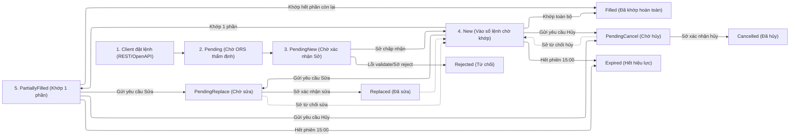

# Cấp Độ 3: Vòng Đời Lệnh, Trạng Thái & Lệnh Điều Kiện

> **Thuộc:** [Cẩm Nang Nghiệp Vụ Chứng Khoán](../securities-domain-rules.md)

## 3. CẤP ĐỘ 3 (TRUNG CẤP): Vòng Đời Lệnh, Trạng Thái & Lệnh Điều Kiện

### 3.1. Máy Trạng Thái Vòng Đời Lệnh Toàn Trình (Order State Machine)

Hệ thống giao dịch (OMS/ORS, Gateway Sở và OpenAPI) vận hành máy trạng thái hữu hạn (FSM) chặt chẽ cho từng vòng đời lệnh:



* **Nguyên tắc bất biến của các trạng thái kết thúc (Terminal States):**
  * Các trạng thái `Filled`, `Cancelled`, `Rejected`, `Expired` là **trạng thái cuối cùng (Terminal)**. Một khi lệnh đã chuyển sang một trong các trạng thái này, hệ thống **TUYỆT ĐỐI KHÔNG ĐƯỢC PHÉP** chuyển sang bất kỳ trạng thái nào khác.
  * Mọi yêu cầu sửa hoặc hủy gửi đến lệnh đã ở trạng thái Terminal đều bị từ chối ngay lập tức tại tầng ORS Gateway.

---

### 3.2. Bảng Ánh Xạ Trạng Thái Lệnh Đa Tầng (Multi-Tier Order Status Mapping)

Sự đồng bộ trạng thái xuyên suốt giữa hệ thống Core Brokerage (FIX Protocol), dịch vụ OpenAPI V2, WebSocket Realtime Topic và Giao diện Sổ Lệnh (Web/App UI - Chuẩn hóa theo ticket `G3PTP-7070`, `G3PTP-17152`, `G3PTP-13773`):

| Trạng Thái Core / FIX (Tag 39) | OpenAPI V2 Enum | WebSocket Event Status | Hiển Thị Sổ Lệnh UI | Ý Nghĩa Nghiệp Vụ | Trạng Thái Cuối (Terminal)? |
|:---:|:---:|:---:|:---:|:---|:---:|
| `Pending` | `PENDING` | `Pending` | **Chờ gửi** | Lệnh đang được xử lý kiểm tra sức mua, ký số SmartOTP và định tuyến nội bộ | Không |
| `PendingNew` (A) | `PENDING_NEW` | `PendingNew` | **Chờ khớp** | Lệnh đã gửi sang Gateway của SGDCK, đang chờ bản tin ACK phản hồi | Không |
| `New` (0) | `NEW` | `New` | **Chờ khớp** | SGDCK đã xác nhận lệnh hợp lệ và xếp vào Sổ lệnh chờ khớp của sàn | Không |
| `PartiallyFilled` (1) | `PARTIALLY_FILLED` | `PartiallyFilled` | **Khớp 1 phần** | Một phần khối lượng đã khớp thành công, phần còn lại vẫn nằm trên sổ lệnh | Không |
| `Filled` (2) | `FILLED` | `Filled` | **Đã khớp** | Khớp hoàn toàn $100\%$ khối lượng đặt | **Có** |
| `PendingReplace` (E) | `PENDING_REPLACE` | `PendingReplace` | **Chờ sửa** | Đang gửi yêu cầu sửa giá/khối lượng lên Sở, chờ xác nhận | Không |
| `Replaced` (5) | `REPLACED` | `Replaced` | **Chờ khớp** | Sở xác nhận sửa thành công, lệnh mang mức giá hoặc khối lượng mới | Không |
| `PendingCancel` (6) | `PENDING_CANCEL` | `PendingCancel` | **Chờ hủy** | Đang gửi yêu cầu hủy khối lượng chưa khớp lên Sở, chờ xác nhận | Không |
| `Cancelled` (4) | `CANCELLED` | `Cancelled` | **Đã hủy** | Sở xác nhận hủy thành công khối lượng chưa khớp | **Có** |
| `Rejected` (8) | `REJECTED` | `Rejected` | **Bị từ chối** | Lệnh bị từ chối bởi hệ thống quản trị rủi ro ORS hoặc bởi SGDCK (kèm mã lỗi) | **Có** |
| `Expired` (C) / `DoneForDay` (3) | `EXPIRED` | `Expired` | **Hết hiệu lực** | Lệnh chưa khớp hết thời hạn phiên trong ngày (Gộp chung hiển thị trên UI) | **Có** |
| `WaitToConfirm` | `WAIT_TO_CONFIRM` | `WaitToConfirm` | **Chờ xác nhận** | Lệnh thỏa thuận 2F đang chờ đối tác nhập lệnh đối ứng xác nhận | Không |
| `Accepting` | `ACCEPTING` | `Accepting` | **Đang xác nhận** | Bên đối tác đang tiến hành chấp thuận lệnh thỏa thuận 1F | Không |
| `Rejecting` | `REJECTING` | `Rejecting` | **Đang từ chối** | Bên đối tác từ chối lệnh thỏa thuận 1F | Không |

---

### 3.3. Danh Mục 15 Mã Lỗi Đặt Lệnh ORS & Quy Tắc Xử Lý Frontend/Backend

Khi gọi API Đặt lệnh (`POST /order-service/v2/orders`), hệ thống ORS (Order Routing System) thực hiện thẩm định và trả về các mã lỗi chuẩn sau (theo tài liệu Confluence `4786356229`):

| Mã Lỗi Backend (ORS Code) | Diễn Giải Nghiệp Vụ Cụ Thể | Thông Báo Toast Web/App | Hành Vi Xử Lý Hệ Thống |
|:---|:---|:---|:---|
| `INVALID_INPUT: cash not enough` | Sức mua khả dụng ($PP0$) của tài khoản không đủ để thanh toán giá trị lệnh mua | "Vượt quá khối lượng được giao dịch" | Chặn đặt lệnh, hiển thị Toast đỏ |
| `TRADE_QUANTITY_NOT_ENOUGH` | Khối lượng chứng khoán khả dụng bán (`tradeQuantity`) nhỏ hơn khối lượng đặt | "Vượt quá khối lượng được giao dịch" | Chặn đặt lệnh, hiển thị Toast đỏ |
| `PRICE_MUST_GREATER_THAN_OR_EQUAL_TO_FLOOR_PRICE` | Mức giá đặt nhỏ hơn Giá sàn của mã trong ngày | "Giá ngoài biên độ" | Trong phiên: Báo lỗi.<br>Ngoài phiên: Fallback sang lệnh 24/7 |
| `PRICE_MUST_LESS_THAN_OR_EQUAL_TO_CEILING_PRICE` | Mức giá đặt lớn hơn Giá trần của mã trong ngày | "Giá ngoài biên độ" | Trong phiên: Báo lỗi.<br>Ngoài phiên: Fallback sang lệnh 24/7 |
| `INVALID_QUANTITY` | Khối lượng $= 0$, âm, lẻ lô hoặc vượt quá $500,000$ CP trên sàn HoSE | "Khối lượng không hợp lệ" | Trong phiên: Báo lỗi.<br>Ngoài phiên: Fallback sang lệnh 24/7 |
| `CAN_NOT_PLACE_ORDER_ON_THIS_SESSION` | Loại lệnh không tương thích với phiên hiện tại (vd: đặt ATO trong phiên liên tục) | Không hiện lỗi | **Tự động Fallback sang Lệnh 24/7** (`SESSION_ACTIVE`) |
| `CANNOT_PLACE_ORDER_IN_THE_CLOSED_SESSION` | Đặt lệnh khi thị trường đã đóng cửa (buổi tối, cuối tuần) | Không hiện lỗi | **Tự động Fallback sang Lệnh 24/7** (`SESSION_ACTIVE`) |
| `CANNOT_PLACE_ORDER_IN_THE_HALT_SESSION` | Đặt lệnh khi toàn thị trường/bảng đang tạm ngưng giao dịch (Halt) | "Phiên giao dịch tạm ngưng" | **Tự động Fallback sang Lệnh 24/7** (`SESSION_ACTIVE`) |
| `CAN_NOT_PLACE_ORDER_ON_HALTED_SYMBOL` | Mã chứng khoán bị Sở tạm ngừng giao dịch khẩn cấp | "Mã chứng khoán tạm ngưng giao dịch" | **Tự động Fallback sang Lệnh 24/7** (`SYMBOL_ACTIVE`) |
| `CAN_NOT_PLACE_ORDER_ON_UNLISTED_SYMBOL` | Mã chứng khoán bị hủy niêm yết hoặc mã không tồn tại trên hệ thống | "Mã chứng khoán không hợp lệ" | Chặn đặt lệnh, hiển thị Toast đỏ |
| `BATCH_IN_PROGRESS` | Hệ thống đang chạy batch quyết toán và đồng bộ dữ liệu cuối ngày (EOD) | "Hệ thống đang xử lý, vui lòng thử lại sau" | **Tự động Fallback sang Lệnh 24/7** (`SESSION_ACTIVE`) |
| `INVALID_OTP` | Mã SmartOTP hoặc SMS OTP người dùng nhập không chính xác | "Mã OTP không hợp lệ" | Giữ nguyên popup cho phép người dùng nhập lại OTP |
| `OTP_EXPIRED` | Mã OTP đã quá thời gian hiệu lực quy định | "Mã OTP đã hết hạn, vui lòng lấy mã mới" | Cho phép gửi lại mã OTP mới |
| `ACCOUNT_LOCKED` | Tài khoản của khách hàng bị khóa giao dịch (theo yêu cầu rủi ro/pháp lý) | "Tài khoản bị khóa giao dịch" | Chặn toàn bộ thao tác đặt lệnh |
| `INTERNAL_SERVER_ERROR` | Sự cố kết nối cơ sở dữ liệu hoặc lỗi không mong đợi tại backend | "Đã có lỗi xảy ra, vui lòng thử lại" | Ghi log TraceID và bắn cảnh báo Mattermost |

---

### 3.4. Cơ Chế Tự Động Fallback Lệnh 24/7 (Session-Active & Symbol-Active)

Để mang lại trải nghiệm giao dịch liên tục không gián đoạn, hệ thống triển khai cơ chế **Tự động Fallback Lệnh 24/7**:

1. **Nguyên lý hoạt động:**
   * Khi người dùng đặt lệnh thường thông qua Web/App/OpenAPI ngoài giờ giao dịch hoặc khi thị trường tạm ngưng, thay vì từ chối lệnh, Client và ORS tự động bắt các mã lỗi ngoài giờ (`CANNOT_PLACE_ORDER_IN_THE_CLOSED_SESSION`, `CAN_NOT_PLACE_ORDER_ON_THIS_SESSION`, `CANNOT_PLACE_ORDER_IN_THE_HALT_SESSION`, `BATCH_IN_PROGRESS`, `CAN_NOT_PLACE_ORDER_ON_HALTED_SYMBOL`).
   * Hệ thống tự động chuyển tiếp request sang dịch vụ Lệnh Điều Kiện (`POST /order-service/conditional-orders`) với `orderCategory = TRADING_EVENT`.
2. **Phân loại Trigger Type:**
   * **`SESSION_ACTIVE`:** Áp dụng khi lệnh đặt ngoài giờ, giờ nghỉ trưa hoặc khi sàn Halt. Lệnh được lưu an toàn trong hệ thống; ngay khi thị trường mở cửa phiên giao dịch tiếp theo (09:00 sáng hoặc 13:00 chiều), hệ thống tự động sinh Target Order đẩy thẳng vào Sở.
   * **`SYMBOL_ACTIVE`:** Áp dụng khi đặt lệnh cho mã chứng khoán đang bị tạm ngưng giao dịch (`EI8`). Ngay khi Sở phát cờ gỡ tạm ngưng (`EI1`/`EI9`), hệ thống tự động kích hoạt lệnh lên sàn.
3. **Quy tắc biên phiên:**
   * Trong phiên giao dịch chính thức (sau khi tiến trình BOD hoàn tất), các lỗi về Giá (ngoài trần/sàn) và Khối lượng (lẻ lô, âm) sẽ báo lỗi trực tiếp cho người dùng, **tuyệt đối không fallback sang 24/7** để đảm bảo tính kỷ luật giá trong phiên.

---

### 3.5. Hệ Thống Lệnh Điều Kiện Chuyên Sâu (Conditional Order Engine)

Theo tài liệu đặc tả kiến trúc dịch vụ Lệnh Điều Kiện (`Conditional Order Service` - Confluence `4995416095` & `4875812936`), hệ thống vận hành một Động cơ Đánh giá Realtime (Evaluation Engine) độc lập:

#### 1. Các Nhóm Lệnh Điều Kiện (`orderCategory`):

1. **`STOP` (Lệnh Dừng - Stop-Loss / Stop-Limit):**
   * Giám sát giá thị trường realtime theo toán tử điều kiện `conditionOperator`:
     * $\le$: Dùng cho lệnh Cắt lỗ Bán (Stop Sell) khi giá giảm xuống chạm hoặc thủng `stopPrice`.
     * $\ge$: Dùng cho lệnh Mua Breakout (Stop Buy) khi giá tăng vượt ngưỡng cản `stopPrice`.
   * Khi thỏa mãn điều kiện: Hệ thống tự động sinh `TargetOrder` (với loại lệnh `LO`, `MP` hoặc `MTL`) đẩy lên sàn.
2. **`TRAILING_STOP` (Lệnh Dừng Trượt Giá):**
   * Điểm kích hoạt tự động trượt theo đỉnh cao nhất (đối với vị thế Bán bảo toàn lãi) hoặc đáy thấp nhất (đối với vị thế Mua) theo khoảng trượt `trailingAmount` (VND) hoặc `trailingPercent` (%).
   * Ngay khi thị trường đảo chiều vượt quá khoảng trượt đã định $\implies$ Tự động kích hoạt lệnh.
3. **`TRADING_EVENT` (Lệnh Theo Sự Kiện Phiên / Lệnh 24/7):**
   * Cho phép đặt lệnh bất kỳ lúc nào 24/7. Lệnh tự động kích hoạt khi phiên giao dịch thỏa mãn trạng thái `SESSION_ACTIVE` hoặc cổ phiếu `SYMBOL_ACTIVE`.
4. **`OCO` (One-Cancels-the-Other - Lệnh Kép Chốt Lời & Cắt Lỗ Phái Sinh):**
   * Áp dụng chuyên biệt cho thị trường Phái sinh (`DERIVATIVES`) nhằm bảo vệ vị thế đang mở.
   * Giám sát đồng thời 2 mục tiêu: Chốt lời (`takeProfitPrice`) và Cắt lỗ (`stopPrice` / `stopOrderPrice`).
   * Hệ thống đặt trước 1 lệnh chờ trên sàn; khi giá biến động chạm ngưỡng cắt lỗ, hệ thống thực hiện lệnh **Sửa/Thay thế (Replace Order)** sang giá cắt lỗ và ngược lại. Khi một vế khớp hoàn toàn, vế kia tự động kết thúc. Bắt buộc áp dụng hiệu lực trong ngày (`DAY`).

#### 2. Hiệu Lực Thời Gian (Time-In-Force - TIF):
* **`DAY` (Trong ngày):** Có hiệu lực đến hết ngày giao dịch. Nếu chưa kích hoạt, cuối ngày tự động chuyển sang `EXPIRED`.
* **`GTD` (Good-Till-Date):** Giữ hiệu lực liên tục qua nhiều ngày cho đến mốc thời gian hết hạn (`expireTime`). Đối với Phái sinh, thời gian này không được vượt quá ngày đáo hạn hợp đồng (`DeListedDate`).
* **`GTC` (Good-Till-Cancelled):** Có hiệu lực vô thời hạn cho đến khi thỏa mãn điều kiện kích hoạt hoặc bị người dùng hủy bỏ.

#### 3. Kiến Trúc Hiệu Năng & Zero-DB Latency:
* **Đánh giá 100% trên RAM:** Trong giờ giao dịch, dữ liệu tick khớp lệnh tần suất cao được đẩy từ Kafka vào các Goroutine Worker phân tách theo từng mã chứng khoán (`Actor per Symbol`). Không phát sinh truy vấn PostgreSQL trong quá trình so khớp.
* **Biên Dịch Bytecode VM (`antonmedv/expr`):** Biểu thức điều kiện được biên dịch sẵn sang Bytecode ngay lúc tạo lệnh. Quá trình đánh giá tick giá chỉ mất vài nano-giây.
* **Khóa phân tán Redis (`Redis Distributed Lock`):** Mọi tác vụ kích hoạt (`TriggerOrder`) bắt buộc giành khóa phân tán theo `orderId` $\implies$ Ngăn chặn triệt để lỗi kích hoạt trùng lặp (`Double Trigger`) khi thị trường giật giá mạnh quanh ngưỡng điều kiện.

#### 4. Máy Trạng Thái Của Lệnh Điều Kiện:
```
  [Tạo mới] ──► [NEW] (Theo dõi trên RAM) ──(Thỏa điều kiện)──► [ACTIVATED] ──► [Khớp trên sàn] ──► [FILLED]
                  │                                                                │
                  ├─► [CANCELLED] (User chủ động hủy)                               ├─► [PARTIALLY_FILLED]
                  ├─► [EXPIRED] (Hết hạn DAY/GTD)                                  └─► [CANCELLED_AFTER_TRIGGER]
                  ├─► [REJECTED] (Lỗi sức mua / sàn từ chối khi gửi TargetOrder)
                  ├─► [CANCELLED_BY_RIGHTS_EVENT] (Hủy tự động do sự kiện chia cổ tức/quyền mua)
                  └─► [CANCELLED_BY_DELISTED_EVENT] (Hủy tự động do hủy niêm yết)
```

#### 5. Cơ Chế Tự Động Bảo Vệ Vị Thế Khi Có Sự Kiện Quyền / Cổ Tức:
* **Rủi ro thực tế:** Khi doanh nghiệp thực hiện quyền (chia cổ tức bằng tiền/cổ phiếu, phát hành thêm), giá tham chiếu của cổ phiếu sẽ bị **điều chỉnh giảm kỹ thuật** vào ngày Giao dịch không hưởng quyền (GDKHQ). Nếu giữ nguyên lệnh Cắt lỗ (Stop Sell), việc điều chỉnh giá kỹ thuật sẽ làm lệnh bị **kích hoạt oan** ngoài ý muốn của nhà đầu tư.
* **Giải pháp tự động:** Dịch vụ Lệnh Điều Kiện tự động tiêu thụ sự kiện quyền từ Kafka vào cuối ngày $T-1$. Toàn bộ các lệnh điều kiện của mã chứng khoán đó sẽ được hệ thống tự động hủy và chuyển sang trạng thái **`CANCELLED_BY_RIGHTS_EVENT`**, gửi thông báo cảnh báo đến khách hàng để bảo vệ an toàn tài sản tuyệt đối.

---

