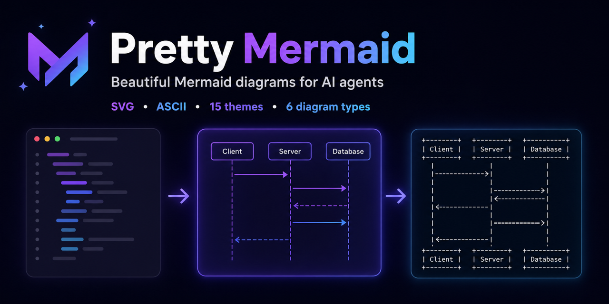

<div align="center">

# ba-design-flowchart

**Sơ đồ Mermaid đẹp mắt dành cho AI agents**

Biến mã nguồn Mermaid thành ảnh SVG trau chuốt, ảnh PNG dễ chia sẻ và mã ASCII tương thích với terminal—hoàn toàn chạy cục bộ, không cần trình duyệt.



[](https://www.skills.sh/imxv/pretty-mermaid-skills/pretty-mermaid)
[](https://github.com/imxv/Pretty-mermaid-skills/actions/workflows/ci.yml)
[](LICENSE)
[](https://nodejs.org/)
[](https://github.com/imxv/Pretty-mermaid-skills)

</div>

## 🚀 Cài đặt

Skill này đã được tích hợp sẵn vào dự án `agent-skills`. Bạn không cần phải cài đặt qua NPM/Skills.sh nữa.

## Tại sao chọn ba-design-flowchart?

- **Thiết kế cho AI agents**: hoạt động tốt với Claude Code, Cursor, Codex, Gemini CLI, Antigravity và nhiều hơn thế
- **Một mã nguồn, ba định dạng đầu ra**: SVG trau chuốt cho tài liệu, PNG để chia sẻ, và ASCII/Unicode cho terminal
- **Không cần trình duyệt**: render cục bộ hoàn toàn không cần Chromium, Puppeteer hay DOM
- **Linh hoạt mặc định**: 15 themes, hỗ trợ màu tùy chỉnh, 6 loại sơ đồ và khả năng render hàng loạt (batch)

## ✨ Tính năng

- 📊 **Đa định dạng**: Hỗ trợ xuất SVG, PNG, và ASCII
- 🎨 **Theme phong phú**: 15 theme tích hợp sẵn cho nhiều ngữ cảnh
- 📈 **Sáu loại sơ đồ**: Flowchart, Sequence, State, Class, ER, và XY charts
- ⚡ **Hiệu suất cao**: Render song song hàng loạt
- 📚 **Sẵn sàng sử dụng**: Có sẵn template hoàn chỉnh và tài liệu hướng dẫn chi tiết

### Các theme hỗ trợ
| Theme sáng        | Theme tối         | Khác       |
|:------------------|:------------------|:-----------|
| zinc-light        | zinc-dark         | nord       |
| tokyo-night-light | tokyo-night       | nord-light |
| catppuccin-latte  | tokyo-night-storm | dracula    |
| github-light      | catppuccin-mocha  | one-dark   |
| solarized-light   | github-dark       |            |
|                   | solarized-dark    |            |

## 🎨 Bộ sưu tập Theme

So sánh cùng một flowchart trên mọi theme có sẵn trong [bộ sưu tập 15 theme đầy đủ](references/THEMES.md).

<p align="center">
  
  
</p>

## 🤖 Tích hợp AI Assistant

Hoạt động trơn tru với các môi trường lập trình AI sau:

- **Claude Code**
- **Cursor**
- **Gemini CLI**
- **Antigravity**
- **OpenCode**
- **Codex**
- **qoder**

## 📖 Bắt đầu nhanh

### Xem danh sách theme
```bash
node scripts/themes.mjs
```

### Render một sơ đồ (SVG)
```bash
node scripts/render.mjs \
  --input diagram.mmd \
  --output output.svg \
  --theme tokyo-night
```

### Render PNG
```bash
node scripts/render.mjs \
  --input diagram.mmd \
  --output output.png \
  --format png \
  --width 1200 \
  --theme tokyo-night
```

### Render hàng loạt (Batch)
```bash
node scripts/batch.mjs \
  --input-dir ./diagrams \
  --output-dir ./output \
  --theme dracula
```

## 📂 Ví dụ

Kiểm tra 6 file template trong thư mục `assets/example_diagrams/`:
- `flowchart.mmd` - Flowchart (Sơ đồ quy trình)
- `sequence.mmd` - Sequence Diagram (Sơ đồ tuần tự)
- `state.mmd` - State Diagram (Sơ đồ trạng thái)
- `class.mmd` - Class Diagram (Sơ đồ lớp)
- `er.mmd` - ER Diagram (Sơ đồ thực thể kết hợp)
- `xychart.mmd` - XY Chart (Biểu đồ cột và đường)

Đầu ra PNG được render trực tiếp qua Node.js, không cần công cụ chuyển đổi bên ngoài. Công cụ render cũng hỗ trợ text CJK, nhãn nhiều dòng, `linkStyle`, tinh chỉnh khoảng cách ELK, tooltip cho XY chart, và mã màu ANSI trên terminal.

## 📚 Tài liệu

- [Hướng dẫn sử dụng Skill (SKILL.md)](SKILL.md)
- [Bộ sưu tập Theme](references/THEMES.md)
- [Tham khảo cú pháp sơ đồ](references/DIAGRAM_TYPES.md)
- [Tham khảo màu sắc và theme](references/THEMES.md)
- [Tham khảo API beautiful-mermaid](references/api_reference.md)

## ⚙️ Yêu cầu hệ thống
- Node.js 16+

## 📄 Giấy phép
MIT License

## 🙏 Lời cảm ơn
Dựa trên [beautiful-mermaid](https://github.com/lukilabs/beautiful-mermaid)
