# Tài liệu tham khảo các loại sơ đồ Mermaid

## Mục lục

- [Flowchart / Graph (Sơ đồ luồng)](#flowchart--graph)
- [Sequence Diagram (Sơ đồ tuần tự)](#sequence-diagram)
- [State Diagram (Sơ đồ trạng thái)](#state-diagram)
- [Class Diagram (Sơ đồ lớp)](#class-diagram)
- [ER Diagram (Sơ đồ thực thể)](#er-diagram)
- [XY Chart (Biểu đồ XY)](#xy-chart)
- [Thực hành tốt nhất chung](#thực-hành-tốt-nhất-chung)

## Flowchart / Graph (Sơ đồ luồng)

### Cú pháp cơ bản
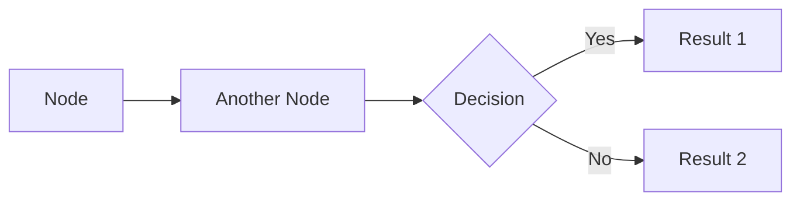

### Các hình dạng Node
- `[Text]` - Hình chữ nhật (Rectangle)
- `([Text])` - Hình chữ nhật bo góc tròn (Stadium)
- `[[Text]]` - Quy trình con (Subroutine - viền kép)
- `[(Text)]` - Hình trụ / Cơ sở dữ liệu (Cylindrical)
- `((Text))` - Hình tròn (Circle)
- `>Text]` - Hình bất đối xứng
- `{Text}` - Hình thoi / Quyết định (Rhombus)
- `{{Text}}` - Hình lục giác (Hexagon)
- `[/Text/]` - Hình bình hành (Parallelogram)
- `[\Text\]` - Hình thang (Trapezoid)

### Đường nối (Connections)
- `-->` - Mũi tên (Arrow)
- `---` - Đường thẳng (Line)
- `-.->` - Mũi tên đứt nét (Dotted arrow)
- `==>` - Mũi tên đậm (Thick arrow)
- `--text-->` - Mũi tên kèm chữ
- `-->|text|` - Mũi tên kèm chữ (cú pháp thay thế)

### Tùy chỉnh đường nối (Edge Styling)
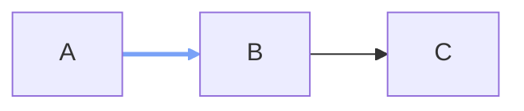

`linkStyle` hoạt động trong Flowchart và State Diagram. Chọn một đường nối bằng thứ tự khai báo bắt đầu từ 0, hoặc dùng `linkStyle default` cho tất cả các đường nối.

### Hướng (Direction)
- `LR` - Trái sang Phải (Left to Right)
- `RL` - Phải sang Trái (Right to Left)
- `TB` / `TD` - Trên xuống Dưới (Top to Bottom / Top Down)
- `BT` - Dưới lên Trên (Bottom to Top)

### Thực hành tốt nhất
- Dùng hướng `LR` cho màn hình rộng.
- Giữ các node quyết định dễ phân biệt bằng hình dạng `{}`.
- Dùng hình `([])` cho điểm bắt đầu / kết thúc.
- Giới hạn độ sâu lồng nhau tối đa 3 cấp.
- Nhóm các node liên quan lại với nhau bằng hình ảnh (subgraph).

---

## Sequence Diagram (Sơ đồ tuần tự)

### Cú pháp cơ bản
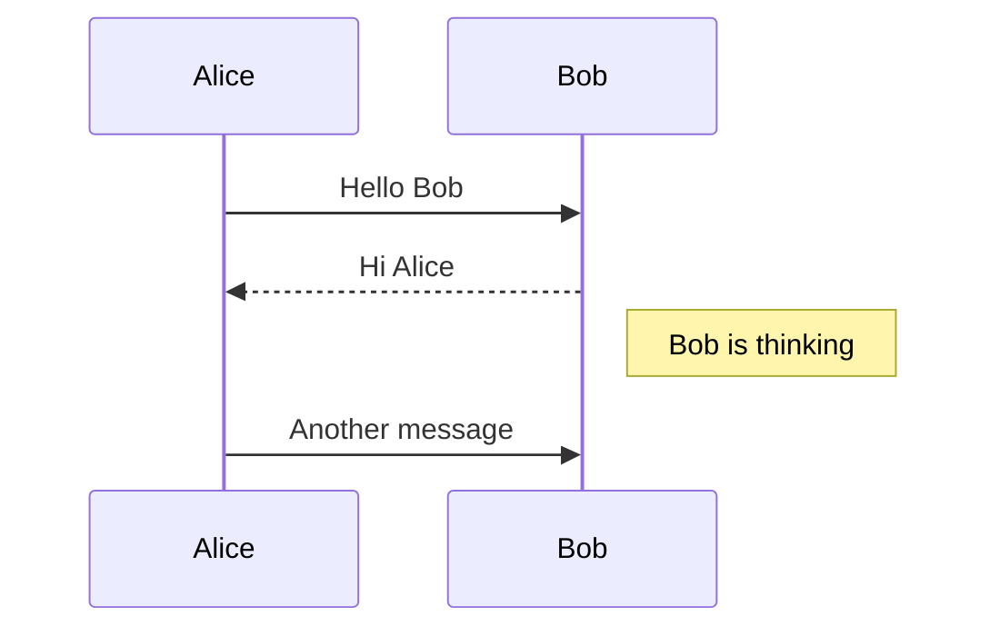

### Thành viên (Participants)
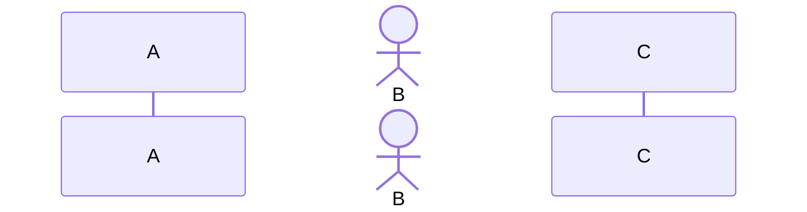

### Các loại thông điệp (Message Types)
- `->>` - Mũi tên nét liền
- `-->>` - Mũi tên đứt nét
- `-x` - Nét liền có dấu chéo
- `--x` - Nét đứt có dấu chéo
- `-)` - Nét liền với mũi tên mở
- `--)` - Nét đứt với mũi tên mở

### Kích hoạt (Activations)
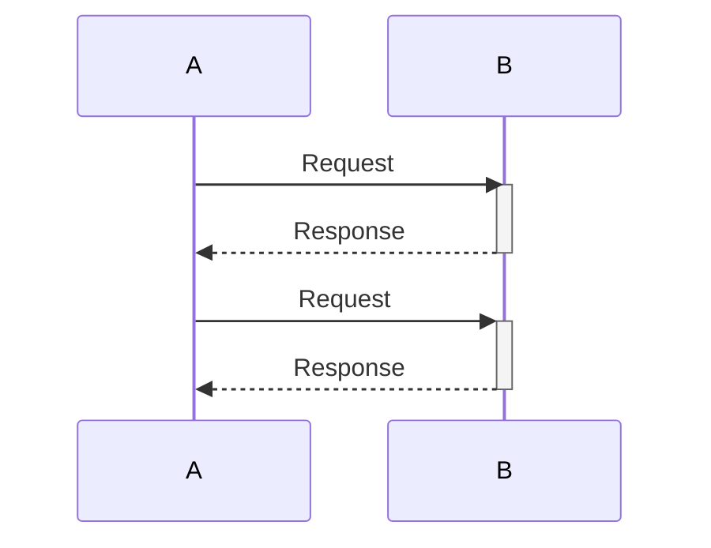

### Thực hành tốt nhất
- Dùng `actor` cho người dùng thay vì hệ thống.
- Sử dụng block `activate/deactivate` để hiện các luồng xử lý đồng thời.
- Nhóm thông điệp bằng `alt/else` (câu lệnh điều kiện).

---

## State Diagram (Sơ đồ trạng thái)

### Cú pháp cơ bản
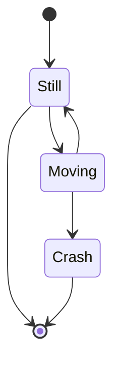

### Trạng thái (States)
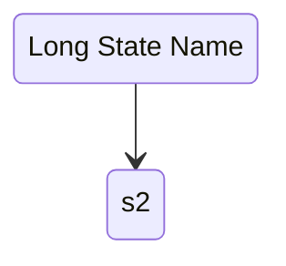

### Trạng thái lồng nhau (Nested States)
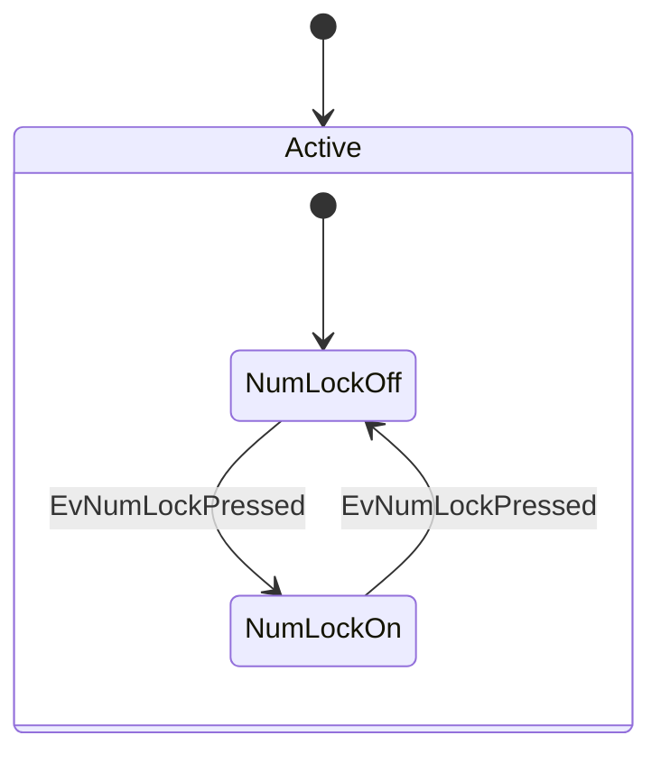

### Hỗ trợ tên CJK (Tiếng Trung/Nhật/Hàn)
Phiên bản 1.1 hỗ trợ đặt tên trực tiếp trạng thái bằng tiếng CJK:
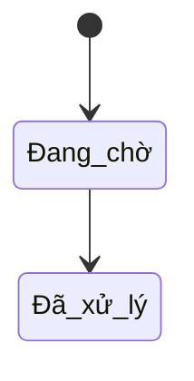

### Thực hành tốt nhất
- Luôn luôn khai báo điểm khởi đầu `[*]` ở đầu.
- Tránh mô hình trạng thái quá sâu (deeply nested).
- Giữ tên trạng thái ngắn gọn, dùng `as` nếu tên cần dài.

---

## Class Diagram (Sơ đồ lớp)

### Cú pháp cơ bản
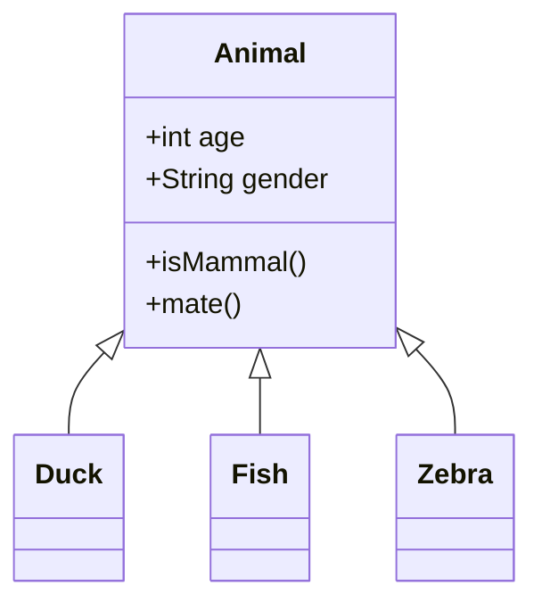

### Quan hệ (Relationships)
- `<|--` - Kế thừa (Inheritance)
- `*--` - Thành phần (Composition)
- `o--` - Tập hợp (Aggregation)
- `-->` - Liên kết (Association)
- `--` - Liên kết (không chiều)
- `..>` - Phụ thuộc (Dependency)
- `..|>` - Hiện thực hóa (Realization/Implementation)
- `..` - Liên kết nét đứt

### Độ hiển thị (Visibility)
- `+` Public
- `-` Private
- `#` Protected
- `~` Package/Internal

### Thực hành tốt nhất
- Giới hạn tối đa 5-7 lớp trong một sơ đồ để dễ đọc.
- Bỏ qua các getter/setter nếu chúng làm lộn xộn sơ đồ.
- Tập trung vào các quan hệ quan trọng.

---

## ER Diagram (Sơ đồ thực thể kết hợp)

### Cú pháp cơ bản
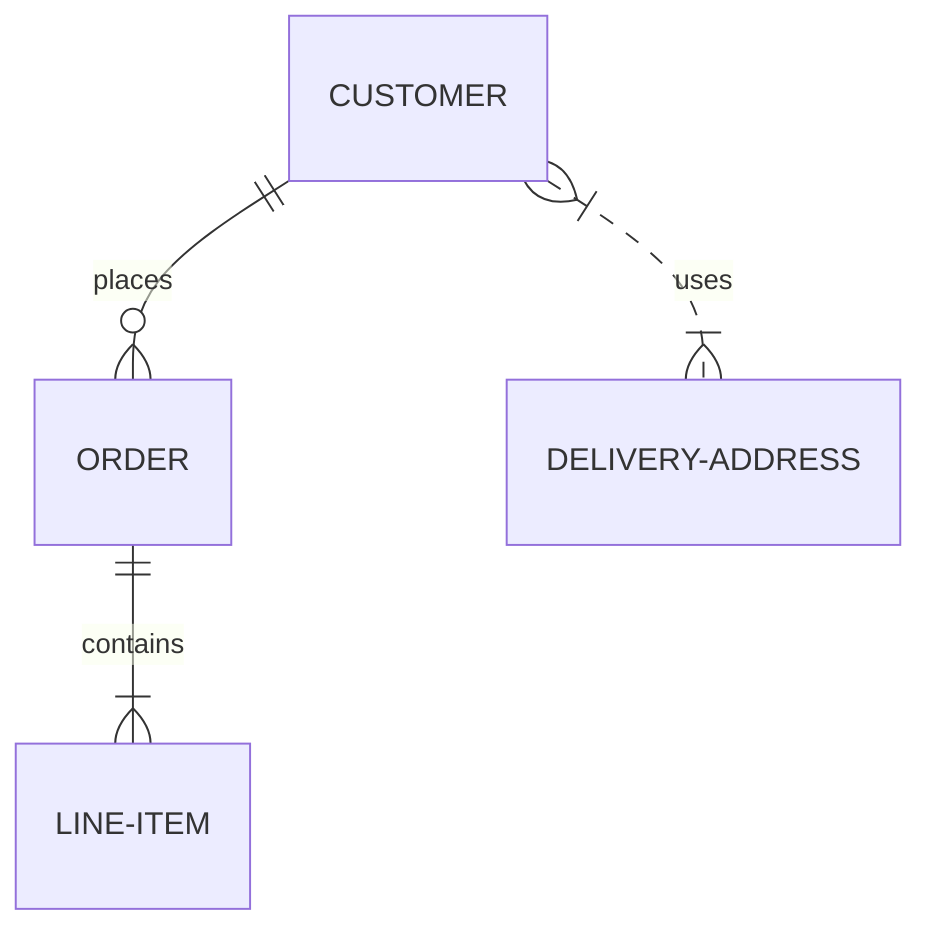

### Quan hệ (Relationships)
Cú pháp: `<entity1> <cardinality1>--<cardinality2> <entity2> : <label>`

Ký hiệu bản số (Cardinality):
- `|o` - Zero or one (0 hoặc 1)
- `||` - Exactly one (Chính xác 1)
- `}o` - Zero or more (0 hoặc nhiều)
- `}|` - One or more (1 hoặc nhiều)

### Thuộc tính (Attributes)
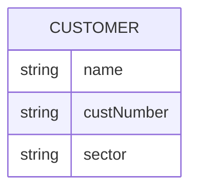

### Thực hành tốt nhất
- Viết hoa toàn bộ tên Thực thể (Entity) theo quy ước.
- Cung cấp các nhãn quan hệ rõ ràng (động từ).
- Định dạng thuộc tính nhất quán (camelCase hoặc snake_case).

---

## XY Chart (Biểu đồ XY)

### Cú pháp cơ bản
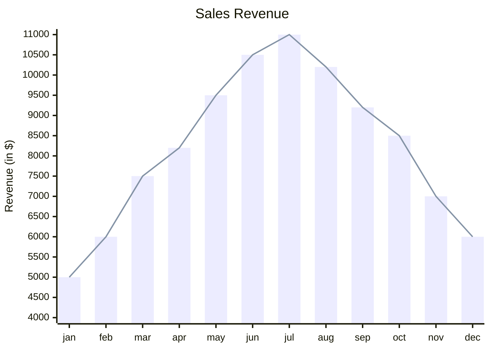

### Hỗ trợ tooltip
Thêm cờ `--interactive` khi render SVG để hiển thị tooltip khi hover qua các cột và điểm trên biểu đồ XY.

---

## Thực hành tốt nhất chung

### Hỗ trợ CSS Tùy chỉnh & Theme
`ba-design-flowchart` tự động quản lý hầu hết các styling thông qua các theme có sẵn. Khi cần tùy chỉnh ngoài các theme, hãy dùng `--bg`, `--fg`, `--accent`, v.v. thông qua CLI, thay vì đưa directives theme trực tiếp vào trong mã Mermaid.

### Đặt tên và Nhãn
- Dùng nhãn ngắn, cụ thể.
- Hỗ trợ nhãn nhiều dòng trong flowchart bằng ` ` hoặc HTML entities nếu cần thiết.
- Hạn chế ký tự đặc biệt ở ID của node; gán nhãn bằng `id["My Label"]`.

### Xử lý lỗi
Nếu quá trình render thất bại:
1. Kiểm tra lại cú pháp hoặc thụt lề sai.
2. Cách ly từng phần của sơ đồ để tìm ra dòng lỗi.
3. Tham khảo lại danh sách lỗi hoặc chạy CLI với `DEBUG=true` để lấy thông tin.
