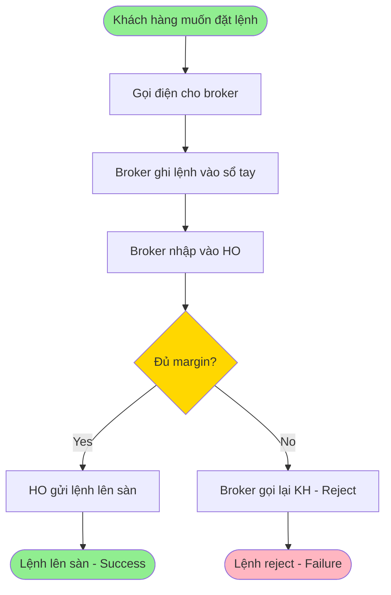
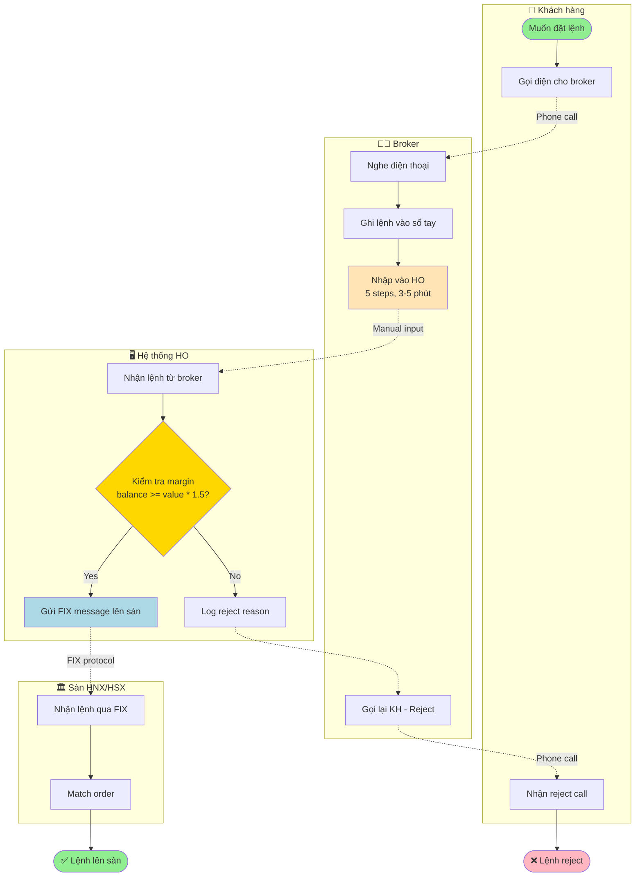
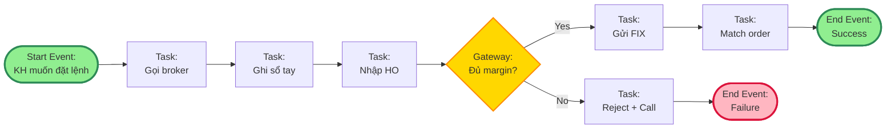
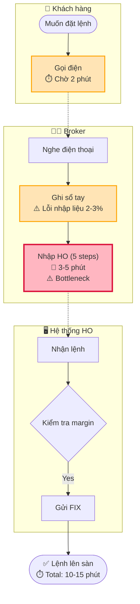
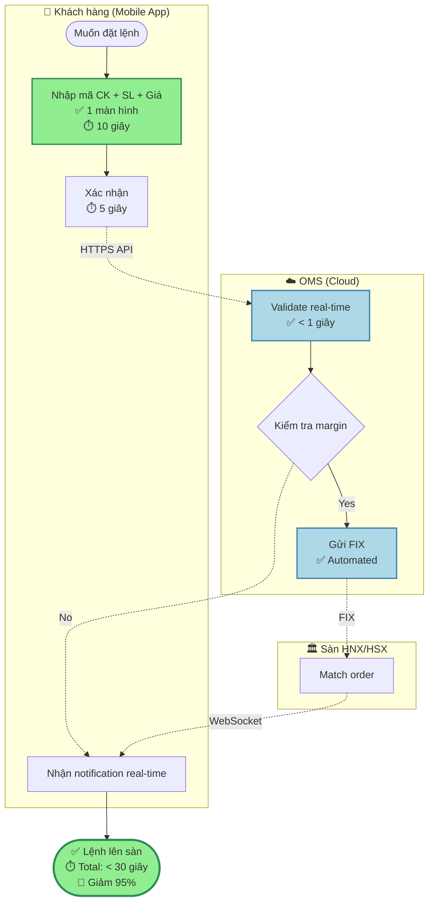

# Skill: ba-process-modeling

## Tổng quan

Process Modeling là kỹ thuật visualize business process thành diagram để:
- **Shared Understanding** — Tất cả stakeholders nhìn thấy same picture
- **Identify Bottlenecks** — Tìm steps chậm, redundant, manual
- **Document AS-IS** — Current state trước khi redesign
- **Design TO-BE** — Target state sau khi improve
- **Communication Tool** — Dễ explain process hơn text wall

Skill này support 3 loại diagram:

### 1. Flowchart (Simple)
- Linear process với decisions (Yes/No branches)
- Dùng cho: Simple workflows, quick visualization
- Tool: Mermaid `flowchart` syntax

### 2. Swim Lane Diagram (Multi-Actor)
- Process với nhiều actors (Customer, Broker, System)
- Dùng cho: Cross-functional workflows, handoff visualization
- Tool: Mermaid `flowchart` với subgraphs

### 3. BPMN (Business Process Model and Notation)
- Standard notation với events, gateways, tasks
- Dùng cho: Formal process documentation, complex workflows
- Tool: Mermaid `flowchart` (BPMN-style) hoặc BPMN XML

## Khi nào sử dụng

Kích hoạt skill này khi:

- Process phức tạp (> 5 steps, nhiều actors, nhiều decision points)
- User yêu cầu: "vẽ quy trình", "process diagram", "flowchart", "BPMN"
- Stakeholders không hiểu rõ process (cần visual để align)
- Cần document AS-IS trước khi optimize (gap analysis input)
- Compliance audit yêu cầu process documentation

**Khi KHÔNG nên sử dụng:**

- Process quá đơn giản (2-3 steps, linear, không có decision)
- Chưa có thông tin đủ về process (chạy `ba-stakeholder-interview` trước)
- User chỉ cần text description (không cần visual)
- Process thay đổi liên tục (diagram sẽ outdated nhanh)

## Quy trình thực hiện

### Bước 1: Đọc Input (Process Description)

**Input A: Business-Spec Section 5 (User Flow)**
```bash
workspace/{issueKey}/spec/final.md
```

Trích xuất:
- Section 5: User Flow (AS-IS hoặc TO-BE)
- Actors (ai làm gì?)
- Steps (sequence)
- Decision points (if/else)

**Input B: Gap Analysis (AS-IS process)**
```bash
workspace/{issueKey}/spec/gap-analysis.md
```

Trích xuất:
- AS-IS process description
- Pain points (để highlight trên diagram)

**Input C: Text từ user**

User mô tả process:
```
"Khách hàng gọi điện cho broker.
Broker ghi lệnh vào sổ tay.
Broker nhập vào hệ thống HO.
HO kiểm tra margin.
Nếu đủ margin → gửi lệnh lên sàn.
Nếu không đủ → reject và gọi lại khách hàng."
```

### Bước 2: Identify Components

**2.1. Actors (WHO)**

Liệt kê tất cả actors tham gia process:

```markdown
### Actors Identified

| Actor | Role | Type |
|-------|------|------|
| Khách hàng | End user, trigger process | Human |
| Broker | Process orders, manual entry | Human |
| Hệ thống HO | Back-office system, validate | System |
| Sàn (HNX/HSX) | Exchange, match orders | External System |
```

**2.2. Activities (WHAT)**

Liệt kê tất cả activities (tasks, actions):

```markdown
### Activities Identified

| # | Activity | Actor | Type | Duration |
|---|----------|-------|------|----------|
| 1 | Gọi điện cho broker | Khách hàng | Manual | 2 phút |
| 2 | Ghi lệnh vào sổ tay | Broker | Manual | 30 giây |
| 3 | Nhập lệnh vào HO | Broker | Manual | 3-5 phút |
| 4 | Kiểm tra margin | Hệ thống HO | Automated | 1 giây |
| 5 | Gửi lệnh lên sàn | Hệ thống HO | Automated | 2 giây |
| 6 | Gọi lại khách hàng (nếu reject) | Broker | Manual | 2 phút |
```

**2.3. Decision Points (IF/ELSE)**

Identify branches trong process:

```markdown
### Decision Points

| # | Decision | Condition | True Path | False Path |
|---|----------|-----------|-----------|------------|
| D1 | Đủ margin? | account_balance >= order_value * 1.5 | → Activity 5 (gửi lên sàn) | → Activity 6 (reject, gọi lại) |
| D2 | Thị trường mở? | time in [9:00-11:30, 13:00-14:30] | → Continue | → Reject "Ngoài giờ giao dịch" |
```

**2.4. Start/End Events**

```markdown
### Start/End Events

| Type | Event | Trigger |
|------|-------|---------|
| Start | Khách hàng muốn đặt lệnh | Phone call to broker |
| End (Success) | Lệnh lên sàn | HO sends FIX message |
| End (Failure) | Lệnh bị reject | Margin không đủ OR Ngoài giờ |
```

### Bước 3: Choose Diagram Type

Dựa trên complexity, chọn diagram type:

**Decision Matrix:**

| Scenario | Actors | Decision Points | Recommended Type |
|----------|--------|----------------|-----------------|
| Simple linear process | 1-2 | 0-1 | Flowchart |
| Multi-actor với handoffs | 3+ | Any | Swim Lane |
| Formal documentation | Any | Any | BPMN |

**Example:**
- Process "Đặt lệnh" có 4 actors (Khách hàng, Broker, HO, Sàn) + 2 decision points
- → **Swim Lane Diagram** (best fit)

### Bước 4: Create Diagram (Mermaid Syntax)

#### Option 1: Flowchart (Simple)



**Pros:** Đơn giản, dễ hiểu  
**Cons:** Không thấy rõ actor nào làm gì

---

#### Option 2: Swim Lane Diagram (Multi-Actor)



**Pros:** Thấy rõ actor nào làm gì, handoffs giữa actors  
**Cons:** Phức tạp hơn flowchart

**Legend:**
- `-->` Solid arrow: Sequential flow (same actor)
- `-.->` Dotted arrow: Handoff to another actor (communication)
- `{}` Diamond: Decision point
- `[]` Rectangle: Task/Activity
- `([])` Rounded rectangle: Start/End event
- `subgraph` Box: Swim lane (actor/role)

---

#### Option 3: BPMN-style (Formal)



**BPMN Elements:**
- **Start Event** (circle): Trigger của process
- **Task** (rectangle): Activity (manual hoặc automated)
- **Gateway** (diamond): Decision point (XOR, AND, OR)
- **End Event** (circle, bold): Kết thúc process
- **Sequence Flow** (arrow): Thứ tự thực hiện

**Pros:** Standard notation, formal, compliance-ready  
**Cons:** Learning curve cao hơn

### Bước 5: Annotate Pain Points (Optional)

Nếu đây là AS-IS diagram, highlight pain points:



**Pain Point Legend:**
- 🐢 = Slow (bottleneck)
- ⚠️ = High error rate
- ⏱️ = Time metric
- Red border = Critical pain point
- Orange border = Medium pain point

### Bước 6: Create TO-BE Diagram (Improved)

Vẽ TO-BE diagram với improvements:



**Improvements Highlighted:**
- ✅ Green = Improvement
- ☁️ Cloud = New technology
- 📱 Mobile = New channel
- ⏱️ Time savings = KPI achieved

### Bước 7: Compare AS-IS vs TO-BE (Side-by-side)

```markdown
## AS-IS vs TO-BE Comparison

| Aspect | AS-IS | TO-BE | Improvement |
|--------|-------|-------|-------------|
| **Total Time** | 10-15 phút | < 30 giây | 🎯 Giảm 95% |
| **Manual Steps** | 6 steps (Broker manual) | 0 steps (Automated) | ✅ Full automation |
| **Error Rate** | 2-3% (nhập sai) | < 0.5% (validation real-time) | 🎯 Giảm 80% lỗi |
| **Actors Involved** | 3 (KH, Broker, HO) | 2 (KH, OMS) | Loại bỏ Broker bottleneck |
| **Technology** | Phone + Desktop | Mobile App + Cloud | ✅ Modern stack |
| **Transparency** | Không (phải gọi hỏi) | Real-time notification | ✅ User visibility |

### Diagram Links

- [AS-IS Process](./as-is-process.md) — Current state với pain points
- [TO-BE Process](./to-be-process.md) — Target state với improvements
```

## Đầu ra (Output)

### Format: Process Modeling Document

```markdown
# Process Model: [Process Name]

**Project:** {project-name}  
**Issue Key:** {issueKey}  
**Process:** {process-name} (VD: Đặt lệnh cổ phiếu)  
**Version:** AS-IS (Current) hoặc TO-BE (Target)  
**Author:** BA/PO Agent  
**Date:** 2026-08-13

---

## Executive Summary

**Process Overview:**
- **Trigger:** Khách hàng muốn đặt lệnh mua/bán cổ phiếu
- **Actors:** 4 (Khách hàng, Broker, Hệ thống HO, Sàn)
- **Total Steps:** 8 activities + 2 decision points
- **Total Time:** 10-15 phút (AS-IS) → < 30 giây (TO-BE)
- **Pain Points:** 3 (Chờ lâu, Lỗi nhập liệu, Không transparent)

---

## Actors

[... table với 4 actors ...]

---

## Activities

[... table với 8 activities, duration, type ...]

---

## Decision Points

[... table với 2 decision points, conditions, branches ...]

---

## Process Diagram

### AS-IS (Current State)

```mermaid
[... Swim Lane diagram với pain points highlighted ...]
```

**Pain Points Identified:**
1. **Bottleneck:** Broker nhập HO (5 steps, 3-5 phút) — Chậm, manual
2. **Error-prone:** Ghi sổ tay (2-3% lỗi) — Nghe nhầm qua điện thoại
3. **No visibility:** Khách hàng không biết trạng thái — Phải gọi hỏi

**Metrics:**
- Total time: 10-15 phút
- Error rate: 2-3%
- Customer satisfaction: 3.2/5.0

---

### TO-BE (Target State)

```mermaid
[... Swim Lane diagram với improvements highlighted ...]
```

**Improvements:**
1. ✅ **Self-service:** Khách hàng tự đặt qua app — Loại bỏ Broker bottleneck
2. ✅ **Real-time validation:** OMS validate < 1 giây — Giảm lỗi xuống < 0.5%
3. ✅ **Transparency:** WebSocket notification — Khách hàng thấy trạng thái real-time

**Target Metrics:**
- Total time: < 30 giây (giảm 95%)
- Error rate: < 0.5% (giảm 80%)
- Customer satisfaction: ≥ 4.2/5.0

---

## AS-IS vs TO-BE Comparison

[... comparison table ...]

---

## Next Steps

1. **Gap Analysis:** Identify gaps để đi từ AS-IS → TO-BE (xem `workspace/{issueKey}/spec/`)
2. **Prioritization:** Ưu tiên gaps theo business value (xem `workspace/{issueKey}/spec/`)
3. **Implementation:** Breakdown TO-BE process thành User Stories (xem `workspace/{issueKey}/spec/`)

---

## Appendix

### Appendix A: Mermaid Source Code

```mermaid
[... full source code để edit/regenerate ...]
```

### Appendix B: BPMN XML (if applicable)

```xml
[... BPMN 2.0 XML export ...]
```

### Appendix C: Process Metadata

| Metadata | Value |
|----------|-------|
| Process Type | Order-to-Cash |
| Domain | Securities Trading |
| Frequency | ~1,000 orders/day |
| Compliance | HOSE Rule 15, SBV Circular 01/2021 |
| Last Updated | 2026-08-13 |
```

**Lưu vào:**
- AS-IS: `workspace/{issueKey}/spec/process-as-is.md`
- TO-BE: `workspace/{issueKey}/spec/process-to-be.md`

Trước khi ghi file, BẮT BUỘC neo về root repo và tạo thư mục đích — `Write` không tự tạo
thư mục cha, và cwd của agent có thể đang lệch (xem `.claude/rules/workspace-paths.md`):

```bash
cd "$(git rev-parse --show-toplevel)"
mkdir -p workspace/{issueKey}/spec
```

## Tương tác với các Skills khác

- **Upstream (Before):**
  - `ba-stakeholder-interview` → Collect process details từ stakeholders
  - `ba-spec` → Đọc Section 5 (User Flow) → Input cho skill này
  - `ba-gap-analysis` → Đọc AS-IS process → Visualize bằng skill này

- **Downstream (After):**
  - `ba-gap-analysis` → Dùng AS-IS diagram để identify bottlenecks
  - `ba-user-story-writing` → Transform TO-BE process thành User Stories
  - `dev-spec-driven-development` → DEV đọc TO-BE diagram để hiểu target architecture

## Các Dấu hiệu Cảnh báo (Red Flags)

❌ **Diagram quá phức tạp (> 20 nodes):**
- Không ai đọc được → Mất mục đích communicate
- → Chia nhỏ thành sub-processes

❌ **Không có actors rõ ràng (swim lanes):**
- Không biết ai làm gì → Confusing
- → Dùng Swim Lane thay vì Flowchart đơn giản

❌ **Pain points không highlighted trên AS-IS:**
- Không thấy được improvements trong TO-BE
- → Annotate pain points với colors/icons

❌ **TO-BE không có metrics:**
- "Nhanh hơn", "Tốt hơn" → Không measurable
- → Phải có số liệu: "< 30 giây", "< 0.5% error"

❌ **Diagram không match với text description:**
- Diagram nói 5 steps, text nói 8 steps → Inconsistent
- → Sync diagram và text

## Anti-patterns (Tránh)

1. **Vẽ diagram không có context:**
   - Chỉ có diagram, không có text explanation → Không hiểu purpose
   - → Phải có Executive Summary, Pain Points, Metrics

2. **Copy diagram từ template mà không customize:**
   - Generic BPMN template → Không reflect real process
   - → Phải interview stakeholders để lấy actual process

3. **Ignore decision points:**
   - Linear flow mà thực tế có branches → Incomplete
   - → Phải identify tất cả IF/ELSE logic

4. **Không validate với stakeholders:**
   - Vẽ xong → Không review → Diagram sai
   - → Validation session với stakeholders

## Verification Checklist

Sau khi chạy skill này:

- [ ] Đã identify tất cả actors (≥ 2 actors cho multi-actor process)
- [ ] Đã identify tất cả activities (tasks) với duration estimates
- [ ] Đã identify tất cả decision points (branches)
- [ ] Diagram type phù hợp (Flowchart/Swim Lane/BPMN)
- [ ] AS-IS diagram có pain points highlighted
- [ ] TO-BE diagram có improvements highlighted
- [ ] Có comparison table (AS-IS vs TO-BE metrics)
- [ ] Mermaid syntax valid (test render trước khi save)
- [ ] Output files đã lưu: `workspace/{issueKey}/spec/process-{as-is|to-be}.md`
- [ ] Stakeholders đã review và approve diagrams

## Ví dụ

Xem file `skills/ba-process-modeling/examples.md` để thấy:
- Swim Lane diagram với 4 actors (Customer, Broker, System, Exchange)
- BPMN diagram với gateways (XOR, AND)
- AS-IS vs TO-BE side-by-side comparison
- Pain point annotation techniques (colors, icons, metrics)
