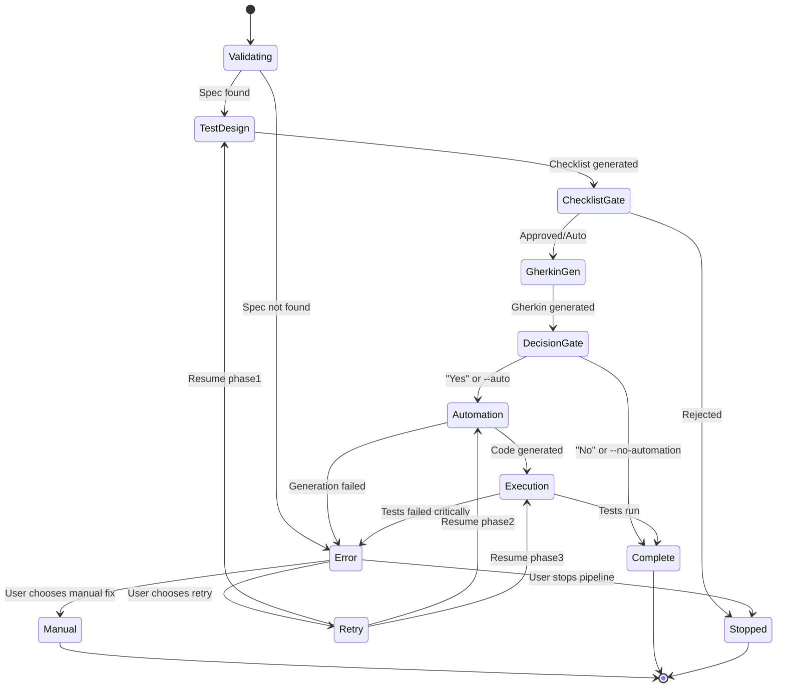

# Pipeline State Machine

## States & Transitions



## Phase States

### Phase 0: Validation
```python
State: VALIDATING
Inputs: issueKey
Checks:
  - issueKey format valid?
  - *-final.md exists?
  - *-final.md readable?
  - *-final.md not empty?
Transitions:
  - All checks pass → PHASE1_CHECKLIST
  - Any check fails → ERROR
```

### Phase 1.1: Checklist Generation
```python
State: PHASE1_CHECKLIST
Inputs: *-final.md
Outputs: {issueKey}-checklist.md
Checks:
  - Checklist has items?
  - P0 items exist?
  - All sections covered?
Transitions:
  - Success → CHECKLIST_GATE
  - Failure → ERROR
  - Already exists → SKIP_TO_PHASE1_2
```

### Gate: Checklist Approval
```python
State: CHECKLIST_GATE
Inputs: Checklist metrics
Decision:
  - Auto mode? → PHASE1_GHERKIN
  - Confidence >= 90%? → PHASE1_GHERKIN
  - Confidence 70-89%? → ASK_USER
  - Confidence < 70%? → ERROR
User Choices:
  - Approve → PHASE1_GHERKIN
  - Reject → STOPPED
Transitions:
  - Approved → PHASE1_GHERKIN
  - Rejected → STOPPED
```

### Phase 1.2: Gherkin Generation
```python
State: PHASE1_GHERKIN
Inputs: Checklist
Outputs: {issueKey}.feature
Checks:
  - .feature file created?
  - Scenarios match checklist?
  - Gherkin syntax valid?
Transitions:
  - Success → DECISION_GATE
  - Failure → ERROR
  - Already exists → SKIP_TO_DECISION_GATE
```

### Gate: Generate Automation?
```python
State: DECISION_GATE
Decision:
  - --auto flag? → PHASE2_AUTOMATION
  - --no-automation flag? → COMPLETE
  - Otherwise → ASK_USER
User Choices:
  - Yes → PHASE2_AUTOMATION
  - No → COMPLETE
Transitions:
  - Generate automation → PHASE2_AUTOMATION
  - Manual testing only → COMPLETE
```

### Phase 2: Test Automation
```python
State: PHASE2_AUTOMATION
Inputs: Checklist + Gherkin
Outputs: test_*.py files
Checks:
  - Test files created?
  - All scenarios covered?
  - Syntax valid (self-fix loop)?
Transitions:
  - Success → PHASE3_EXECUTION
  - Failure → ERROR
  - Already exists → SKIP_TO_PHASE3
```

### Phase 3: Test Execution
```python
State: PHASE3_EXECUTION
Inputs: test_*.py files
Outputs: Test report
Checks:
  - Tests run?
  - Pass rate calculated?
  - Report generated?
Transitions:
  - All passed → COMPLETE (SUCCESS)
  - Some failed → COMPLETE (PARTIAL)
  - Critical failures → ERROR (FAILED)
```

### Terminal: Complete
```python
State: COMPLETE
Status: SUCCESS | PARTIAL | FAILED
Outputs:
  - Pipeline summary
  - Traceability matrix
  - Next steps
Actions:
  - Generate summary
  - Save state file
  - Exit with code 0 (SUCCESS/PARTIAL) or 1 (FAILED)
```

### Terminal: Error
```python
State: ERROR
Inputs: Error message, failed phase
Actions:
  - Log error
  - Show recovery options:
    1. Retry current phase
    2. Resume from next phase (manual fix)
    3. Run phase separately
    4. Stop pipeline
User Choice:
  - Retry → RETRY
  - Manual → MANUAL
  - Separate → STOPPED
  - Stop → STOPPED
```

## Resume Points

Pipeline có thể resume từ các checkpoints:

| Checkpoint | State | Condition |
|------------|-------|-----------|
| `phase1` | PHASE1_CHECKLIST | Start from beginning |
| `phase1.1` | PHASE1_CHECKLIST | Re-generate checklist |
| `phase1.2` | PHASE1_GHERKIN | Checklist exists, re-generate Gherkin |
| `phase2` | PHASE2_AUTOMATION | Gherkin exists, re-generate code |
| `phase3` | PHASE3_EXECUTION | Test code exists, re-run tests |

**Example:**
```bash
# Pipeline failed at Phase 2 (automation)
# Fix issue manually (e.g., add missing locators)
# Resume from Phase 2
/qa-full-pipeline JIRA-123 --resume=phase2

# Or resume from Phase 3 (skip re-generating code)
/qa-full-pipeline JIRA-123 --resume=phase3
```

## State Persistence

Pipeline lưu state vào `.pipeline-state.json`:

```json
{
  "issueKey": "JIRA-123",
  "startTime": "2026-08-13T10:30:00Z",
  "lastUpdate": "2026-08-13T10:35:00Z",
  "currentPhase": "phase2",
  "completedPhases": ["phase1.1", "phase1.2"],
  "status": "IN_PROGRESS",
  "autoMode": false,
  "metrics": {
    "phase1": {
      "checklistItems": 45,
      "p0": 15,
      "p1": 20,
      "p2": 10,
      "scenarios": 28,
      "confidence": 0.95
    }
  },
  "artifacts": {
    "checklist": "/project-root/workspace/{issueKey}/test/checklist.md",
    "gherkin": "/project-root/workspace/{issueKey}/test/{issueKey}.feature"
  }
}
```

**Usage:**
- Pipeline reads state file on start để detect resume points
- Updates state sau mỗi phase thành công
- Deletes state file khi pipeline complete
- State file KHÔNG commit vào Git (add to .gitignore)

## Rollback Strategies

### Rollback Phase 1.2 (Re-generate Gherkin)
```bash
# Delete Gherkin file
rm /project-root/workspace/{issueKey}/test/{issueKey}.feature

# Resume from Phase 1.2
/qa-full-pipeline JIRA-123 --resume=phase1.2
```

### Rollback Phase 2 (Re-generate Test Code)
```bash
# Delete test code
rm -rf /project-root/workspace/{issueKey}/test/steps/*.py

# Resume from Phase 2
/qa-full-pipeline JIRA-123 --resume=phase2
```

### Full Rollback (Start from Scratch)
```bash
# Delete all outputs
rm -rf /project-root/workspace/{issueKey}/test/

# Run full pipeline
/qa-full-pipeline JIRA-123
```

## Concurrent Runs

Pipeline hỗ trợ chạy concurrent cho nhiều issueKeys:

```bash
# Terminal 1
/qa-full-pipeline JIRA-123 --auto

# Terminal 2 (simultaneously)
/qa-full-pipeline JIRA-456 --auto

# No conflicts vì mỗi issueKey có directory riêng
```

**Isolation:**
- Mỗi issueKey có directory riêng: `/project-root/workspace/{issueKey}/test/`
- State files riêng: `.pipeline-state-{issueKey}.json`
- Report files riêng: `{issueKey}-*.md`

## Error Recovery Matrix

| Error Type | Phase | Recovery Action |
|------------|-------|-----------------|
| Spec not found | Phase 0 | Run `/ba-spec {issueKey}` first |
| Checklist empty | Phase 1.1 | Check spec quality, re-run test design |
| Gherkin syntax error | Phase 1.2 | Fix manually or re-generate |
| Test code syntax error | Phase 2 | Self-fix loop (auto) or manual fix |
| Import error | Phase 2 | Check dependencies, install missing packages |
| Runtime error | Phase 3 | Check .env, fix app bugs, re-run |
| Flaky test | Phase 3 | Re-run with `--count=3` to confirm |
| Environment issue | Phase 3 | Fix .env, restart services, re-run |

## Monitoring & Observability

Pipeline emits progress logs:

```
[2026-08-13 10:30:00] Pipeline started: JIRA-123 (auto mode)
[2026-08-13 10:30:01] Phase 0: Validation ✅ (1s)
[2026-08-13 10:30:01] Phase 1.1: Checklist generation...
[2026-08-13 10:32:15] Phase 1.1: Complete ✅ (2m14s) - 45 items (P0:15, P1:20, P2:10)
[2026-08-13 10:32:15] Phase 1.2: Gherkin generation...
[2026-08-13 10:33:40] Phase 1.2: Complete ✅ (1m25s) - 28 scenarios
[2026-08-13 10:33:40] Phase 2: Test automation...
[2026-08-13 10:37:15] Phase 2: Complete ✅ (3m35s) - 12 files, 42 tests
[2026-08-13 10:37:15] Phase 3: Test execution...
[2026-08-13 10:38:42] Phase 3: Complete ⚠️ (1m27s) - 39 passed, 3 failed
[2026-08-13 10:38:42] Pipeline complete: PARTIAL (8m42s)
```

**Integration với monitoring tools:**
- Logs parseable by Datadog, Splunk
- JUnit XML cho CI/CD dashboards
- Metrics exportable to Prometheus
